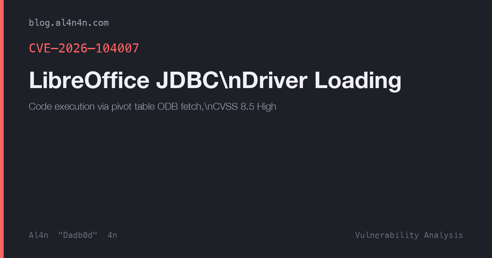

<p align="center">
  
</p>

<p align="center">
  <a href="https://github.com/al4n4n/achilles-heel/stargazers"></a>
  
  
  
  
</p>

<p align="center">
  <a href="#check-non-destructive">Check</a> · <a href="#the-trigger">PoC</a> · <a href="#detection-rules">Detection</a> · <a href="#capture">Capture</a> · <a href="#evidence">Evidence</a> · <a href="https://blog.al4n4n.com/CVE-2026-104007-LibreOffice-JDBC-Pivot-Table-RCE/">Write-up</a>
</p>

---

## Disclaimer

For learning and defense only. Run the lab and PoC only against targets you set up yourself. The detection rules are for education only; use them at your own risk. Everything here is provided as is, without warranty. Full text: [DISCLAIMER](../DISCLAIMER.md).

# CVE-2026-104007: LibreOffice JDBC Driver Code Execution via Pivot Table ODB Fetch

**CWE-829** | Inclusion of Functionality from Untrusted Control Sphere | LibreOffice 26.2.0 -- 26.2.6, 26.8.0 -- 26.8.1 | User opens a crafted spreadsheet

The LibreOffice advisory discloses code execution through JDBC driver loading when a user opens a crafted document. This repository demonstrates the full attack chain: a crafted ODS with a pivot table referencing an HTTP-hosted ODB causes LibreOffice to fetch the ODB, read the attacker-specified JDBC driver class and classpath, load the attacker's JAR, and execute its static initializer. Code ran as `uid=0(root)` on LibreOffice 26.2.6.3; blocked entirely on 26.2.7.2.

No public PoC existed for CVE-2026-104007 (the pivot table route). A PoC exists for the related CVE-2026-63277 (a different route, fixed earlier in 26.2.5).

**Author:** al4n4n (Dadb0d)

**Write-up:** [blog.al4n4n.com/CVE-2026-104007-LibreOffice-JDBC-Pivot-Table-RCE/](https://blog.al4n4n.com/CVE-2026-104007-LibreOffice-JDBC-Pivot-Table-RCE/)

**Fixed in:** LibreOffice 26.2.7 and 26.8.2 ([advisory](https://www.libreoffice.org/about-us/security/advisories/cve-2026-104007))

---

## The bug

LibreOffice connects to databases through Java JDBC drivers. The connection settings live in ODB files (OpenDocument Database documents), which are ZIP archives containing XML metadata. An ODB's `db:driver-settings` element names the JDBC driver class and the classpath to load it from. In normal use, the driver classpath comes from the user's own configuration.

LibreOffice spreadsheets support pivot tables (called "data pilots") backed by database sources. A pivot table element in the ODS content XML (`table:data-pilot-table`) can reference a database by URL through its `table:database-source-sql` child element, and LibreOffice fetches the ODB from that URL.

In affected versions, two deficiencies combine into a code execution chain. First, the pivot table's URL-based ODB fetch happens without a link-update consent dialog. This is distinct from the `calcext:data-mappings` route fixed in CVE-2026-63277 (26.2.5). Second, the ODB's `db:driver-settings` specifies both `db:java-driver-class` and `db:java-classpath`, and LibreOffice loads the named class from the ODB-specified classpath rather than restricting to the user's own driver configuration.

An attacker constructs an ODS whose pivot table points at an attacker-controlled ODB. The ODB names a malicious JDBC driver class and a `file://` classpath pointing to an attacker-staged JAR. When the pivot table refreshes, LibreOffice loads the driver. The driver's static initializer runs in the LibreOffice JVM, achieving code execution. After the CVE-2026-63277 fix in 26.2.5, the classpath is restricted to `file://` URLs only, so the JAR must already be present on the target filesystem. Java must be enabled in LibreOffice.

The fix in 26.2.7 / 26.8.2 applies two restrictions: the JDBC driver location is sourced exclusively from the user's configured drivers, ignoring the ODB's classpath, and pivot tables whose data source names a URL-based ODB require the user to approve link updates before connecting.

## Trigger conditions

1. The victim opens a crafted ODS containing a `table:data-pilot-table` whose `table:database-source-sql` names a URL-hosted ODB.
2. The pivot table refreshes (via user interaction, macro, or UNO API), triggering LibreOffice to fetch the ODB over HTTP.
3. The ODB specifies `db:java-driver-class` and `db:java-classpath` in its `db:driver-settings`.
4. LibreOffice loads the named driver class from the ODB-specified classpath.
5. The driver's static initializer (or constructor) executes in the LibreOffice JVM.

## Tested on

| Component | Version | Host OS | Arch | Date | Result |
|---|---|---|---|---|---|
| LibreOffice (vulnerable) | 26.2.6.3 | Ubuntu 24.04 (Docker) | x86_64 | 2026-11-17 | Code execution |
| LibreOffice (patched) | 26.2.7.2 | Ubuntu 24.04 (Docker) | x86_64 | 2026-11-17 | Blocked |
| Host | macOS | arm64 | - | 2026-11-17 | Docker host |
| Remote Docker host | Ubuntu 24.04 | x86_64 | gmkbox.local | 2026-11-17 | Containers |

Affected per advisory: LibreOffice 26.2.0 through 26.2.6 and 26.8.0 through 26.8.1. Tested by us: the rows above.

## Lab deviations from stock install

| Deviation | Why | Effect on real-world exploitability |
|---|---|---|
| Java enabled in LibreOffice | Required for JDBC driver loading; default on many installations but not all | The attack requires Java to be enabled; targets without Java are not affected |
| `UpdateLinksMode=2` (always update links) | Allows the pivot table to refresh without an interactive prompt in headless mode | On a stock install, the user may be prompted to update links depending on configuration; the fix in 26.2.7 adds a consent dialog regardless |
| Headless mode with UNO API for pivot table refresh | The pivot table does not auto-refresh on open in headless mode; refresh is triggered via UNO API | In a real scenario, refresh occurs via user interaction or an embedded macro |
| Malicious JAR pre-staged on target filesystem | Required after CVE-2026-63277 restricted classpath to `file://` only | An attacker must deliver the JAR by another means (email, download) or target a known path |
| Docker containers on remote host | Lab isolation | No effect on the vulnerability |

## Files

| File | Purpose |
|---|---|
| `setup.py` | Start the vulnerable and patched Docker targets; `--down` tears them down |
| `check.py` | Version-based vulnerability check. Exit 0 = vulnerable, 1 = not, 2 = unknown |
| `poc.py` | The trigger: stages payloads, refreshes the pivot table, checks for code execution. `--target vuln\|patched\|both`, `--capture` |
| `poc/gen_payload.py` | Generates the crafted ODS, ODB, and malicious JAR |
| `poc/MaliciousDriver.java` | Java JDBC driver that writes `/tmp/pwned.txt` on load (the payload) |
| `poc/refresh_pilots.py` | UNO API helper that opens the ODS and refreshes its pivot tables inside the container |
| `poc/out/poc.ods` | Crafted ODS spreadsheet with the pivot table referencing the ODB by URL |
| `poc/out/poc.odb` | ODB database document specifying the malicious JDBC driver class and classpath |
| `poc/out/malicious-driver.jar` | Compiled malicious JDBC driver JAR |
| `lab/docker-compose.yml` | Compose file for vulnerable (26.2.6.3) and patched (26.2.7.2) containers |
| `lab/Dockerfile.libreoffice` | LibreOffice Docker image with Java, Xvfb, and tcpdump |
| `lab/entrypoint.sh` | Container entrypoint that configures Java and LibreOffice settings |
| `detection/` | Suricata and YARA rules with test fixtures ([README](detection/README.md)) |
| `capture/` | Live pcap of the exploit traffic ([README](capture/README.md)) |
| `evidence/` | Raw, unedited output from every cited run ([INDEX](evidence/INDEX.md)) |
| `meta.json` | Entry metadata for the repository index |
| `poster.png` | OG card image (1200x630) |
| `README.md` | This write-up |

## Repository structure

```
CVE-2026-104007/
├── README.md
├── setup.py
├── check.py
├── poc.py
├── meta.json
├── poster.png
├── poc/
│   ├── gen_payload.py
│   ├── MaliciousDriver.java
│   ├── refresh_pilots.py
│   └── out/
│       ├── poc.ods
│       ├── poc.odb
│       └── malicious-driver.jar
├── lab/
│   ├── docker-compose.yml
│   ├── Dockerfile.libreoffice
│   └── entrypoint.sh
├── detection/
│   ├── cve-2026-104007.rules
│   ├── cve-2026-104007.yar
│   ├── README.md
│   └── tests/
│       ├── benign.ods
│       ├── benign.pcap
│       └── gen_benign_fixtures.py
├── capture/
│   ├── vuln-capture.pcap
│   ├── patched-capture.pcap
│   └── README.md
└── evidence/ -> see evidence/INDEX.md
```

## Usage

### Prerequisites

- Python 3.8+
- Docker with access to a Linux x86_64 host (the Docker host runs on `gmkbox.local` via SSH)
- Approximately 2 GB disk space for the LibreOffice container images

### Setup

```sh
python3 setup.py
```

Builds Docker images with pinned LibreOffice versions (26.2.6.3 and 26.2.7.2, SHA-256 verified) and starts the vulnerable and patched containers.

### Check (non-destructive)

```sh
python3 check.py
```

Queries the LibreOffice version inside each container and reports whether it falls within the affected range.

```
vuln       (cve-2026-104007-vuln): LibreOffice 26.2.6.3 -- VULNERABLE
patched    (cve-2026-104007-patched): LibreOffice 26.2.7.2 -- not vulnerable
```

### Trigger

```sh
python3 poc.py --target vuln --capture
```

Stages the crafted ODS, ODB, and malicious JAR into the container, starts an HTTP server on loopback port 9007 to serve the ODB, opens the ODS via LibreOffice's UNO API, and refreshes the pivot table. If the attack succeeds, `/tmp/pwned.txt` is created inside the container with system identity information. With `--capture`, the pcap is saved to `evidence/`.

### Negative control

```sh
python3 poc.py --target patched --capture
```

The same attack against LibreOffice 26.2.7.2. The ODB is not fetched and no code runs.

### Teardown

```sh
python3 setup.py --down
```

## Check (non-destructive)

`check.py` queries the LibreOffice version from each Docker container and checks whether it falls within the affected range for CVE-2026-104007.

Against the vulnerable target:

```
$ python3 check.py --version 26.2.6.3
LibreOffice 26.2.6.3: VULNERABLE
```

Against the patched target:

```
$ python3 check.py --version 26.2.7.2
LibreOffice 26.2.7.2: not vulnerable
```

## The trigger

The PoC stages three files into the container: `poc.ods` (the crafted spreadsheet), `poc.odb` (the malicious database document), and `malicious-driver.jar` (the payload). An HTTP server on loopback port 9007 serves `poc.odb`. The PoC then opens `poc.ods` via LibreOffice's UNO API and calls `DataPilotTable.refresh()` on the pivot table.

On LibreOffice 26.2.6.3 (from `evidence/poc-console-output.txt`):

```
[+] EXPLOIT SUCCEEDED on vuln

--- Output (vuln) ---
Starting LibreOffice listener: /opt/libreoffice26.2/program/soffice --headless [...]
Connected to LibreOffice
Opening file:///work/poc.ods
Document opened: file:///work/poc.ods
Sheet 'Sheet1': 1 data pilot(s)
  Refreshing data pilot 0 (name='Pivot1')...
  Refreshed OK
Closing document
EXPLOIT_SUCCESS
--- CVE-2026-104007 code execution proof ---
timestamp: 2026-11-17T05:46:21Z
id: uid=0(root) gid=0(root) groups=0(root)
hostname: lo-vuln
uname: Linux lo-vuln 6.8.0-147-generic [...] x86_64 GNU/Linux
java.home: /usr/lib/jvm/java-21-openjdk-amd64
pwd: /work
--- end proof ---
```

The marker file `/tmp/pwned.txt` (from `evidence/poc-vuln-pwned.txt`) confirms that attacker-supplied Java code executed inside the LibreOffice JVM:

```
--- CVE-2026-104007 code execution proof ---
timestamp: 2026-11-17T05:53:27Z
id: uid=0(root) gid=0(root) groups=0(root)
hostname: lo-vuln
uname: Linux lo-vuln 6.8.0-147-generic #147-Ubuntu SMP PREEMPT_DYNAMIC Thu Sep 24 11:33:16 UTC 2026 x86_64 x86_64 x86_64 GNU/Linux
java.home: /usr/lib/jvm/java-21-openjdk-amd64
pwd: /work
--- end proof ---
```

## Negative control

The same PoC against LibreOffice 26.2.7.2 (from `evidence/poc-console-output.txt`):

```
[-] Exploit did not succeed on patched

--- Output (patched) ---
Starting LibreOffice listener: /opt/libreoffice26.2/program/soffice --headless [...]
Connected to LibreOffice
Opening file:///work/poc.ods
Document opened: file:///work/poc.ods
Sheet 'Sheet1': 1 data pilot(s)
  Refreshing data pilot 0 (name='Pivot1')...
  Refreshed OK
Closing document
EXPLOIT_FAILED
```

No marker file was created. The pcap from the patched container (`evidence/capture-patched.pcap`) is 24 bytes -- the file header only, with zero packets. LibreOffice 26.2.7.2 did not make any HTTP requests during the pivot table refresh. The fix blocks the ODB fetch entirely.

## Detection rules

**EXPERIMENTAL / MINIMALLY VALIDATED** -- tested against one exploit capture and one benign fixture only. No broad variation testing or false-positive rate measurement was performed.

### Suricata

See [`detection/cve-2026-104007.rules`](detection/cve-2026-104007.rules):

- **SID 1000001**: alerts on HTTP responses with `Content-Type: application/vnd.sun.xml.base` (the ODB MIME type). Detects ODB delivery over plaintext HTTP. Legitimate LibreOffice database workflows that fetch ODB files over HTTP will trigger this rule.

- **SID 1000002**: alerts on HTTP requests with a `LibreOffice` User-Agent targeting a `.odb` URI. Detects the request side of the ODB fetch. Legitimate ODB downloads from web servers will also match.

Requires Suricata 7.0+ with HTTP app-layer. HTTPS traffic requires TLS decryption.

### YARA

See [`detection/cve-2026-104007.yar`](detection/cve-2026-104007.yar):

- **EXPL_LibreOffice_CVE_2026_104007_ODS_Nov26**: matches ODS files containing a pivot table with an HTTP-referenced database source. Detects the crafted spreadsheet at an email gateway or endpoint.

- **EXPL_LibreOffice_CVE_2026_104007_ODB_Nov26**: matches ODB files specifying both a JDBC driver class and a classpath. Detects the malicious database document. Enterprise ODB files with custom JDBC drivers may match legitimately.

Both rule sets are research artifacts. See [`detection/README.md`](detection/README.md) for full limitations and test results.

## Capture

[`capture/vuln-capture.pcap`](capture/vuln-capture.pcap) -- 12242 bytes, 70 packets. HTTP traffic on loopback port 9007 showing LibreOffice 26.2.6.3 fetching the malicious ODB during pivot table refresh.

SHA-256: `7c8a983bc4d7c1175ca0d7458a19d41090f50383320a20b8c28fc85978697947`

The capture shows OPTIONS, HEAD, and GET requests for `poc.odb` with User-Agent `LibreOffice 26.2.6.3 denylistedbackend/8.22.0 OpenSSL/3.5.7`. See [`capture/README.md`](capture/README.md) for details.

[`capture/patched-capture.pcap`](capture/patched-capture.pcap) -- 24 bytes, 0 packets. The patched version made no HTTP requests.

SHA-256: `704e5e5b3234433c01fcfd1b20a306e77e985038120492dc53965c3edd38a4ea`

```sh
tcpdump -nr capture/vuln-capture.pcap | head
```

## Evidence

All raw output from lab runs is in [`evidence/INDEX.md`](evidence/INDEX.md), mapped to the claims they support.

## What this repo proves (and does not prove)

| Claim | Status | Evidence |
|---|---|---|
| Code execution on LibreOffice 26.2.6.3 (attacker Java code runs in LO JVM) | **Proven** | `evidence/poc-vuln-pwned.txt`, `evidence/poc-console-output.txt` |
| Full attack chain: ODS pivot table fetches ODB, ODB specifies JDBC driver, driver executes | **Proven** | `evidence/poc-console-output.txt`, `evidence/capture-vuln.pcap` |
| Network capture of ODB fetch over HTTP | **Proven** | `capture/vuln-capture.pcap` |
| Patched version unaffected (ODB not fetched, no code execution) | **Confirmed** | `evidence/poc-console-output.txt`, `evidence/capture-patched.pcap` |
| Remote code execution without pre-staged JAR | **Not reached** | The CVE-2026-63277 fix in 26.2.5 restricts the classpath to `file://` only; the JAR must be pre-staged on the target filesystem |

- **Proven**: the evidence file is in the repo.
- **Confirmed**: the negative control was run.
- **Not reached**: tried, with what was tried. Never "not possible".

## References

- [LibreOffice security advisory CVE-2026-104007](https://www.libreoffice.org/about-us/security/advisories/cve-2026-104007)
- [CVE-2026-104007](https://www.cve.org/CVERecord?id=CVE-2026-104007)
- [CVE-2026-63277](https://www.cve.org/CVERecord?id=CVE-2026-63277) -- related vulnerability (calcext:data-mappings route), fixed in 26.2.5

## Reliability

The attack fires deterministically. The pivot table refresh is a synchronous UNO API call and the ODB fetch is a blocking HTTP request, so there is no race condition. If Java is enabled and the prerequisites are met, the driver loads and executes on every run.

## Changelog

- 2026-11-16: published.

## License

Part of [achilles-heel](https://github.com/al4n4n/achilles-heel), licensed under [CC BY 4.0](../LICENSE). Anyone who shares or builds on this work, commercial or not, must credit "al4n4n (Dadb0d)" and link to https://github.com/al4n4n/achilles-heel. See [Attribution](../README.md#attribution) and [DISCLAIMER](../DISCLAIMER.md).

<sub>CVE-2026-104007 LibreOffice JDBC pivot-table ODB ODS CWE-829 RCE poc exploit suricata yara CVE-2026-63277 data-pilot-table OpenDocument Java JVM</sub>
